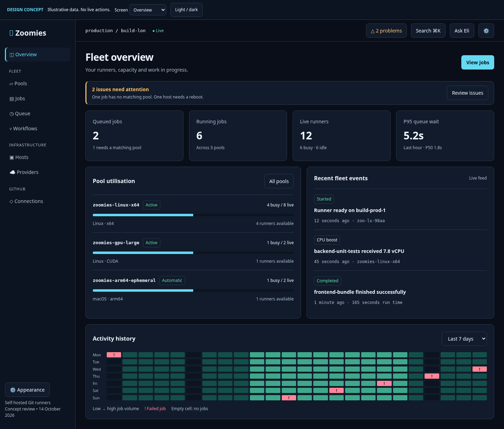
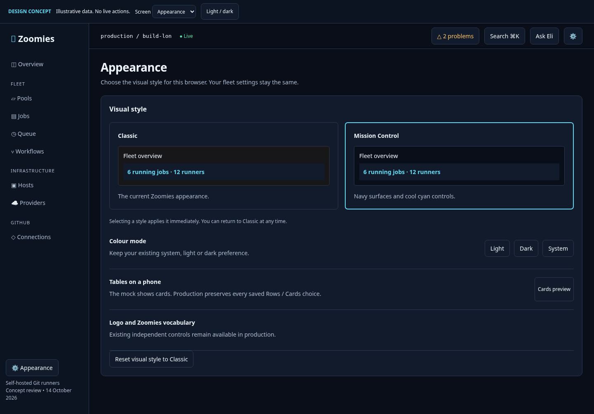
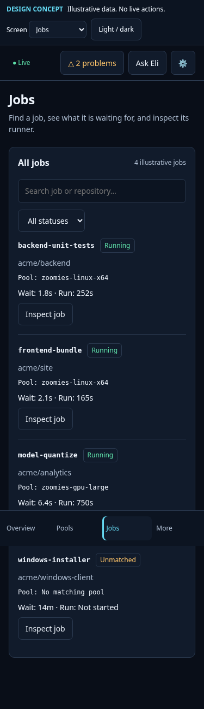

# Selectable Mission Control visual style: coding-agent handoff

14 October 2026. Design specification; see the current implementation handoff below for delivered stages.

## Current implementation handoff

The additive visual-style stage is merged in [PR #1030](https://github.com/eyupio/zoomies/pull/1030).
The operational-layout stage is merged in [PR #1038](https://github.com/eyupio/zoomies/pull/1038),
with its final verification recorded in the
[current handoff](roadmap/plans/2026-10-14-mission-control-style.md).
That handoff is the source of current status; the design and phase descriptions below
remain the implementation specification. No first-job dispatch or companion service work
is included in these controller UI stages.

## Brand and personality requirements

The original Zoomies logo and quirky personality are required in the implementation. Keep the existing logo artwork and treatments, Eli dog identity, status dog/paw illustrations, animations, playful copy and Off/Cute/Standard vocabulary controls. Honour each user's saved choice and reduced-motion preference; changing visual style must not disable or reset these features. The mock uses placeholder symbols and abbreviated plain labels for layout only. Replace those placeholders with the actual existing Zoomies components, never a generic brand mark.

## Outcome and scope

Add **Mission Control**, an optional visual style inspired by the 17 supplied screenshots: navy surfaces, clear cyan controls, compact technical data, restrained panels and a calm fleet-console feel. Keep **Classic** as the existing appearance and default for every current and new browser. Let people select the new style in Settings, Appearance without losing their light/dark/system mode or other preferences.

The reference should influence material and tone, not dictate a new product. Its small type, one-row navigation, nested borders, clipped assistant, colours without sufficiently explicit semantics and misleadingly effortless first-job action are poor implementation targets. Existing source already solves several of those problems. Reuse it.

Success is a readable, recognisable, selectable visual system applied consistently to every route and state. No new scheduler behaviour, assistant capabilities, repository mutations or network dependencies are required for the style. First-job workflow improvements are a separate optional work package.

### Read first

- `AGENTS.md`, `web/AGENTS.md`, `docs/ui-guidelines.md`, `docs/brand.md` and `docs/architecture.md`.
- Existing shell: `web/src/App.svelte`, `web/src/lib/shell/{Nav,NavMenu,TopBar}.svelte`, `web/src/lib/shell/sections.ts`.
- Existing preferences: `web/src/lib/state/{theme,prefs,viewport}.svelte.ts`, `web/index.html`.
- Existing tokens and state vocabulary: `web/src/lib/styles/tokens.css`, `web/src/lib/status.ts`, `web/src/lib/state/status-style.ts`.
- New findings appended to `UI_AUDIT.md`, beginning “14 October 2026”. Historical findings are not evidence that an old defect persists.

Use British spelling, existing Svelte 5 runes and API clients. All production colours belong in tokens. Do not add a router, state library, chart library, icon set or new font package for this work. Keep original logo artwork, existing logo-treatment options and the fixed status meanings. Do not copy the standalone mock's JavaScript or placeholder symbols into production.

## Reviewable designs

Open [design/theme-review/mockups.html](design/theme-review/mockups.html). It is a standalone interactive concept with five screens, a Problems drawer, an assistant placeholder and a first-job success state. Serve it over loopback if the browser blocks local file URLs. See [the artefact index](design/theme-review/README.md) for all 12 main captures and the six current-app comparison captures.







### What the mock specifies, and what it simplifies

| Item | Binding design intent | Production caveat |
| --- | --- | --- |
| Navy/cyan surfaces | Clear background, panel and inset separation; readable secondary text | Values below are proposed tokens, not permission to colour components directly |
| Appearance cards | Classic and Mission Control are independent from mode | The mock does not persist choices; production must |
| Primary live metrics | Read current activity before historical patterns | Preserve all six existing metrics, scopes, timing units and drill-downs |
| Jobs phone cards | A job name and state precede optional analytics | Honour explicit global and per-grid choices; mock cards omit some fields |
| Pool cards | Labelled capacity, clear pool identity and one obvious drill-down | Use existing pool verdicts; idle runners do not equal available host slots |
| Heatmap | Clear legend and non-colour failure cue | Reuse current ActivityMatrix and its keyboard/touch behaviour |
| Navigation | Grouped and stable, with mobile bottom bar | Mock entries are abbreviated; `sections.ts` is authoritative |
| Assistant | User-requested, bounded panel with context | Reuse current movable widget and mobile sheet; mock has no AI connection |
| Problems | Worst-first diagnosis, reason, concrete next step | Reuse current grouping, snooze/dismiss, target links and RBAC |
| First job | Honest file-copy path and a visible success moment | No dispatch API is implied; YAML must be generated by `testJobWorkflow` |

Mock screenshots use illustrative fixture values and system-font fallback. Production continues to use bundled Inter and JetBrains Mono and the real logo. The mock review strip is not product UI. The production bottom bar remains Overview, Pools, Runners, Workflows, More as resolved by current `sections.ts`; do not substitute the concept's representative screen links.

## Architecture: style and colour mode are independent

Do not turn `ThemeChoice` into `light | dark | system | mission-control`. That creates an undefined “Mission Control follows what?” mode and breaks the current first-paint contract.

Proposed independent types:

```ts
export type UIStyle = 'classic' | 'mission-control';
export type ThemeChoice = 'light' | 'dark' | 'system'; // unchanged
```

| Concern | Storage / DOM contract | Rule |
| --- | --- | --- |
| Colour mode | Existing `zoomies.theme`; existing `data-theme` | Preserve existing validation, system listener and cycling |
| Visual style | New `zoomies.ui-style`; `data-ui-style="mission-control"` | Missing, unknown or legacy value means Classic; Classic removes attribute |
| Style state | New `web/src/lib/state/ui-style.svelte.ts` | One validated reactive source, shared by Appearance and NavMenu |
| Logo treatment | Existing preference and logo attributes | Never reset it on a style change |
| Status vocabulary | Existing Off/Cute/Standard preference | Never derive it from style |
| Phone grid layout | Existing explicit grid/global choices | Preserve them; new-style fallback only when unset |
| Navigation collapse | Existing browser preference | Keep default breakpoint logic and stored choice |
| Column widths/order | Existing local/account preference | Never remount/reset the grid for a style change |

Add a pure resolver, preferably in `state/ui-style.ts`, so bootstrap, tests and the runes module can agree on valid values. Keep the inline bootstrap small; if importing the resolver before paint is unsuitable, cover both resolver and inline allowlist with one parity test. Do not create a blocking script request just to select a style.

### Persistence and first paint

1. In `web/index.html`, alongside the existing theme bootstrap, read only the validated new style key in the same guarded storage path. Set `data-ui-style` before first paint. A failure to access storage leaves Classic; no toast is needed.
2. Initialise the runes state from the same allowlist without repainting the page incorrectly. `set(style)` updates state, DOM and browser storage; blocked storage means the choice lasts for the current page.
3. Keep the selected `ThemeChoice` intact. Mission Control + System resolves with the existing `matchMedia` listener; it does not silently force dark mode. A system change must update the palette without changing the selected style or reloading the app.
4. Update browser `theme-color` for the resolved style/mode. Existing `pinBrowserChrome` only selects media tags. Extend its palette mapping or token-derived synchronisation; cover first paint and subsequent system changes. Preserve ordinary CSS `color-scheme` for native form controls and scrollbars.
5. Switching style is an in-place root attribute change. Do not key App, route components or grids by style. Preserve focus, route, scroll position, form drafts, table selection and assistant conversation.
6. The preference stays in this browser, including sign-in, consistent with current appearance settings. Do not add a server preference or fleet setting for it. Explain this in the selector description.
7. Existing browsers remain Classic, including when `zoomies.theme='dark'`. Unknown style values and cleared storage remain Classic. Remove only the new key when resetting style, not `zoomies.prefs` or `zoomies.theme`.

## Token contract

Keep existing token names where their meaning fits. Add style-scoped overrides in `tokens.css` after the existing palette definitions, with matching explicit-mode and system-mode selectors. Avoid copying whole themes or overriding brand/status constants accidentally.

Recommended neutral and interaction palette:

| Semantic token | Mission Control dark | Mission Control light | Intent |
| --- | --- | --- | --- |
| `--z-bg` | `#090e18` | `#f4f7fb` | Page background |
| `--z-surface` | `#111b2b` | `#ffffff` | Panels |
| `--z-surface-sunken` | `#0c1421` | `#eaf0f7` | Code and bounded detail |
| `--z-border` | `#2b3a50` | `#b9c8da` | Quiet grouping; not the only control edge |
| `--z-text` | `#eef4fc` | `#122235` | Primary reading |
| `--z-text-muted` | `#afbed2` | `#455d76` | Metadata and help |
| `--z-accent` | `#65d9f2` | `#00657a` | Interactive accent |
| `--z-accent-contrast` | `#07131d` | `#ffffff` | Filled button text |

Derive `surface-raised`, hover, strong border, accent hover/active/subtle/border, selection, focus, chart grid, scrim and terminal mappings as part of the same token package. Do not ship only the eight entries above: they are the design direction. Existing token inventory and contrast tests are the authority for all required variants.

The mock uses a minimal palette and illustrative series colours. Its green, amber, red and purple are not the production status specification. Production must preserve each existing semantic state's hue family and icon mapping, adjusting luminance only as required to meet contrast in the new surfaces. The public guidelines reserve Fast Cyan for moving work; document the new style's cool cyan interactive accent explicitly and keep running-work cues distinguishable through state labels and glyphs. If this proves confusing in side-by-side review, keep Runner Blue for interaction and use cyan only for moving work. That is a palette refinement, not an architectural change.

Contrast acceptance: normal text ≥4.5:1, large text and meaningful non-text controls ≥3:1; target ≥7:1 for long secondary explanations. Quiet panel borders need not pretend to be control boundaries. Focus, inputs, selected radios/tabs and resize handles require stronger edges. Test complete combinations, including accent text on subtle backgrounds, status text in badges, disabled explanation text, tooltip surfaces and error banners. Maintain non-colour icons, labels and patterns.

### Typography and density

| Element | Target | Notes |
| --- | --- | --- |
| Page heading | 28px desktop, 24px phone | Semibold, concise |
| Panel heading | 16px | Sentence case |
| Body and controls | 14px | Inter, line height about 1.5 |
| Technical identifier | 13px | JetBrains Mono; wrap/reveal full value |
| Nonessential metadata | 12px | Never shrink a required action label to fit |
| Primary metric | 28–32px | Tabular numerals, explicit unit |
| Touch input | 16px | Prevent unwanted mobile input zoom |
| Touch action | ≥44px target | Visible shape can remain compact |
| Card padding | 20px desktop, 16px phone | Tokenised |
| Grid row | About 44px desktop | Expand for wrapped content or touch |

Reuse the existing 4px-based spacing, radii and typography tokens. If style-specific sizes are necessary, scope them to the style and update the guidelines. Do not change Classic's 13px density as a side effect. A 200% zoom or larger system text must reflow, not truncate essential labels.

## Responsive layout and screen specifications

Use the existing breakpoints: phone ≤768px, narrow desktop 769–1180px, full desktop ≥1181px. Do not introduce “almost phone” variants that disagree with `viewport.svelte.ts`. Test 375px specifically; current suite Pixel 7 coverage is not a substitute for that width.

### Overview

- First-run checklist retains priority when the fleet has not yet run its own job.
- Operational order: problems summary, current queue/running/live/queue-wait group, pools and active jobs, recent events, historical activity, detailed performance/capacity. Show no warning banner when no actionable problems exist.
- Keep all six current metrics. Startup and registration are available in an expandable Performance block or secondary row; the concept's four tiles are the primary hierarchy, not a data removal instruction.
- At 1440×900, show title, issues, primary metrics and at least one pool or active-job row without scrolling. At 375×900, show the main issue action and primary status before historical charts. The review toolbar is excluded from these production targets.
- Use two columns for short phone metrics if they remain readable; use one when zoom/text scaling requires it. Long subtitles must wrap without clipping.
- Pool bar keeps busy/live, floor, ceiling and current verdict. Events have a bounded list height only on desktop; avoid nested vertical scrolling on phones.
- History chart remains current `FleetActivity`/ActivityMatrix. Move its position; do not rewrite its sampling, legend, failure classification or click-to-filter behaviour.

### Pools and pool detail

- Cards can form three columns on wide desktop only if the actual content fits, two on narrow desktop, one on phone.
- Prominent identity, enabled state, GitHub installation and routing labels; then allocation and floor/ceiling; then busy/live and verdict. Keep automated routing explanations available without filling the page with unrelated banners.
- Primary Create pool stays permission-aware. Detail leads to existing edit/pause/delete operations with existing confirmations. Do not turn every metric into a badge.
- Preserve current import/export, sizing advice and actual host compatibility. Long names wrap or reveal full value via current tooltip behaviour.

### Runners, Workflows, Jobs and Queue

- Use current DataGrid, shared status maps and workflow/job filters. Restyle primitives once.
- Phone Jobs: status, search, Filters(active count), then records. Supplementary metrics/outcomes are initially collapsed, with clear labels and no lost data. Preserve selected filter values when collapsing.
- Rows/Cards remains visible above records. Fresh Mission Control fallback can be Cards; explicit saved choices always win. Do not mistake a stored global default for an explicit choice when migrating preferences. Add an explicit-set marker if necessary rather than changing every existing browser.
- A card begins with identity, repository, state and timing; Inspect remains a labelled action. All other columns are accessible in labelled detail, including wide-priority columns.
- Workflow cards show run/repository identity and expand to jobs. Preserve cancel permission and confirmation. Queue shows why demand is waiting and what Run now actually changes; “priority” must not imply bypassing capacity or labels.
- Empty source list, no filter matches, stale cached data, fetch failure and loading are separate states. No-results Clear filters changes only filters, not style or saved columns.

### Usage, Hosts and Providers

- Usage preserves range, grouping, scoped data, export, axes/units and estimate/provenance text. Style changes cannot turn estimated costs into measured savings.
- Hosts: identity, connection/OS state and current capacity are primary. Preserve CPU/memory/slots as separate units. Reboot pending has an explicit safe next step; no implicit restart on click.
- Providers: show spending limit, machine lifecycle and inventory. Keep backend/provider-specific config in existing wizards. Theme cards do not conceal errors or pending enrolment.
- Capacity and utilisation fills use semantic series tokens and existing legends. Keep chart accessibility and touch inspection.

### Repairs, Kennel Club, Migrate, Audit and Settings

- Repairs distinguishes offered diagnosis, investigation, review and verified outcome. Existing permission/sandbox rules remain. Purple decoration must not look like a critical alert.
- Kennel Club: repository list and findings become a single-column progression on phones. Keep tracked/partially checked/off/failure states distinct; “no findings” is not equivalent to “not checked”.
- Migrate: retain exact diff review before opening a PR. Desktop before/after can remain side-by-side; phone prefers explicit Before/After tabs or stacked blocks with local code scrolling. Never auto-apply YAML from a visual mock.
- Audit: keep timestamp, actor, role, action, target and details. On phone cards, start with action/target then actor/time; details expand. Do not discard IP or machine-readable event identity.
- Settings: restyle all existing panels and forms. Appearance gets the new style cards, existing colour-mode selection, logo treatment, navigation, vocabulary and phone-table controls. Other settings remain unchanged in purpose and permissions.

### Drawers, assistant and overlays

- Reuse shared Drawer and current EliWidget. Problems remains grouped worst first, with reason and next step. Keep snooze, dismissal and restoration semantics.
- Desktop assistant starts closed, stays movable/resizable and uses current viewport constraints. Do not copy the reference's full-height permanent clipped rail.
- Phone sheet uses current visual-viewport sizing when the keyboard opens, inert background, focus containment, Escape/close, return focus and safe-area spacing. Use existing sheet helper; do not invent another modal stack.
- Do not turn the current nonmodal desktop assistant into a blocking modal just because the mock's placeholder uses a dialog. The mock's focus handling demonstrates an overlay, not the production assistant contract.
- When a modal and assistant could compete, retain existing application arbitration or explicitly test topmost focus and close order. No focusable content behind a modal.

## Appearance interaction contract

1. On Appearance, show a labelled radiogroup of two preview cards: Classic and Mission Control. Prefer a real radio input and label or an existing accessible selection primitive over ad hoc clickable divs.
2. Each card has style name, small static preview, concise description and a checked marker that is not colour-only. Entire card is a target; arrow keys and Space work according to the chosen control's semantics.
3. Selection applies immediately. Keep focus on the selected control; announce “Mission Control selected for this browser” once in a polite region. No confirmation modal, trial gate or reload.
4. Colour mode remains System/Light/Dark below the cards. System description says which palette is currently resolved.
5. Provide “Reset visual style to Classic”. This resets only style. Do not label it Reset appearance if it leaves other preferences unchanged.
6. A phone reaches Appearance through the existing More menu. A quick style control is optional; if added, read the same state and allowlist, with clear names and no contradictory toggle cycle.
7. Sign-in/bootstrap and public status page need an explicit decision: apply the visual style to the controller's ordinary sign-in/bootstrap document; do not extend the separate `/status` build's bootstrap automatically. Either add compatible status style support within its <30KB budget or leave that separate document Classic and document the boundary in the setting. The first release recommendation is the latter, because the status page is a separate public document, not part of the operator UI.

## Implementation packages and sequencing

Estimates are working ranges for one agent/engineer with review time, not promises. Merge packages only when their acceptance checks pass.

| Package | Estimate | Concrete work | Depends on | Done when |
| --- | --- | --- | --- | --- |
| P0: baseline | 0.5 day | Record current captures, saved preference fixtures, first-paint behaviour and shell budget | None | Current baseline and source/route inventory agreed |
| P1: style state | 0.5–1 day | Add pure resolver + runes module; validated storage and root attribute; bootstrap parity; browser-chrome sync | P0 | Both modes and System work without flash or lost preferences |
| P2: token palette | 1 day | Add complete light/dark style overrides; semantic variants, chart/terminal bridge review; contrast checks | P1 | All required token pairs pass and Classic is unchanged |
| P3: selector | 0.5–1 day | Add accessible preview cards, reset action, mode descriptions and More-menu access | P1/P2 | Keyboard/touch selection, refresh and blocked-storage behaviour verified |
| P4: primitives | 1 day | Audit buttons, inputs, pills, tooltips, grids, skeletons, errors, drawers and assistant against tokens | P2 | State gallery demonstrates every required state in four style/mode combinations |
| P5: operational layout | 1–2 days | Reorder Overview; separate primary/secondary metrics; collapse phone Jobs context/filters; preference-aware cards fallback | P3/P4 | 375px list and 1440px operational panels meet visibility targets, without missing data |
| P6: route coverage | 1 day | Route-by-route verification, touch/zoom, chart/log colours and all settings panels | P4/P5 | No clipping, missing states or wrong permissions in matrix below |
| P7: release evidence | 0.5 day | Update guidelines and screenshots, run required checks, rollback drill | P6 | All evidence recorded, style optional, budgets within limits |
| P8: first-job assistance | Separate, size after API review | Repository prerequisites, manual handoff and any supported discovery/dispatch contracts | Independent of style | First-run journey has honest actions and protected-branch handling |

P1–P4 are the additive theme. P5 changes information hierarchy and fresh-style fallback, so keep it reviewable separately. They must not be coupled to a scheduler release. If the hierarchy proposal is not approved, the selectable theme can ship with current layouts; mark the layout audit items unresolved.

### Expected file changes

| File/group | Planned change |
| --- | --- |
| `web/src/lib/state/ui-style.ts` (new) | Types, option labels and pure validation |
| `web/src/lib/state/ui-style.svelte.ts` (new) | Reactive style, storage, DOM application |
| `web/index.html` | Early validated root attribute alongside existing bootstrap |
| `web/src/lib/state/theme.svelte.ts` | Preserve existing mode; synchronise browser chrome with style |
| `web/src/lib/styles/tokens.css` | Complete scoped light/dark overrides and any justified shared tokens |
| `web/src/lib/settings/AppearancePanel.svelte` | Accessible preview selection and precise persistence copy |
| `web/src/lib/shell/NavMenu.svelte` | Appearance access/optional shared quick selector |
| `web/src/lib/state/prefs.svelte.ts` | Explicit-vs-fallback grid-view resolution, only if P5 selected |
| `web/src/routes/Overview.svelte` | Operational reading order, only if P5 selected |
| `web/src/lib/overview/FleetMetrics.svelte` | Preserve six metrics with clearer primary/secondary grouping |
| `web/src/routes/Jobs.svelte`, `web/src/lib/jobs/JobFilters.svelte` | Phone context/filter disclosure and initial record visibility |
| Shared primitives | Only remove leaks or add required semantic variants; avoid mass route rewrites |
| `web/unit/`, `web/tests/` | Focused regression checks and theme/viewport coverage |
| `docs/ui-guidelines.md` | Style/mode contract, semantics, palette evidence and persistence boundary |

No OpenAPI, Go database, scheduler or provider schema changes are required by P1–P7. Any P8 mutation endpoint must be separately documented and reviewed; the style package does not authorise backend scope creep.

## Verification requirements

Do not claim success because the happy-path screenshot looks good. Test what switching actually risks.

### Focused automated checks

- Resolver: absent/valid/unknown style, blocked storage fallback, correct Classic reset.
- First paint: persisted style + explicit light/dark, persisted style + System, opposite system palette. Assert initial root attributes before app hydration; check no incorrect first-frame palette in captures.
- System mode: dispatch media change, retain style and mode choice, update palette/native chrome.
- Preference integrity: style switching leaves logo, vocabulary, navigation collapse, per-grid view/columns, route and draft intact; do not remount an editor or reset an open conversation.
- Mobile fallback: explicit per-grid > explicit global > Mission Control fresh default > Classic default. Legacy saved choices remain unchanged. Existing rows can still be selected on a phone and restore across reload.
- Appearance: keyboard selection, visible focus, clear selected state, reset only style; two independent browser contexts do not accidentally share account/fleet style.
- Contrast: extend existing `web/unit/text-contrast.test.ts` rather than testing CSS variable strings without evaluating colours. Account for style selectors when extracting values.
- Layout: no document overflow at 1440, 1180, 1179, 768, 375 and 360px; local grid/code scrolling is intentional. Test 200% zoom and enlarged text separately.
- Jobs: with deterministic fixture data, a job identity and Inspect are visible within the first phone screen after primary controls. Filter expansion/collapse never loses selected filters.
- Overview: concise critical issue precedes history; first-run checklist remains first when applicable; all six timing/live metrics remain available.
- Drawer and assistant: keyboard focus, return focus, phone keyboard, nested close order, resize bounds and reduced motion. Use existing helper tests and fixture providers; no paid AI calls are needed.

### Route/state matrix

| Area | Normal | Empty/no results | Error/stale | Permission / interaction |
| --- | --- | --- | --- | --- |
| Overview | Live counts/pools | First-run checklist | Fetch error; SSE reconnect keeps last-known truth | Scope toggle and Problems target |
| Pools | Enabled/automatic | No pool | Create/edit validation | Viewer cannot mutate; import/export and delete confirmation |
| Runners | Busy/idle/pending/draining | No runners / filter miss | Lost heartbeat or detail fetch | Drain, selection, local grid scroll |
| Workflows/Jobs | Active/completed/failure | No matching records | Unknown outcome / held job | Expand jobs, inspect, cancel permissions |
| Queue | Ready/paused/unmatched | No demand | Failed expedite action | Run now/pause/remove semantics |
| Usage | Real measured samples | No period data | Partial sample coverage | Units/range/CSV and chart keyboard |
| Hosts | Healthy/capacity | No hosts | Reboot pending/offline | Reserve/cordon/join gates |
| Providers | Machines and spending | No provider | Enrolment/config error | Provider wizard, spend ceiling |
| Repairs | Offer/progress/review | No offers/provider | Investigation failure | Personal provider access and explicit initiation |
| Kennel | Findings/clear | Off/not tracked | Partial check/error | Repository detail and opt-in tracking |
| Migrate | Exact before/after diff | No selected repositories | Read failure/refusal | Review before opening PR |
| Audit | Events/details | No filter match | Fetch failure | Full actor/target/time and details |
| Settings | Every panel | Empty tokens/users/backups as allowed | Form validation/retry | RBAC and destructive confirmation |
| Auth | Bootstrap/sign-in | First install | Invalid token/password | Autofill, password reveal, phone keyboard |

Run `npm run check`, `npm run lint`, `npm run test:unit`, `npm run build`, and the relevant Playwright projects using the real binary after implementation. Extend the existing harness with a 375px profile or focused test configuration; do not assume its Pixel 7 width is 375px. Run first-run, connect and diagnostics fixtures for onboarding/blocked-state work. The full Go race suite is appropriate if P8 changes backend contracts; do not run it as substitute evidence for a CSS-only patch.

Budgets remain shell <200KB gzipped, ordinary route <80KB except existing documented allowances, and separate status document <30KB. The current baseline build passed its configured budgets. Preview thumbnails should be compact static HTML/CSS or tiny inline SVG, not large image bundles on every page. Keep style code in the shell small.

## Release and rollback

Ship Classic as default. Mission Control is an explicit opt-in browser choice. Stage style state/tokens/selector before layout changes so a regression is easy to isolate. There is no fleet migration and no new backend setting.

Rollback is returning to Classic via Appearance or clearing only `zoomies.ui-style`. A release rollback whose older bootstrap does not recognise the key must safely render Classic. Avoid hard-coding new style assumptions into route markup, so removing a root attribute reverses the appearance without editing data.

Before completion, attach the final four style/mode captures for representative screens and current first-run, empty, failure and phone-keyboard evidence. Update the existing screenshot generation tooling where appropriate; do not retouch real UI captures. Keep the concept files labelled as concepts even after implementation.

## Exact instruction to the next coding agent

Implement P0–P4 first as an additive, opt-in visual style. Follow the repository's token and status contracts; reuse existing components and keep Classic behaviour. Preserve all appearance, table and route state while switching. Complete the specified tests and capture both styles in both modes at 1440 and 375px. Then implement P5–P7 as a separate reviewable layout package using the same criteria. Leave P8 as a separate scoped feature unless explicitly assigned. Use the mockups for hierarchy and material; use current source and this plan for routes, permissions, data semantics and real interactions. Do not ship dummy controls, invented counts, fake dispatch actions or abbreviated mock navigation.
