# Eli repairs UX review and concepts

19 October 2026. Design review only. No application source, API, test or
documentation page was changed. The worktree contains this folder and its
captures; production behaviour is untouched.

Start with [the interactive board](mockups.html). It switches between two hub
concepts, four screens, three hub states and light or dark. Data is illustrative
and every action is local to the board.

Concept A was implemented on 19 October 2026; the log entry in
[roadmap/progress.md](../../roadmap/progress.md) names what shipped and
[docs/ui.md](../../docs/ui.md#eli-repairs) is the operator-facing description.

## Why this review exists

The Overview has just moved to a calmer shape: current work first, one sticky
page navigation, supporting detail behind summaries that stay useful when
closed. The same review is needed behind **Eli repairs**, where the hub still
stacks every surface with similar weight and the detail pages still repeat setup,
readiness and failure facts.

The review starts from the recent changes to the Overview's failure attention,
in both themes, and asks a narrower question: can the repairs pages use the same
grammar without hiding the work that matters?

## Evidence reviewed

- The current four repair screens and their source: `EliRepairs.svelte`,
  `EliRepairNew.svelte`, `EliRepairAttempt.svelte`, `RepairSetupPanel.svelte`,
  and the components they compose.
- The checked-in captures in `docs/screenshots/eli-*.webp` and
  `docs/screenshots/eli-stale-failure-*.png`, in both themes.
- The current repair flow spec and implementation plan:
  `roadmap/plans/2026-10-18-eli-repair-workspace.md` and
  `roadmap/plans/2026-10-18-eli-repair-workspace-plan.md`.
- The Calm operations Overview review and implementation in
  [PR #1167](https://github.com/eyupio/zoomies/pull/1167), especially its sticky
  page navigation, `OverviewDisclosure` summaries and failure-attention rail.
- `docs/ui-guidelines.md`, `web/AGENTS.md` and the Mission Control tokens.

This is a source and capture review, not a usability study, runtime accessibility
audit or model evaluation. The concepts are layout and interaction sketches, not
measured product states.

The current pages, for comparison:

- [Hub, light](../../docs/screenshots/eli-repairs-light.webp) and
  [hub, dark](../../docs/screenshots/eli-repairs-dark.webp).
- [Repair page, light](../../docs/screenshots/eli-repair-readiness-light.webp).
- [One repair, light](../../docs/screenshots/eli-repair-attempt-light.webp).
- [Repair setup, light](../../docs/screenshots/eli-repair-setup-light.webp).
- [Automatic repair, light](../../docs/screenshots/eli-repair-automatic-light.webp).

## What is not working

| Finding | User cost | Proposed direction |
| --- | --- | --- |
| The hub is a stack of four large surfaces with equal weight. | At a 1440 by 900 laptop the History is below the fold even when the page is quiet, and the first screen does not say what to do next. | Put a compact Now area first, then one sticky section navigation, then sections that are open only when they hold work. |
| The empty "Needs you" state is a full panel. | A quiet fleet spends a card on saying there is nothing to do, pushing the useful History down. | Use one clear line when empty, with the action that starts a repair. |
| Automatic repairs is an administrator's policy panel, shown in full beside daily work. | A healthy automatic policy competes with offers and running repairs for attention. | Show a closed summary with a neutral rail. Use a warning rail only when a repository cannot run. Open the rows on request. |
| History filters are always visible. | Three filter fields take a row of height on every visit, even when nobody is filtering. | Put them behind a **Filters** disclosure with active filter chips in the toolbar. Keep the history closed until opened, with a live summary. |
| Setup is repeated as a bar on the hub, a card on the repair page and a full page. | People meet the same account and policy facts three times and cannot tell which is authoritative. | The hub shows one setup status line. The repair page shows only the missing piece inside the decision that needs it. Setup itself keeps the full form. |
| The repair page puts setup, failed jobs and the readiness checklist above the decision. | The page explains why Eli cannot act only after the reader has scrolled through setup and failure detail. | Put the single next step first. Show failed jobs next. Collapse readiness to blocked checks with **Show all 9 checks**. |
| The readiness checklist and the setup card both say the same blocker. | Two buttons and two explanations for one missing account or provider. | One blocked row, one action, one setup disclosure. Passed checks collapse to one line. |
| The attempt page mixes outcome, case, failure and technical detail in one long column. | The result and the next action are clear, but the supporting evidence adds height before it is needed. | Outcome first, next action second, then **What Eli was asked to fix** and **Technical details** as closed summaries. |
| The setup page is one long form with no orientation. | An administrator cannot see what is complete or where to change one thing. | Three anchor sections: Access, Repositories, Allowance. Show completion, open the incomplete section, keep Save in a sticky bar. |
| No repair page has within-page navigation. | Returning to a section means scrolling and searching. | Sticky page links with counts, current-section indication and bookmarkable fragments. On a phone the fourth and fifth destinations move behind **More**. |
| The page subtitle describes the process, not the outcome. | The most valuable sentence on the page is spent narrating the feature. | Say what the person can do here, then let the sections carry the process. |

## The process today

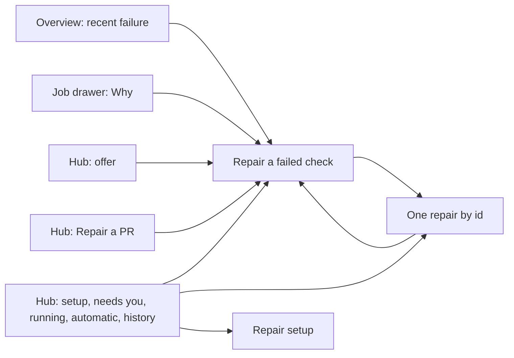

The four pages are the right decomposition. The problem is that the hub behaves
like all four pages at once, and the detail pages do not put the decision ahead
of the evidence.

## Concept A: Calm review (recommended)

One continuous page, with a sticky section navigation and supporting detail in
closed summaries. This extends the Calm operations pattern to repairs rather
than inventing a second one.

Reading order:

1. **Now**: setup status, offers needing a person and repairs running now.
2. **Needs you**: open when it holds offers; one clear line when it does not.
3. **In progress**: open when something is running; otherwise absent.
4. **Automatic repairs**: closed summary with the number of repositories, the
   allowance used and a warning only when one cannot run.
5. **History**: closed by default, with a live summary. It opens by itself only
   when there is no current work, because then it is the useful content.

Why this shape works:

- The first viewport answers "does anything need me?" and "is Eli working?".
- Every section still has an address and a count, so nothing is lost.
- Supporting detail is one press away and its summary stays true while closed.
- The page does not need a second route, a new preference or a new data shape.

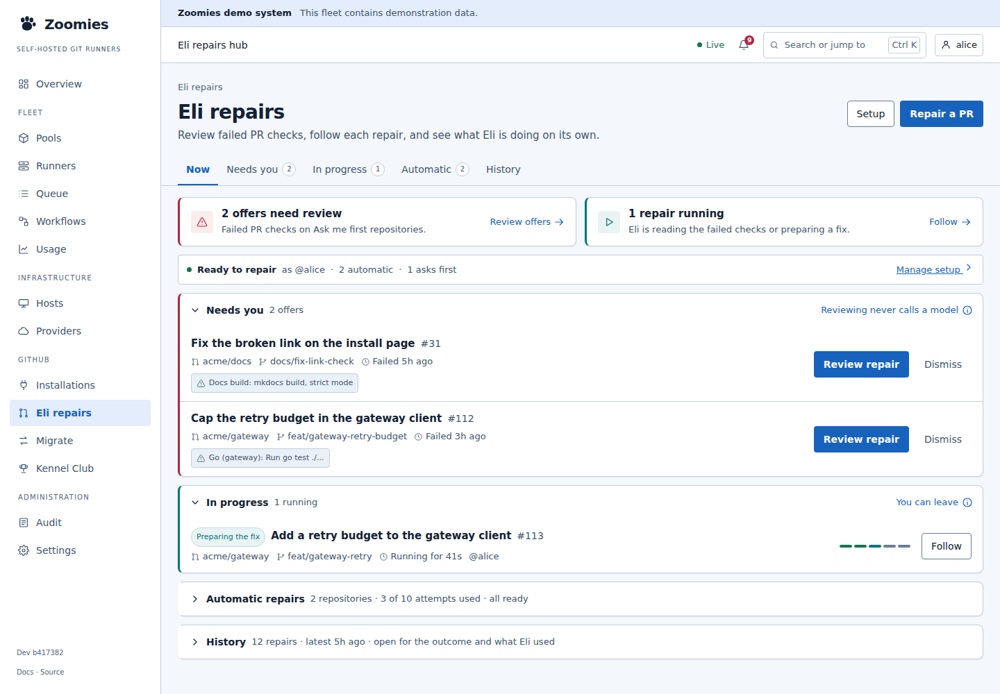

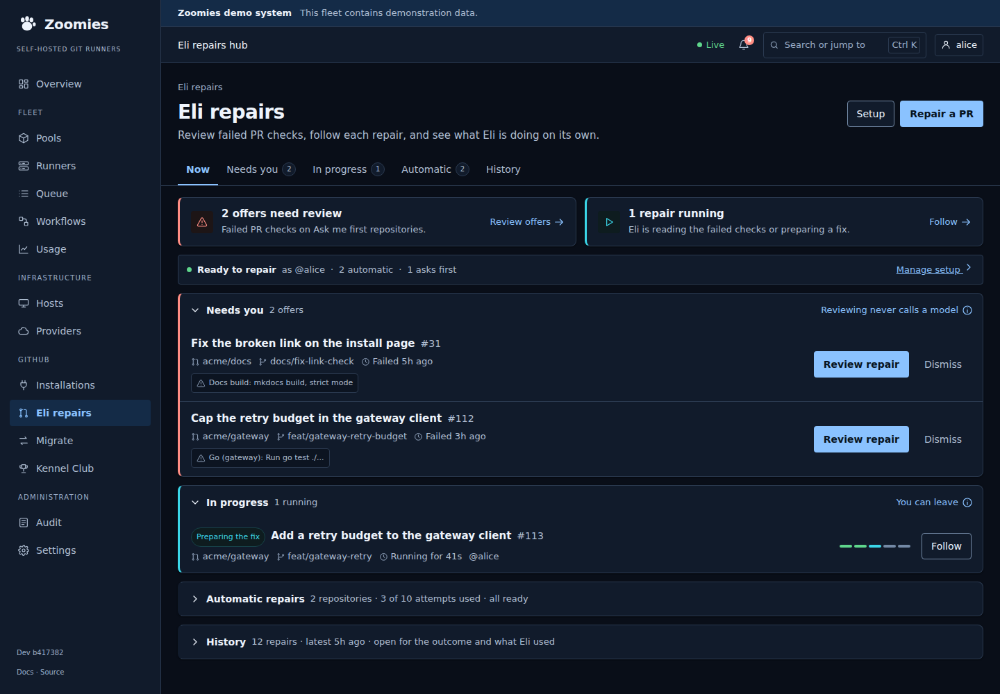

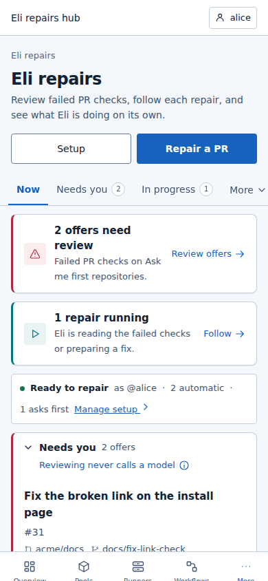

A quiet fleet, where history becomes the content:

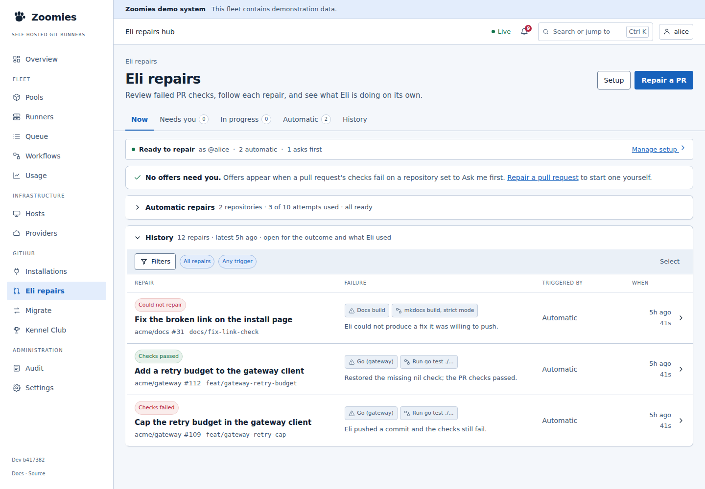

A fleet that cannot repair yet, where the primary action changes to finishing
setup:

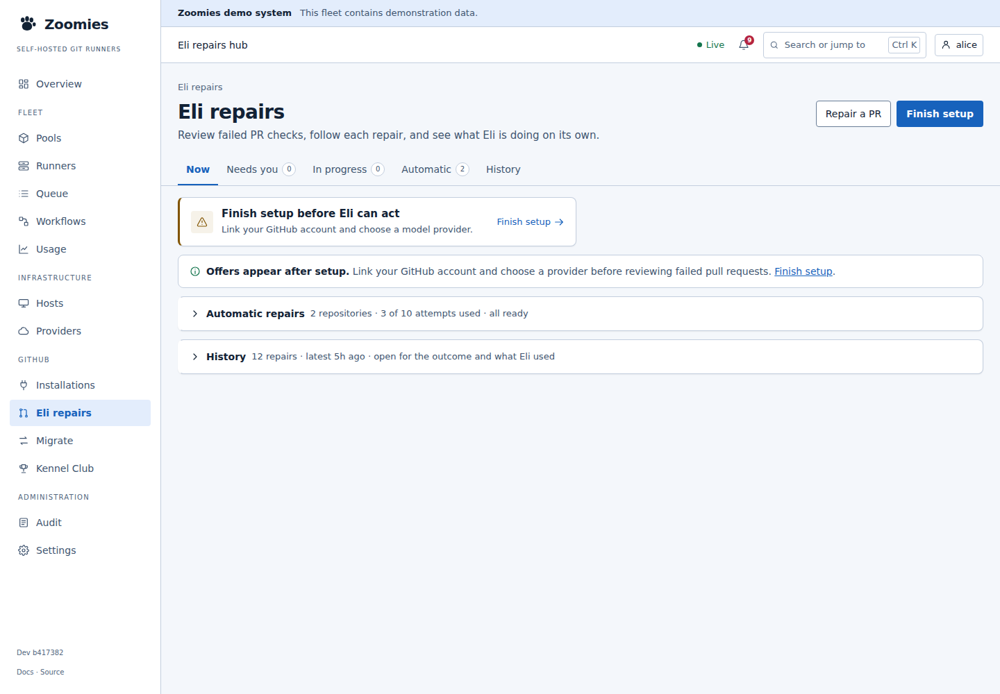

## Concept B: Focus workspace

The same summary and counts, but one view at a time behind a segmented control:
Needs you, In progress, Automatic, History. Setup remains a line above.

Benefits: less scrolling, more room for a long history and a clear single focus.
Costs: simultaneous monitoring is lost, the page has view state to remember and
a phone needs an overflow treatment. It is the better shape only if operators
tell us they investigate one thing at a time. Do not ship both layouts as a
preference without that evidence.

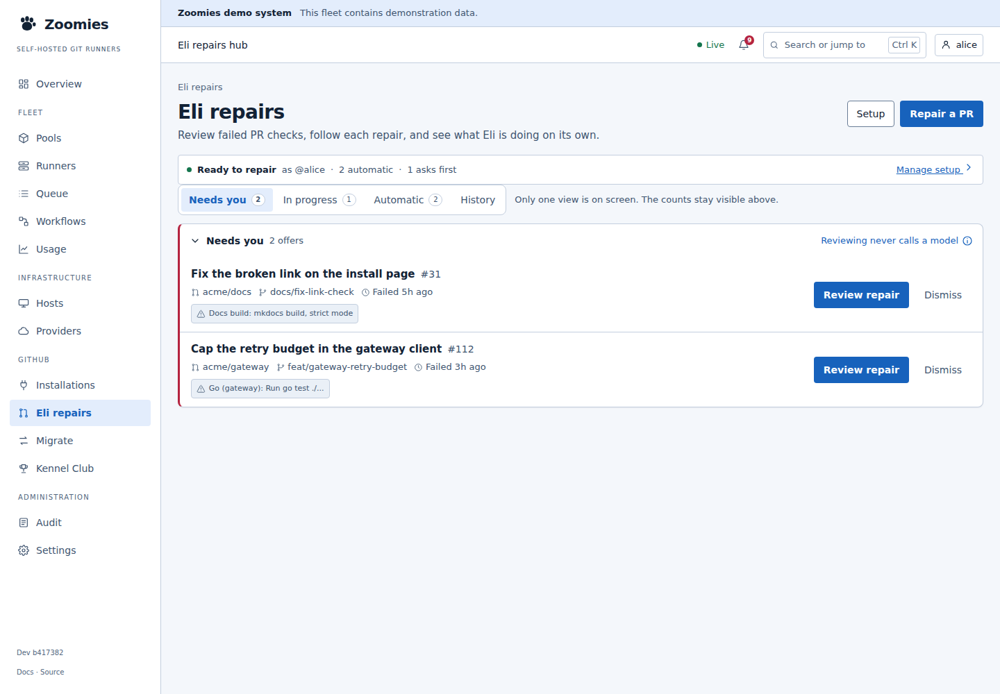

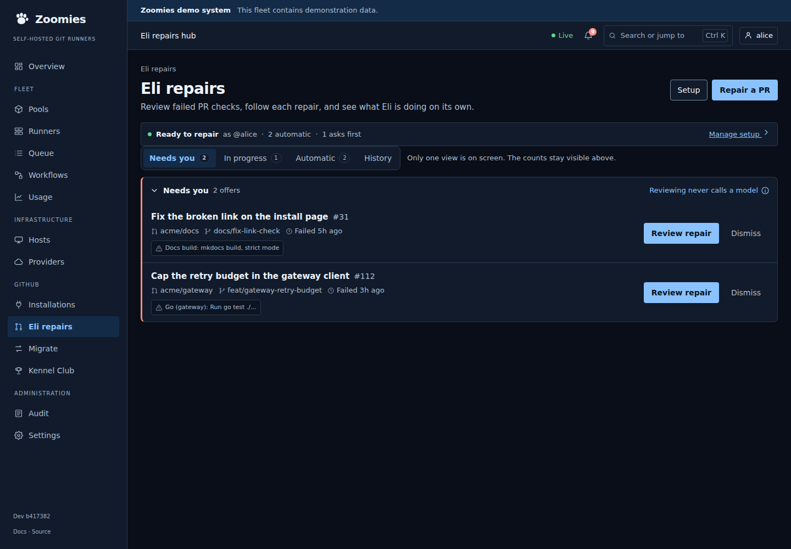

## The repair page

The decision moves to the top. The failure follows. Readiness is reduced to the
checks that are actually blocked, and setup appears as the fix inside the
decision that needs it, not as a second form competing with the checklist.

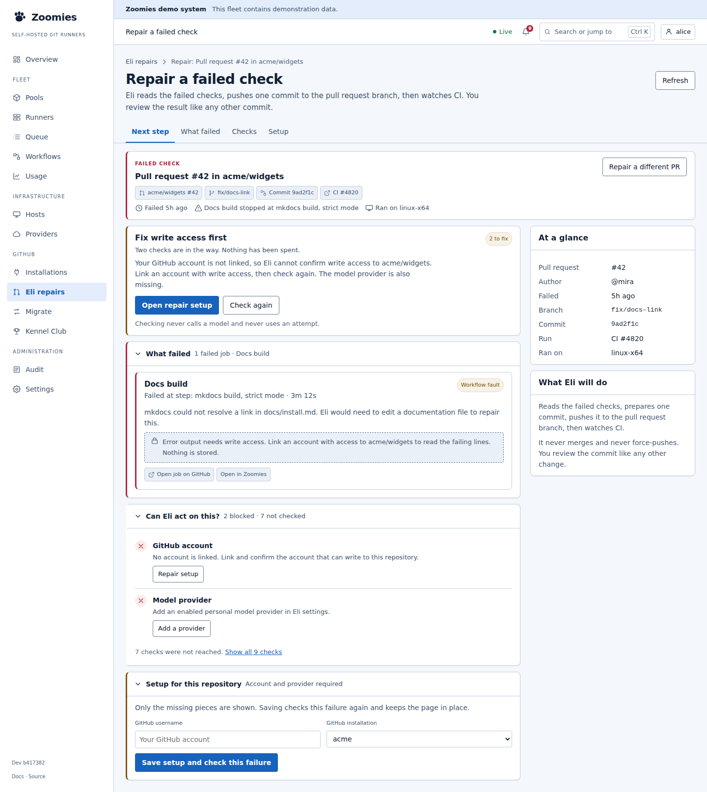

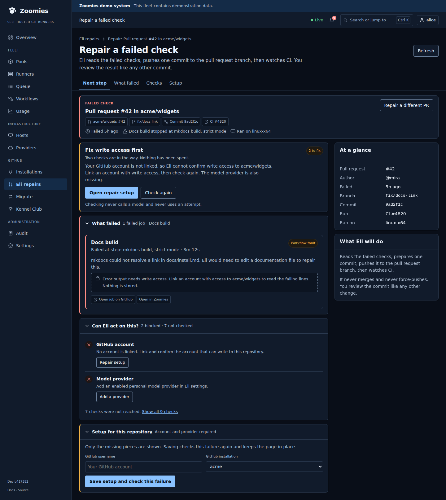

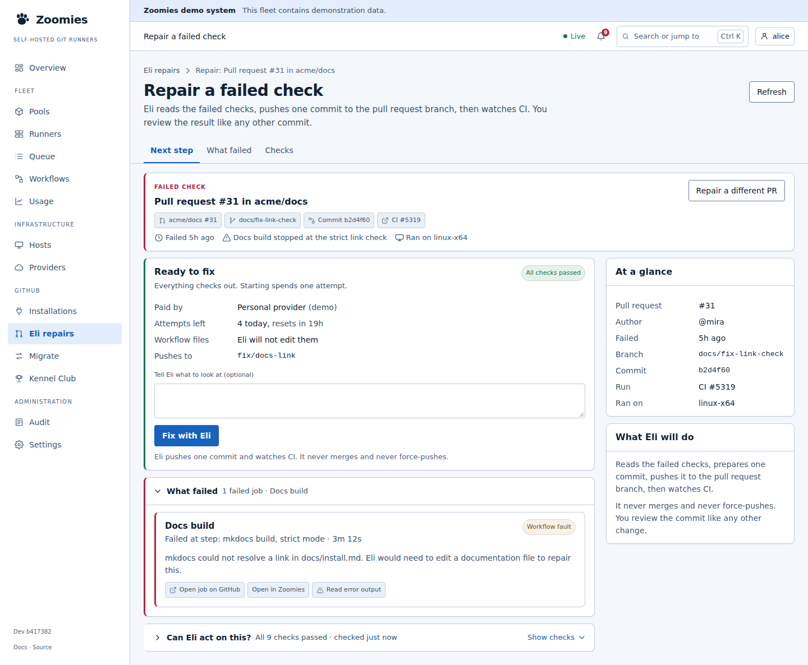

What changed:

- One **Fix write access first** or **Ready to fix** card, with one primary
  action. The old page split this across the left column and a sticky aside.
- The case strip carries the pull request, branch, commit, run, failed job and
  run location. It replaces the title and meta repeated across three cards.
- **What failed** is a single job disclosure, with error output on demand.
- **Can Eli act on this?** shows blocked rows and one line for the unreached
  checks. Passed checks collapse to **All 9 checks passed**.
- Setup shows only the missing fields, inside a disclosure that opens from the
  decision. It is not drawn when nothing is missing.
- The right rail is context only: **At a glance** and **What Eli will do**. It
  never holds the primary action.

## The attempt page

Outcome first. Then the next action. The case and the technical evidence are
closed, with summaries that carry the facts a glance needs.

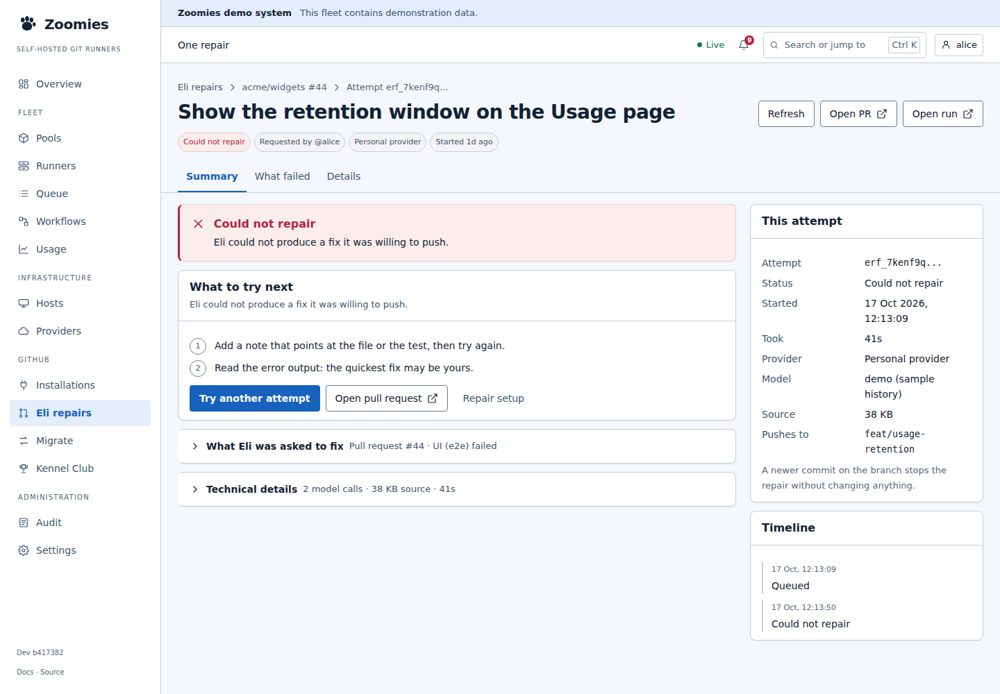

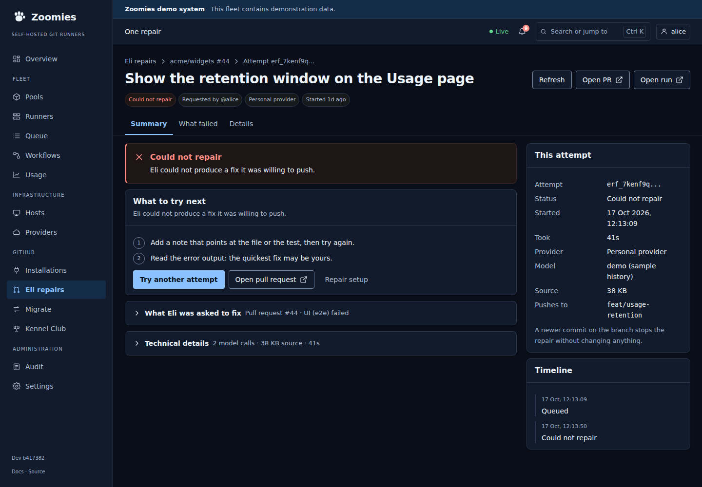

What changed:

- The outcome banner and **What to try next** share the first screen.
- **What Eli was asked to fix** folds the old case and failed-job cards into one
  disclosure.
- **Technical details** is closed, with **2 model calls, 38 KB source, 41s** in
  the summary. The table is unchanged when opened.
- **This attempt** and **Timeline** remain a side rail on desktop and move below
  the next action on a phone.

## Repair setup

Three sections, completion at the top, and a save bar that appears only when
something changed.

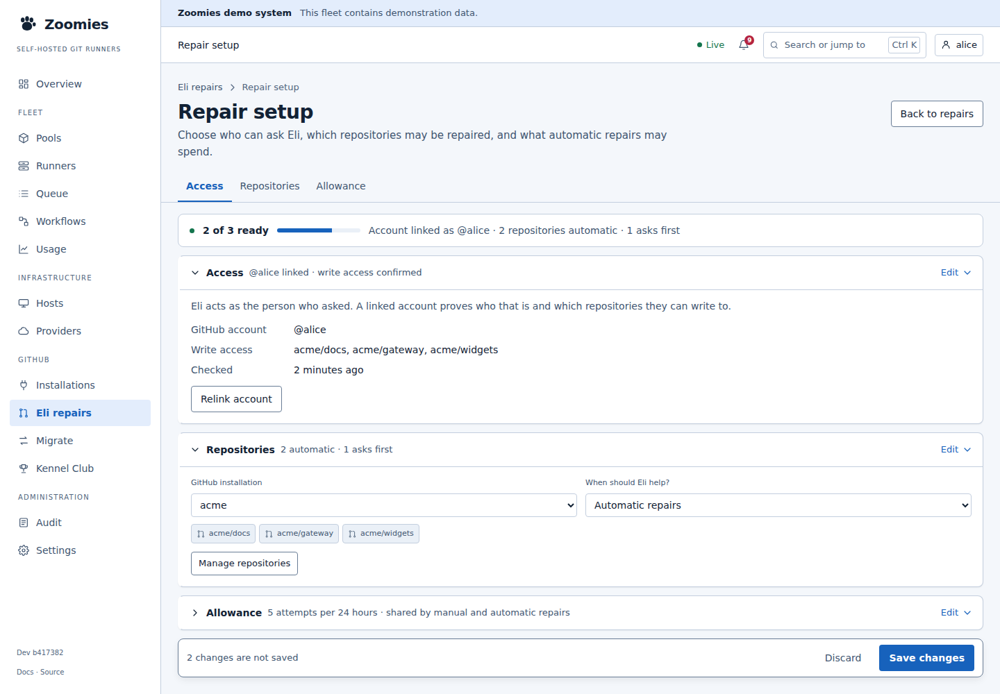

What changed:

- Access, Repositories and Allowance have stable fragments and a current-section
  nav.
- The incomplete section opens; completed sections show their answer and stay
  closed.
- The summary says **2 of 3 ready** and names the account and the policy counts.
- **Save changes** is sticky and says how many changes are unsaved. Discard sits
  beside it.

## Interaction and accessibility rules

- Use `<nav aria-label="... sections">` with `aria-current="location"` on the
  current link. Links open a closed destination before moving focus.
- Use native `<details>` for disclosure. A summary must carry a live, useful
  number when closed; a closed section may not hide a new problem.
- Keep the page navigation sticky under the top bar. Do not let it overlap a
  heading or a focused control; use scroll margins.
- On a phone, show **Now, Needs you, In progress, More**. More contains
  Automatic and History. Keep the app's bottom navigation separate.
- Remember explicit expansion choices per browser only if the implementation
  follows the existing Overview disclosure approach. Do not make a data update
  change what is open.
- Keep every untrusted string as text. Links only through `safeHttpUrl`.
- Keep 44px touch targets, visible focus, no horizontal overflow and reduced
  motion. Use existing tokens; no new colour, font, dependency or chart library.
- Do not fabricate counts. If a closed summary does not have authoritative data,
  say what is known rather than inventing a total.

## What the implementation would reuse

- The `OverviewDisclosure` pattern and page navigation from the Calm operations
  work, extracted to a shared component rather than copied.
- `Panel`, `Button`, `Badge`, `StatusDot`, `RelativeTime`, filters and pagination.
- The existing repair reads and routes. No API change is implied by these mocks.
- `prefs` for remembered disclosure choices only if the Overview pattern is
  accepted as the shared one.

## Captures

| File | What it shows |
| --- | --- |
| `hub-calm-light-1440.png` | Concept A, light, work waiting |
| `hub-calm-dark-1440.png` | Concept A, dark, work waiting |
| `hub-calm-light-390.png` | Concept A phone viewport, light |
| `hub-calm-dark-390.png` | Concept A phone viewport, dark |
| `hub-focus-light-1440.png` | Concept B, light |
| `hub-focus-dark-1440.png` | Concept B, dark |
| `hub-quiet-light-1440.png` | Concept A, nothing needs a person |
| `hub-setup-light-1440.png` | Concept A, setup incomplete |
| `repair-blocked-light-1440.png` | Repair page, blocked, light |
| `repair-blocked-dark-1440.png` | Repair page, blocked, dark |
| `repair-ready-light-1440.png` | Repair page, ready to start |
| `attempt-light-1440.png` | One repair, failed outcome, light |
| `attempt-dark-1440.png` | One repair, failed outcome, dark |
| `setup-light-1440.png` | Repair setup, three sections |

The interactive board is the source of truth. Open `mockups.html` directly, or
serve this folder on loopback:

```sh
python3 -m http.server 8102 --bind 127.0.0.1
```

Then browse `http://127.0.0.1:8102/mockups.html`.

## What to decide before code

1. Concept A or Concept B for the hub. A is recommended because it preserves
   simultaneous monitoring and matches the Overview's new grammar.
2. Whether Automatic repairs belongs as a section in the hub or as a separate
   administrator page. This review keeps it in the hub because stopping a policy
   is an operational action, but it is closed by default.
3. Whether the repair page should open setup inline or in a drawer. The mock
   keeps it inline, below the decision, so the failure stays in view.
4. Whether History should open by itself on a quiet fleet. The mock does so
   because, when nothing needs a person, the record is the useful content.
5. Whether the phone page navigation should use More for the last two
   destinations, as the Overview now does.
