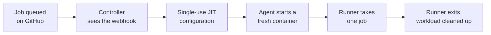

# Ephemeral GitHub Actions runners

An **ephemeral runner** takes exactly one job and then goes away. The next job
gets a new runner, started from the same image, with a clean workspace. Nothing
the last job left behind is there to find: no stray files, no changed
environment variables, no credentials written to disk, no half-installed
toolchain.

GitHub supports this directly. A runner registered as ephemeral is removed from
GitHub after it has run one job, and GitHub will not hand it a second. The
harder part is everything around it: something has to notice a job is waiting,
register a new runner, start it on a machine with room, and clean up
afterwards, every time. That is the work a controller does, and it is what
Zoomies does by default.

## Why one job per runner

A long-lived runner is cheap to set up and slowly gets worse:

- **State leaks between jobs.** A build that leaves a file, a cached credential
  or a modified `PATH` changes the next job's result, sometimes in a way that
  is hard to reproduce.
- **Secrets stay around.** Anything one workflow wrote to the workspace or the
  home directory is readable by the next workflow that lands on the same
  runner.
- **Drift builds up.** Packages, toolchains and disk usage change a little
  with every job until the runner no longer matches the image it started from.
- **Registration lasts too long.** A runner that stays registered for weeks is
  a standing credential on your network.

An ephemeral runner removes the first three by construction, and the fourth
because its registration is single-use.

## What Zoomies does for each job

1. GitHub tells the controller a job is queued, by `workflow_job` webhook.
2. The controller asks GitHub for a **just-in-time (JIT) configuration**. A JIT
   configuration registers exactly one runner and cannot be replayed, which is
   what makes it safe to hand to a container in its environment.
3. The agent on the chosen host starts a fresh container from the pool's runner
   image, with that configuration.
4. The runner registers, takes the job GitHub assigns, and exits when it is
   done.
5. The agent reports the exit to the controller. Once the report has been
   accepted and the retention window (`agent.finished_retention`) has passed,
   the agent deletes the finished container and anything it made for it.

The retention window is the only reason a finished runner lingers: it is how
long you can still read that runner's log from the Runners page. Set it to zero
and the workload goes as soon as the controller has the report. The full
sequence is in [the architecture notes](architecture.md#a-job-arrives).

## Ephemeral is a pool setting, and it is on

Each pool has an `ephemeral` setting, and the default is to leave it on. A pool
with it off keeps its runners between jobs, and has to register them with a
registration token and a runner configuration step instead of a JIT
configuration. That is the model of a traditional self-hosted runner, and it has
the drawbacks above. Leave it on unless you have a specific reason, and see
[the pool settings](configuration.md) for the rest.

## What a fresh runner costs you

Starting from nothing every time has a price, and these are the ways to pay less
of it:

- **Cold starts.** A runner whose image is not on the host has to pull it
  first. Prewarm a pool's image after you create it or change it
  (`zoomies pools prewarm <pool>`), as described in [hosts and
  pools](hosts-and-pools.md).
- **Warm capacity.** A pool with a minimum above zero keeps registered runners
  idle and waiting, so the first job does not wait for a container to start.
  Each warm runner is still ephemeral and takes exactly one job. A minimum of
  zero leaves no warm runners and costs nothing while the queue is empty.
- **Rebuilt caches.** A fresh workspace has no dependency cache. Use GitHub's
  own cache action, or an optional [persistent cache](persistent-caches.md)
  that lives outside the workspace so selected build data survives between
  jobs.

## What ephemeral does not do

A fresh workspace is not a security boundary. Containers share the host
kernel, and the process backend has no container boundary at all, so arbitrary
code can still affect the machine it runs on. Treat ephemeral runners as the
right default for workloads you trust, and read [security](security.md) before
you run code from forks or other strangers on your own hardware.

## Questions

**Does an ephemeral runner need Kubernetes?** No. Zoomies starts ordinary
containers (Docker, Podman) or a bare process on machines you own. See
[runners without Kubernetes](runners-without-kubernetes.md).

**Is the runner removed from GitHub afterwards?** Yes. A runner registered with
a JIT configuration is single-use, and GitHub drops it after its job.

**Can two jobs share an ephemeral runner?** No. One job, then the runner exits.
Jobs that need to share data should use caches or artifacts.

## Where to go next

[Understand the basics](fundamentals.md) explains pools, hosts and labels.
[Autoscaling](runner-autoscaling.md) explains how runners are created in
response to a queue. [What are self-hosted
runners?](what-are-self-hosted-runners.md) covers persistent and ephemeral
runners from the start.
