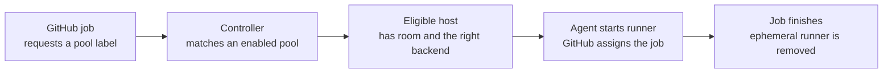

# Understand the basics

You keep your workflows in GitHub Actions. Zoomies supplies the machines that
execute their jobs. The first change a workflow usually needs is its
`runs-on` label; the steps still run through GitHub's runner application.

## Five things to know

| Term | What it means | Where you use it |
| --- | --- | --- |
| **Controller** | The Zoomies process that watches jobs, schedules runners and stores fleet state in SQLite. It serves the UI and API. | Install one to manage the fleet. |
| **Agent** | The Zoomies process that starts and removes runners on a machine, and reports its health. | Join another machine to the controller. On a single-machine install the controller has an embedded agent. |
| **Host** | A machine running an agent. It contributes runner slots, CPU, memory and supported backends. | **Hosts** shows where work can run and how much room remains. |
| **Pool** | A recipe for interchangeable runners: workflow labels, GitHub installation, backend, image, size and runner limits. | **Pools** defines what a job can ask for. A pool can use several suitable hosts. |
| **Runner** | The GitHub runner application that executes the job. With the default ephemeral setting, it takes one job and is then removed. | **Runners** shows its lifecycle and logs; **Jobs** keeps the job record. |

A **backend** is how an agent runs a runner: Docker or Podman uses a container;
`process` runs it directly on the host. A **GitHub installation** is the App's
permission to manage runners for an organisation or a repository. It also
determines which repositories Zoomies can see.

## Follow one job



GitHub normally announces a queued job with a `workflow_job` webhook. When
webhooks are unavailable, the controller can discover work through fallback
polling, which is slower. Agents open their connections to the controller;
the controller does not need to open a connection into a runner host.

Zoomies provisions capacity. **GitHub assigns the job to a registered runner**,
using the runner's labels, runner group and repository access. That distinction
matters when diagnosing a runner that is idle while a job waits.

## Choose the right label

The quick start uses `zoomies-linux-x64` as an example pool label. Copy the
label from **your pool's page**, which supplies a complete test workflow.
Its name depends on the machine and the way you created the pool.

```yaml
name: Test my Zoomies pool
on: workflow_dispatch
jobs:
  hello:
    runs-on: zoomies-linux-x64 # Replace with your pool's label.
    steps:
      - run: echo "Hello from a Zoomies runner"
```

Save this as `.github/workflows/zoomies-test.yml` on the repository's default
branch. In GitHub, choose **Actions → Test my Zoomies pool → Run workflow**.
The repository must be accessible to the App installation and runner group.

| Label or selector | What it selects | Example |
| --- | --- | --- |
| Workflow `runs-on` | A runner whose advertised labels satisfy the job. With a list, every requested label must match. | `runs-on: zoomies-linux-x64` |
| Pool runner labels | What workflows can ask for. Every pool also answers to the shared `zoomies` label. | A pool advertising `zoomies-linux-x64` can answer the workflow above. |
| Host labels and pool `host_selector` | Which machines the scheduler may place that pool's runners on. | Host label `gpu=true` and pool selector `gpu=true`. |

Host labels do not automatically become workflow labels. Asking for
`runs-on: [zoomies-linux-x64, gpu]` requires a pool that advertises **both**
labels; labelling a host `gpu=true` alone does not provide that match.

Use a specific pool label for your first job. The shared `zoomies` label is
useful when any matching pool is suitable, but it does not express the
operating system or hardware your job needs. See [naming and
platforms](naming.md) before mixing architectures or operating systems.

## Understand capacity

There are two different limits:

- **Host capacity** limits how many runner slots the machine can provide. CPU,
  memory, backend support, health and placement rules can further restrict it.
- **Pool minimum and maximum** control how many runners that recipe keeps
  ready and may create. A minimum of zero leaves no warm idle runners; it does
  not switch the pool off. A maximum of zero prevents new capacity.

A pool maximum does not create hardware. If a pool allows eight runners but
its eligible hosts only have room for four, additional jobs wait. Pools also
share the room on a host: each pool's maximum is not a separate reservation.

Start with one pool, a finite maximum and one trusted workflow. Add pools when
jobs need different images, resources, backends or placement rules. [Hosts and
pools](hosts-and-pools.md) explains sizing and placement in detail.

## What a fresh runner gives you

With a container backend and the default ephemeral setting, each job gets a
fresh runner and workspace. Completed workloads are cleaned up after their
reports have been accepted and the configured retention window has passed.
An optional [persistent cache](persistent-caches.md) lives outside that
workspace, so selected build data can survive between jobs.

Containers share the host kernel. A fresh workspace cannot make arbitrary code
safe to run on your own infrastructure. The process backend has no container
boundary and preserves host state outside the job's work directory. Choose
trusted workloads first and read [security](security.md) before changing
isolation settings or sharing caches.

## Ready for your first job?

[Follow the quick start](quickstart.md) to install, connect GitHub and run the
workflow. If you already have a fleet and a job is waiting, use [the queued-job
guide](queued-job.md) to check routing, capacity and registration in order.
