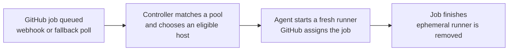

<div class="zoomies-hero" markdown>

<p class="eyebrow">Free · open source · AGPL-3.0</p>

# GitHub Actions runners <br><span class="quiet">on machines you own.</span>

<p class="lede">
Zoomies is a self-hosted GitHub Actions runner controller: one binary, SQLite,
no Kubernetes. Put your cloud VMs, office servers or home lab to work. It starts
a fresh runner for each job, scales across your hosts and shows you what is
happening in one live web UI. Ask Eli about your builds, or connect your own AI
assistant through MCP.
</p>

<p class="actions" markdown>
[Run your first job :material-arrow-right:](quickstart.md){ .md-button .md-button--primary }
[Try the live demo](https://demo.zoomies.sh/){ .md-button }
</p>

<div class="zoomies-install" markdown>

```sh
curl -fsSL https://zoomies.sh/install.sh | sh
```

</div>

<p class="prereq" markdown="span">Start on Linux with Docker or Podman and a GitHub organisation or repository you administer. Explore the live demo without signing in, or [run the local demo](quickstart.md#just-looking) without GitHub credentials. [Read the installer first](quickstart.md#1-install).</p>

<p class="popular" markdown="span">[Meet Eli and MCP](#ask-your-fleet-understand-your-builds) [Documentation](start-here.md) [What it costs](costs.md)</p>

</div>

## Choose your next step

<div class="zoomies-paths" markdown>

<div markdown>
### New to self-hosted runners?

Learn what a host and pool do, connect GitHub, then run one trusted workflow.

[Learn the basics :material-arrow-right:](fundamentals.md)
</div>

<div markdown>
### Moving an existing workflow?

Preview `runs-on` changes and try one repository before expanding the fleet.

[Plan your migration :material-arrow-right:](migration.md)
</div>

<div markdown>
### Already operating a fleet?

Size capacity, measure queue waits, tune resources and automate operations.

[Advanced operations :material-arrow-right:](advanced.md)
</div>

</div>

{ .zoomies-shot }
{ .zoomies-shot }

Watch jobs, capacity and scheduler decisions update in place, shown here in the Classic style. [Explore the web UI](ui.md).
{ .zoomies-shot-caption }

## Ask your fleet. Understand your builds.

Investigate a failed test, find why a job is waiting, or work out whether a
build needs more memory or a smaller runner. Zoomies gives assistants access
to the job evidence and fleet measurements behind those questions.

<div class="zoomies-paths zoomies-paths--assistants" markdown>

<div markdown>
### Eli, right where you work

Press **Ask Eli** on a job, host, pool or problem. With fleet access enabled
for your chosen model, Eli can read job history, failure explanations,
available runner logs and measured sizing advice, then explain what to try
next. Its answer shows what it looked at.

> “Why did this job fail, and what should I try next?”

Use a local or hosted model you choose. Explore the built-in fixture provider
in the [local demo](quickstart.md#just-looking), without an account or API key.

[Meet Eli :material-arrow-right:](eli.md)
</div>

<div markdown>
### Your assistant, connected over MCP

Bring the same live diagnostics into Claude or another Model Context Protocol
client. Compare queue waits, runner sizes and usage; with separately granted
AI Context access, read the verified workflow source behind a job.

> “Compare this workflow's runner sizes and show the evidence for a better fit.”

Start with read access. Operator connections can also re-run jobs, drain
runners and adjust capacity, within the role you grant.

[Connect your assistant :material-arrow-right:](mcp.md)
</div>

</div>

**From a failed check to a fix:** opt-in [Eli PR repairs](eli.md#set-up-pr-repairs)
can investigate failed jobs, publish changes to the existing PR branch and
watch GitHub's checks. Choose when repairs run and which provider pays; Eli
never merges the PR. Chat itself diagnoses and advises without changing the
fleet or repository.

[Try Eli in the local demo](quickstart.md#just-looking){ .md-button }
[Troubleshoot jobs and improve builds](troubleshooting.md#investigate-jobs-with-eli-and-mcp){ .md-button }

## What you get

<div class="zoomies-grid" markdown>

<div markdown>
:material-monitor-dashboard:{ .icon }

### See why a job is waiting

<span id="a-live-web-ui"></span>
<span id="actually-observable"></span>

Fourteen pages, one job each: live jobs, runner logs, host health, queue waits
and scheduler reasons. [Tour the UI](ui.md) or [diagnose a queued job](queued-job.md).
</div>

<div markdown>
:material-recycle-variant:{ .icon }

### A fresh runner per job

<span id="ephemeral-by-default"></span>
<span id="no-pasted-tokens"></span>

Ephemeral container runners take one job, then their containers and workspaces
are removed. GitHub App authentication supplies single-use registrations.
[Understand the boundaries](security.md).
</div>

<div markdown>
:material-server-network-outline:{ .icon }

### Scale across your machines

<span id="multi-host-multi-os"></span>

Pools define labels, runner sizes and limits. Agents contribute capacity from
eligible hosts and connect outbound to the controller. [Hosts and pools](hosts-and-pools.md).
</div>

<div markdown>
:material-rabbit:{ .icon }

### Use spare resources

<span id="elastic-cpu-zoomies"></span>
<span id="elastic-memory"></span>

Optional [elastic CPU](elastic-cpu.md) lends spare CPU to busy runners.
[Elastic memory](elastic-memory.md) can raise a memory limit when there is
headroom. Observe first, then tune from measurements.
</div>

<div markdown>
:material-database-clock-outline:{ .icon }

### Keep useful build caches

Optional host-local caches preserve selected downloads and build data outside
the disposable workspace. [Add a cache](persistent-caches.md) with a workflow
recipe that also works on a cache miss.
</div>

<div markdown>
:material-backup-restore:{ .icon }

### Operate through open interfaces

<span id="backed-up-by-itself"></span>

Use the [CLI](cli.md), [API](api-surface.md), [Prometheus metrics](metrics.md)
and [backup tools](backup-and-restore.md) alongside the UI. Keep the database
and its matching encryption key recoverable.
</div>

</div>

## How it works

<span id="event-driven"></span>

Connect a GitHub App to your organisation or to a repository on your personal
account. A pool advertises the runner label your workflow requests. Zoomies
sees queued work through webhooks, with polling as a fallback, and provisions
capacity on a host that can run it. GitHub assigns the job to the runner.



[The fundamentals](fundamentals.md) explain labels and capacity.
[Architecture](architecture.md) follows the complete lifecycle.

## Your home lab belongs in the pack.

Built-in **Tailcat** connections bring private home and office hosts into the
same fleet as your cloud machines, without a public host IP, router port
forwarding, Tailscale account or separate tunnel installation. Choose
**Private connection · Tailcat** in **Hosts → Add a host**, then run the
command on that machine.

[Connect a private host :material-arrow-right:](private-hosts.md){ .md-button }
[Plan a home-lab fleet](home-lab.md){ .md-button }

## From a fresh host to a running fleet

The [quick start](quickstart.md) takes you through five steps: install, choose
native or container deployment, connect GitHub, create a pool and run a test
workflow. Native setup completes in the terminal; container deployments finish
account, App and pool setup in the browser. Use the label printed by your pool,
then watch the job complete and its ephemeral runner be removed.

Keep the first setup small: one host, one pool and a workflow you trust.
Caches, resource elasticity and automatic pools can follow once that works.

[Run your first job :material-arrow-right:](quickstart.md){ .md-button .md-button--primary }

## Run it from the browser. Reach it from anywhere.

| Your task | Documentation |
| --- | --- |
| Learn and install | [Start here](start-here.md), [fundamentals](fundamentals.md), [quick start](quickstart.md) |
| Run the fleet day to day | [Web UI](ui.md), [hosts and pools](hosts-and-pools.md), [troubleshooting](troubleshooting.md) |
| Deploy from files or a platform | [Docker Compose](compose.md), [PaaS](paas.md), [marketplace deployment](marketplace.md) |
| Scale, tune and recover | [Advanced operations](advanced.md), [metrics](metrics.md), [backup and restore](backup-and-restore.md) |
| Script or integrate | [CLI](cli.md), [API](api-surface.md), [configuration](configuration.md) |
| Investigate jobs or use an assistant | [Eli](eli.md), [MCP guide](mcp.md), [AI Context](ai-context.md), [job troubleshooting](troubleshooting.md#investigate-jobs-with-eli-and-mcp) |

## Moving what you have now

<span id="one-pull-request-per-repository"></span>

**From hosted runners:** the migration wizard maps supported hosted labels to
your pools, shows the diff and can open one pull request per repository. It
needs optional repository write permissions. It never merges the pull
requests; test one workflow before moving more.

**From static self-hosted runners:** a pool can advertise the labels your jobs
already request, so workflows may need no edits. Check the installation,
runner group, platform and toolchain before retiring the old runners. The
migration wizard deliberately leaves existing self-hosted jobs alone.

[Preview a migration :material-arrow-right:](migration.md){ .md-button }

## What runs where

| Component | Platforms and boundaries |
| --- | --- |
| **Controller and agents** | Linux x86-64 and arm64. The agent also builds for Windows x86-64; macOS builds are useful for controller development. Qualification is described below. |
| **Container runners** | Ubuntu 24.04, Ubuntu 26.04, Ubuntu 22.04, Debian 12, Debian 13, Fedora 42 and Rocky Linux 9, each for x86-64 and arm64. See [the image catalogue](naming.md#the-runner-image). There is no macOS runner image. |
| **Backends** | Docker, Podman (including rootless), or `process`. Windows uses `process`, which runs directly on the host with a fresh work directory and no container isolation. See [worked shapes](hosts-and-pools.md#worked-shapes). |

## What is qualified

The [support matrix](https://github.com/eyupio/zoomies/blob/main/roadmap/support-and-measurement.md)
separates automated evidence, manual trials and builds. It is the place to
check before choosing a platform for important workloads.

Controller, agent, join and real-workload paths are exercised on pull requests
with the process backend and a fake GitHub, on amd64 and arm64. Docker is
unit-tested against a fake Engine API; this repository also runs its own CI on
Zoomies container runners, apart from the arm64 and Windows legs. That is useful
operating evidence, with different coverage from a dedicated end-to-end test.

The Windows agent builds and is vetted and unit-tested on a hosted Windows
runner. The maintainer reports a real Windows host join and job on 11 October
2026; the written qualification evidence is still pending. Treat that manual
trial separately from a qualified support claim.

## Why not something else

Zoomies suits teams that own runner hardware or VMs and want ephemeral runners,
autoscaling and a web UI without operating Kubernetes. You still own host
capacity, patching, network access and recovery.

| Your situation | Read before choosing |
| --- | --- |
| You already operate Kubernetes and want runners in that cluster | [Compared with ARC](actions-runner-controller.md) |
| You want CI capacity without maintaining machines | [Compared with runner services](hosted-runner-services.md) |
| You are choosing among VM-based controllers | [Alternatives](alternatives/index.md) |
| You are unsure the savings justify the work | [Should you self-host?](should-i-self-host.md) and [costs](costs.md) |

Zoomies charges no platform fee. Machines, storage, electricity and operator
time still count; [costs](costs.md) records the pricing assumptions and links
to GitHub's current billing guidance.

## A word about self-hosted runners

<span id="safe-defaults"></span>

Start with workflows you trust. Ephemeral containers reduce leftover job state,
but share the host kernel; they are not a VM per job. The process backend runs
on the host itself. Optional Docker access and shared caches change the
boundaries further. Read [security](security.md) before running untrusted
pull requests or changing isolation settings.

<div class="zoomies-cta" markdown>

--8<-- "overrides/partials/animated-logo.html"

<div class="zoomies-cta__copy" markdown>

<p class="title">Give your CI the Zoomies.</p>

<p class="lede">
Explore the demo, run your first trusted job, then grow at your own pace.
The documentation takes you from the basics to operating a fleet.
</p>

<p class="actions" markdown>
[Run your first job :material-arrow-right:](quickstart.md){ .md-button .md-button--primary }
[Browse the docs](start-here.md){ .md-button }
</p>

</div>

</div>
