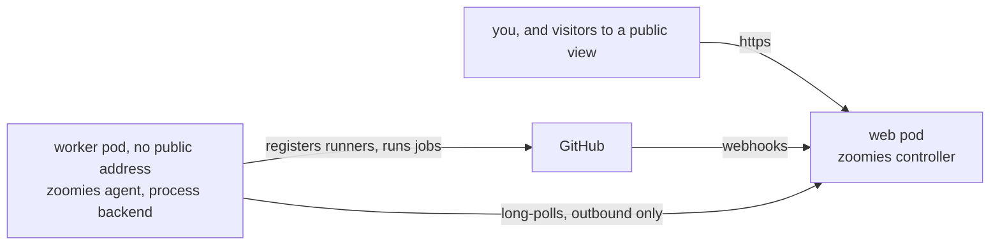

# Deploying on InstaPods

[InstaPods](https://docs.instapods.com) gives you persistent Ubuntu 24.04
containers, called pods, each with an HTTPS address and a Git deployment that
runs an Install, a Build and a Start command of your choosing. Zoomies runs on
two of them: a **web pod** for the controller and a **worker pod** for the
agent that runs your jobs. The repository carries the two scripts those
commands call, in `deploy/instapods/`, so there is nothing to fork.

It is the same shape as [Deploying on a PaaS](paas.md), with one difference
that matters: a pod offers no Docker, so the runner host is a pod too, and its
runners are processes rather than containers. Read
[what that costs](#the-worker-runs-jobs-as-processes) before you point a
repository at it.

## What you get, and why two pods



**The web pod** runs `zoomies controller`: the API, the web UI, the webhook
endpoint, the scheduler and the SQLite database. InstaPods holds its
certificate and proxies its address to the controller.

**The worker pod** runs `zoomies agent` on the `process` backend. It is a
[worker pod](https://docs.instapods.com/guides/worker-pods), so it has no
public address at all, and it needs none: an agent connects outbound to the
controller and asks it for work.

The reason for two is the one the process backend makes unavoidable. A job's
steps run as the agent's user on the agent's machine, so a job on the web pod
could read the database and the encryption key that seals the GitHub App's
private key. On a pod of their own, the worst a job can reach is that pod and
the agent's own token.

## The commands each pod runs

Both pods deploy `https://github.com/eyupio/zoomies`, branch `main`, with these
commands:

| | Install | Build | Start |
| --- | --- | --- | --- |
| **Web pod** | `true` | `sh deploy/instapods/fetch.sh controller` | `sh deploy/instapods/run.sh controller` |
| **Worker pod** | `true` | `sh deploy/instapods/fetch.sh agent` | `sh deploy/instapods/run.sh agent` |

**Install is `true`** so that the Go preset's own `go mod download` does not
run. Nothing is compiled on a pod: the preset's Go is older than the one
Zoomies is built with, and the UI is built with Node, which the preset does
not have.

**Build** downloads a published release for the pod's architecture into
`~/zoomies/bin`, checks it against the release's `checksums.txt` exactly as
the installer does, and refuses a binary that does not match. It skips the
download when the binary already there is the one the release lists. On the
worker it also installs the libraries the GitHub Actions runner loads
(`libicu74`, `libkrb5-3`, `zlib1g`, `libssl3t64`, `liblttng-ust1t64`) when
they are missing, through `sudo` if `sudo` needs no password; if it does, the
build fails with the `apt-get` line to run yourself from the pod's Web
Terminal.

**Start** fills in the defaults the pod needs and starts Zoomies. Everything
Zoomies keeps (the database, the encryption key if it generated one, the
agent's credentials) lives under `~/zoomies`, outside the checkout, so a
redeploy's `git pull` never touches it.

The Build step also writes `~/app/app`, a two-line launcher for the same Start
command, because the Go preset documents that its service runs that file. A
pod whose Start command was never saved therefore still starts the right role
rather than a missing binary.

## Choose a version

The pods download whichever release `ZOOMIES_VERSION` names:

* **`latest`**, the default: the newest numbered release.
* **`vX.Y.Z`**: exactly that release. Pin one for anything you depend on, so a
  redeploy never moves you to a release you have not read the notes for.
* **`dev`**: the moving prerelease built from `main`.

The [public view](public-view.md) is newer than the latest release. Until a
numbered release carries it, a public instance runs `dev`.

## 1. The web pod

Create it on the Go preset, then give its Git deployment the commands above.
The InstaPods CLI has no flag for the Start command, so the commands are set
through the API, with an API token from **Settings → API Tokens** in the
InstaPods dashboard:

```sh
instapods pods create zoomies-web -p go --plan build -w

export INSTAPODS_TOKEN=ipk_...
api=https://app.instapods.com/api/pods

curl -fsS -X POST "$api/zoomies-web/git" \
  -H "Authorization: Bearer $INSTAPODS_TOKEN" -H "Content-Type: application/json" \
  -d '{"repo_url": "https://github.com/eyupio/zoomies", "branch": "main", "auto_deploy": false}'

curl -fsS -X PUT "$api/zoomies-web/git" \
  -H "Authorization: Bearer $INSTAPODS_TOKEN" -H "Content-Type: application/json" \
  -d '{"install_command": "true",
       "build_command": "sh deploy/instapods/fetch.sh controller",
       "start_command": "sh deploy/instapods/run.sh controller",
       "auto_deploy": false}'
```

In the dashboard it is the pod's **Git** tab: connect the repository on branch
`main`, fill in Install, Build and Start, and switch auto-deploy off.

**Turn auto-deploy off.** With it on, every push to Zoomies' `main` redeploys
your pod, which restarts the controller several times a day for changes that
are not yours. Nothing you run comes from the repository except the two
scripts anyway; the version you run comes from `ZOOMIES_VERSION`.

Then set its environment. `instapods pods get zoomies-web` shows the pod's
address; generate the encryption key first and keep a copy somewhere other
than the pod:

```sh
openssl rand -base64 32        # keep this: it is the only way to read what Zoomies stores

instapods env set zoomies-web \
  ZOOMIES_EXTERNAL_URL=https://zoomies-web.<region>.instapods.app \
  ZOOMIES_ENCRYPTION_KEY=<the key> \
  ZOOMIES_VERSION=v1.2.3

instapods git deploy zoomies-web -w
```

| Variable | Why |
| --- | --- |
| `ZOOMIES_EXTERNAL_URL` | The pod's https address, or your own domain once it is attached. Webhooks are delivered to `$ZOOMIES_EXTERNAL_URL/webhooks/github`, the session cookie's `Secure` flag is derived from it, and every link in the UI is built from it. |
| `ZOOMIES_ENCRYPTION_KEY` | Everything secret in the database is sealed with it. Left unset, Zoomies generates one under `~/zoomies/data`, and losing the pod then loses the key with it. |
| `ZOOMIES_VERSION` | The release the Build command downloads. |
| `ZOOMIES_PUBLIC_VIEW` | `true` only for an instance meant to be [public](public-view.md). |

`instapods env set` restarts the app but does not run the Build command, so
after changing `ZOOMIES_VERSION` run `instapods git deploy` as well.

`run.sh` sets the rest, each only where you have not: `ZOOMIES_BIND` to
`0.0.0.0:$PORT` (InstaPods sets `PORT`, and proxies the pod's address to it),
`ZOOMIES_TLS_MODE=off` because InstaPods holds the certificate,
`ZOOMIES_STATE_DIR` and `ZOOMIES_CONFIG_DIR` at `~/zoomies/data`,
`ZOOMIES_AGENT_EMBEDDED=false` because a pod has no Docker for an embedded
agent to use, and text logs, which read better in `instapods logs`. Every one
is an ordinary variable from [Configuration](configuration.md), and anything
you set with `instapods env set` wins.

The controller warns at startup that it listens without TLS. Behind the
InstaPods proxy that warning is expected, for the reason
[Deploying on a PaaS](paas.md#set-these) gives.

**Attach your own domain now, if you want one**, before connecting GitHub, and
set `ZOOMIES_EXTERNAL_URL` to it. The GitHub App is created with the webhook
address of the moment, and moving it later means editing the App as well.

## 2. The first account

A controller with no account prints a setup token in its log, and the first-run
form asks for it, so that whoever reaches a new controller first cannot claim
it without also being able to read its log:

```sh
instapods logs zoomies-web -s app -g 'setup token'
```

Matches print newest first. Every restart mints a new token, `env set`
included, so the top line is the one to use. Open the pod's address, create
the administrator, then connect GitHub from **Installations → Connect GitHub**;
[the quickstart](quickstart.md#3-connect-github) explains the permissions it
asks for.

## 3. Trusted proxies

Every request reaches the controller from the InstaPods proxy, so until
Zoomies is told to trust it, the audit log records the proxy's address for
everything anyone does and the login rate limiter treats every caller as one.

Find the address rather than guessing it: sign in, open **Audit**, and look at
the source address of your own actions. When every row shows the same address
whoever made it, that is the proxy. Set it:

```sh
instapods env set zoomies-web ZOOMIES_TRUSTED_PROXIES=<that address>
```

Zoomies then takes the client's address from the right-most entry of
`X-Forwarded-For` that is not a trusted proxy. If the Audit page still shows
one address for everybody after that, the proxy is not sending the header, and
the setting changes nothing; unset it rather than leave a trust that does no
work.

## 4. The worker pod

Make a join token on the controller: **Hosts → Add a host**, or from any
machine with the CLI pointed at it:

```sh
zoomies hosts join-token create --ttl 15m
```

Then create the worker pod, make it a worker so it has no public address, and
give it the same Git settings with the agent's commands:

```sh
instapods pods create zoomies-worker -p go --plan grow -w

curl -fsS -X POST "$api/zoomies-worker/kind" \
  -H "Authorization: Bearer $INSTAPODS_TOKEN" -H "Content-Type: application/json" \
  -d '{"kind": "worker"}'

curl -fsS -X POST "$api/zoomies-worker/git" \
  -H "Authorization: Bearer $INSTAPODS_TOKEN" -H "Content-Type: application/json" \
  -d '{"repo_url": "https://github.com/eyupio/zoomies", "branch": "main", "auto_deploy": false}'

curl -fsS -X PUT "$api/zoomies-worker/git" \
  -H "Authorization: Bearer $INSTAPODS_TOKEN" -H "Content-Type: application/json" \
  -d '{"install_command": "true",
       "build_command": "sh deploy/instapods/fetch.sh agent",
       "start_command": "sh deploy/instapods/run.sh agent",
       "auto_deploy": false}'

instapods env set zoomies-worker \
  ZOOMIES_CONTROLLER_URL=https://zoomies-web.<region>.instapods.app \
  ZOOMIES_JOIN_TOKEN=zoojoin_... \
  ZOOMIES_VERSION=v1.2.3

instapods git deploy zoomies-worker -w
```

In the dashboard, the worker switch is the pod's **Settings → Pod type**.
Use the same `ZOOMIES_VERSION` as the controller, or an older one: an agent
may lag its controller, and a newer agent against an older controller is not
supported ([version skew](upgrading.md#version-skew)).

`run.sh agent` defaults to the `process` backend, with the agent's state in
`~/zoomies/data` and its work directory, where each runner unpacks and runs,
in `~/zoomies/work`. On its first start the agent redeems the join token and
keeps the credentials it is given in `~/zoomies/work/agent.json`; from then on
it needs only `ZOOMIES_CONTROLLER_URL`, which it reads on every start. The
token is single use, so remove it once the host appears:

```sh
instapods env unset zoomies-worker ZOOMIES_JOIN_TOKEN
```

The host appears on the **Hosts** page under the pod's hostname; set
`ZOOMIES_AGENT_NAME` for a better one. The agent's log opens with a few
findings written for a controller (no external URL, no encryption key), which
on a worker are noise.

## 5. A pool for the worker

Nothing runs until a pool exists, and on this path nothing creates one for
you. On **Pools → Create a pool**, choose the installation, give it labels your
workflows will put in `runs-on`, and set the backend to **process**, which is
the only one the worker offers. Keep its maximum at the number of slots the
Hosts page shows for the worker; more only queues. From the CLI:

```sh
zoomies pools create --name instapods --labels zoomies-instapods \
  --backend process --installation <id> --max 2
```

[Hosts and pools](hosts-and-pools.md) is what every other setting means.

## The worker runs jobs as processes

Read [`agent.backend: process`](security.md#agentbackend-process) in full. On
this pod it comes to this:

* **Every step runs as the pod's `instapod` user**, the same user the agent
  runs as. A job can read the agent's `agent.json` and with it act as this
  host. If `sudo` needs no password on the pod, a job can be root in it too.
* **Nothing is thrown away between jobs** but the work directory. A later job
  can see what an earlier one left anywhere else on the pod.
* **So run only your own workflows on it.** Use labels nothing else asks for,
  install the GitHub App only on the repositories you mean, and in the
  repository's or organisation's Actions settings require approval before a
  workflow from an outside contributor runs. That last one matters even if
  your workflows never trigger on pull requests, because a pull request can
  add a workflow of its own that names your labels.

On a **public** organisation, and on anything with the public view on, go
further: trigger the workflows on `schedule` and `workflow_dispatch` only, and
give them **no secrets**, because anyone who can read the fleet can read every
runner's log.

## Plans

| Pod | Plan | Why |
| --- | --- | --- |
| Web | **Build** (2 vCPU, 2 GB) | The controller is light (tens of megabytes idle), so Launch (512 MB) is enough to try it with one worker. Build leaves room for a public view's visitors, each holding a live event stream (up to `limits.visitor_event_subscribers`, 200 by default), and for the backups the controller takes beside its database. |
| Worker | **Grow** (2 vCPU, 4 GB), or **Scale** (4 vCPU, 8 GB) for heavier builds | The jobs are the load: each runner is the Actions runner plus whatever its job compiles, tests or installs, with no container limit around it. Grow is sized for two ordinary jobs side by side; for anything bigger, choose a larger plan before you raise the pool's maximum. |

## Upgrading

Change the version, then redeploy, controller first:

```sh
instapods env set zoomies-web ZOOMIES_VERSION=v1.2.4
instapods git deploy zoomies-web -w

instapods env set zoomies-worker ZOOMIES_VERSION=v1.2.4
instapods git deploy zoomies-worker -w
```

The first start of a new controller applies any schema migrations, and copies
the database aside first. [There is no downgrade](upgrading.md#there-is-no-downgrade):
setting the old version back after a migration gives you a controller that
refuses to start, so take a [backup](backup-and-restore.md) before a release you
are unsure of.

Drain the worker's host before redeploying the worker, and uncordon it after:
the redeploy restarts the agent, and its runners are processes on the same
pod.

```sh
zoomies hosts drain <host-id>       # before: no new work, and let what is running finish
zoomies hosts uncordon <host-id>    # after: take work again
```

Update by redeploying, not from the controller's Updates page: nothing on a
pod installed the update helper that page hands an update to.

## The zoomies.sh demo

The project's public demo, planned for `demo.zoomies.sh` and not running yet,
is this guide with these choices: the web pod on Build with
`ZOOMIES_PUBLIC_VIEW=true` and `ZOOMIES_VERSION=dev`, `demo.zoomies.sh` as its
domain from before GitHub is connected, and a worker on Grow taking the jobs
of a demo organisation whose public repositories run scheduled workflows only,
with no secrets and approval required for outside contributors. The
organisation's workflows, and how to set it up, are in `deploy/demo-org/` in
the repository. Visitors read the fleet without signing in; [Public
view](public-view.md) is what they can and cannot see, and what being public
costs.
