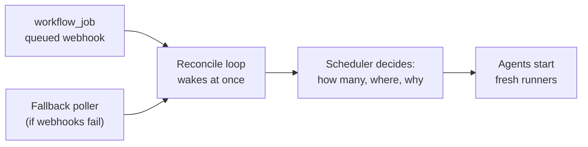

# Autoscaling GitHub Actions runners without Kubernetes

Autoscaling means the number of runners follows the number of jobs waiting:
runners appear when work is queued and go away when it is done. GitHub's own
answer to this is a Kubernetes operator. Zoomies does it with one Go binary and
the machines you already have, and nothing in it needs a cluster.

## How the decision is made

1. GitHub sends a `workflow_job` webhook when a job is queued. The controller
   checks its signature and records the job.
2. The reconcile loop wakes immediately. It also runs on a timer, so a missed
   event is corrected on the next pass.
3. The scheduler is handed a snapshot of the pools, runners, queued jobs and
   hosts, and returns a plan. It reads no clock, database or network, which is
   why its behaviour can be tested, and every decision it makes comes with a
   plain-language reason.
4. For each runner in the plan, the controller asks GitHub for a single-use
   registration and queues a task for the chosen host's agent. The agent starts
   a fresh container, and the runner takes one job. See [ephemeral
   runners](ephemeral-runners.md).

Agents only ever connect outwards, so a host behind a home router or a firewall
needs no inbound port. If webhooks cannot reach the controller at all, a
fallback poller lists queued jobs on a timer (`github.poll_fallback`, on by
default), so a controller whose webhook was misconfigured keeps scaling instead
of silently stopping.

## The settings that bound it

Autoscaling that has no ceiling is a runaway bill waiting to happen, so the
limits matter more than the trigger.

| Setting | What it does |
| --- | --- |
| `min_runners` | Runners kept warm and idle even with nothing queued. `0` is usually right, and it does not switch the pool off. |
| `max_runners` | The hard ceiling for the pool. Always set it: it is the backstop against a runaway workflow. |
| `idle_timeout` | How long an idle runner waits before it is drained. |
| `scale_up_delay` (fleet setting `scheduler.scale_up_delay`) | How long a job must have been queued before it counts as demand. `0` reacts at once; a small delay damps churn when jobs arrive in bursts. |
| `repository_scale_up_limit` | A best-effort limit on new capacity attributed to one repository. It throttles creation and is not an isolation boundary. |

These are pool settings; [the configuration reference](configuration.md) lists
every one with its default, and the [hosts and pools](hosts-and-pools.md)
guide explains how to size them.

## Why a queued job can still wait

A pool's maximum does not create hardware. If a pool allows eight runners but
the hosts it can use only have room for four, the other jobs wait. Pools also
share the room on a host rather than each reserving a separate slice.

The scheduler places each new runner only on a host that is healthy, not
cordoned, offers the pool's backend, matches the pool's platform and host
selector, and has room left. A host that is under sustained load is stepped
down automatically so a runaway job cannot starve the rest.

When a job waits, the [queued-job guide](queued-job.md) checks routing,
capacity and registration in order and names the one that applies.

## Scaling the machines themselves

Runners are scaled within the capacity of your hosts. If you also want the
machines to come and go, an optional infrastructure provider (Proxmox VE is the
first) can rent a machine when a pool has queued work and no host can run it,
install an agent on it, and destroy it when it has been idle long enough. Its
own delay and cooldown settings keep a quiet minute between two bursts from
deleting machines the next burst needs. See [the provider
contract](providers.md) and [Proxmox VE](proxmox.md).

## How this compares

Actions Runner Controller scales runners as pods in a cluster you operate, which
is a good fit when you already run Kubernetes. Zoomies is for the case where you
do not, or do not want to. [Compared with ARC](actions-runner-controller.md)
goes through the differences, and [runners without
Kubernetes](runners-without-kubernetes.md) helps you choose between a single
runner, a container, Zoomies and a runner service.

## Questions

**Can runners scale to zero?** Yes. A pool with `min_runners` of `0` keeps no
warm runners, and creates one when a job is queued. The first job pays the start
time, which [prewarming the image](hosts-and-pools.md) reduces.

**Does it need a public webhook URL?** A webhook is the fast path, but the
fallback poller means a controller with no reachable address still scales,
at the cost of a short delay and more GitHub API calls.

**What stops it creating too many runners?** `max_runners` on the pool, the
capacity of the hosts, and the pool-sharing rules above. Set a finite maximum
before you rely on it.

## Where to go next

[Understand the basics](fundamentals.md) explains hosts, pools and labels, and
[the quick start](quickstart.md) runs a first job end to end.
