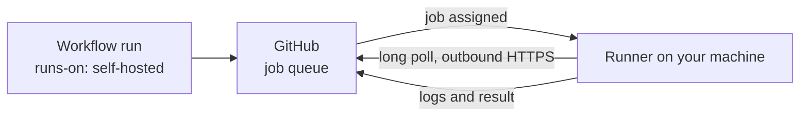

# What are self-hosted GitHub Actions runners?

A runner is the machine, and the small program on it, that executes a GitHub
Actions job. **GitHub-hosted** runners are virtual machines GitHub provides and
bills by the minute. **Self-hosted** runners are machines you provide: a cloud
VM, a server in an office, a spare box at home. The workflow file is the same
either way. Only the line that says where the job runs changes.

```yaml
jobs:
  build:
    runs-on: [self-hosted, linux]
```

That `runs-on` list is a set of **labels**. GitHub gives a job to an idle runner
that carries every label the job asks for, and every self-hosted runner has the
`self-hosted` label by default. You add others, such as the operating system or
the size, to tell your runners apart. GitHub's
[documentation on self-hosted runners](https://docs.github.com/en/actions/concepts/runners/self-hosted-runners)
is the reference for the details.

## How a job reaches a runner



The runner always dials out. It holds a connection to GitHub open and asks for
work, so a machine behind a home router or a corporate firewall needs no inbound
port. That is why self-hosting works almost anywhere there is an internet
connection.

## GitHub-hosted or self-hosted

| | GitHub-hosted | Self-hosted |
| --- | --- | --- |
| Who provides the machine | GitHub | You |
| Who patches and secures it | GitHub | You |
| A fresh machine for every job | Yes | Only if you arrange it |
| Hardware | The sizes GitHub offers | Whatever you own: more memory, a GPU, an arm64 board, a machine with private network access |
| Cost | Per minute beyond your plan's allowance | Your own hardware or cloud bill, plus the time to run it |
| Jobs that need your private network | Awkward | Natural |

Neither is better in general. See [should you self-host?](should-i-self-host.md)
for how to decide, and [what it costs](costs.md) for the arithmetic, which
changes whenever GitHub changes its pricing.

## Persistent or ephemeral

A **persistent** runner stays registered and takes job after job on the same
machine. It is the simplest thing to set up and the one most people start with.
It has two problems. Work from one job is still on the disk for the next, so a
leftover file, a poisoned cache or a stray process can change the next result.
And a job from a pull request can leave something behind for the one after it.

An **ephemeral** runner takes exactly one job and is then removed. The next job
gets a fresh one. The state of one job cannot leak into another, which is the
property GitHub-hosted runners have by default and a hand-built self-hosted
runner usually lacks. It is also what makes autoscaling possible, because
nothing needs to be cleaned up.

Ephemeral runners are registered with a short-lived, single-use credential
rather than a long-lived one sitting on the machine, which also shrinks what an
attacker gets from a compromised job.

## Autoscaling

A fixed set of runners is either idle and costing money or busy while jobs queue.
Autoscaling watches the queue, starts an ephemeral runner when a job is waiting
and removes it when the job ends, so capacity follows demand and can be zero
overnight. Something has to do the watching and the starting. GitHub's own
answer is
[actions-runner-controller (ARC)](https://docs.github.com/en/actions/concepts/runners/actions-runner-controller),
which runs on Kubernetes. The alternatives for people without a cluster are
compared on [this page](alternatives/index.md).

## Security

GitHub's guidance is that a self-hosted runner should not serve a public
repository, because anyone who can open a pull request can run code on it. Even
on a private repository, assume a workflow can read whatever the runner can
reach. The rules that follow:

- Run each job in a fresh, disposable environment, not on a machine you care
  about.
- Keep the runner on a network that cannot reach what it does not need.
- Give it the narrowest credentials that work, and never a long-lived token that
  outlives the job.
- Keep the runner application and the operating system up to date. GitHub
  expects it, and an old runner version eventually stops being accepted.

GitHub's [secure use reference](https://docs.github.com/en/actions/reference/security/secure-use)
covers workflows in detail, and [Zoomies' security page](security.md) says what
this project does about each of the above.

## What you take on

Installing the runner application takes a few minutes. Running a fleet of them
is a standing job: registering and removing runners, keeping them updated,
cleaning disks, noticing when a host has stopped taking jobs, scaling with
demand and not letting one repository's work starve another's. A
[controller](fundamentals.md) exists to do that for you.

## Where Zoomies fits

Zoomies is that controller for people who have machines rather than a
Kubernetes cluster. It is one binary with a web UI, it runs one ephemeral runner
per job on hosts you own, and it scales them with the queue. The
[quick start](quickstart.md) takes a fresh Linux host to a completed job in
about five minutes, and the [FAQ](faq.md) answers what people ask before they
try it.
