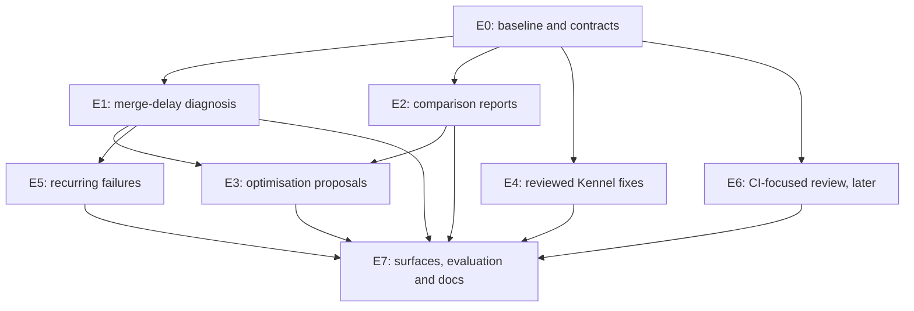

# Eli enhancement roadmap handoff

Prepared 12 October 2026. Planning baseline: local checkout
`1e745d258fdfce61d3395da97b72d575aab1fbbd`.

This document turns the product review into implementation tracks that several
agents can work from. It describes proposed extensions, their dependencies,
contracts, acceptance criteria and evidence requirements. Creating this handoff
does not mark these features as implemented, approve external writes or start
the implementation programme.

[ROADMAP.md](ROADMAP.md) remains the sole active delivery-order source of truth.
This file supports it rather than replacing it. Before implementation, the
coordinating agent reconciles these tracks with current code and records new or
changed work in ROADMAP.md, using existing packages where the work overlaps.
The track IDs below are local handoff identifiers, not allocated ZF numbers.

## Execution status, updated 13 October 2026

The owner subsequently authorised implementation and stacked PRs. This section
is the live handoff record for that work; ROADMAP.md and `roadmap/progress.md`
retain delivery-order and package-status authority. Update all relevant records
in the same implementation PR. A draft PR is not a delivered feature.

| Track / slice | State | PR and dependency | Verification and remaining work |
| --- | --- | --- | --- |
| Handoff document | Merged | [#928](https://github.com/eyupio/zoomies/pull/928) | Planning baseline published; this status section tracks subsequent implementation |
| E0 reconciliation | Completed for the first E1 slices | Upstream refreshed to `d382fb7a`; ZF-242 allocated in ROADMAP.md | Confirmed the analysis package was absent; preserve ZF-240/241 ownership and reconcile again before route integration |
| E1 calculation core | Merged | [#931](https://github.com/eyupio/zoomies/pull/931) | Go 1.27.2 formatting, analysis race tests and vet pass; no runtime surface yet |
| E1 bounded GitHub evidence | Merged | [#933](https://github.com/eyupio/zoomies/pull/933), following #931 | Full GitHub/analysis package race tests and vet pass; target-branch protection, bounded check reads, currentness recheck and explicit coverage |
| E1 snapshot assembly | Merged | [#935](https://github.com/eyupio/zoomies/pull/935), following its merged parents | Focused controller/analysis race tests pass; verifies repository/installation/run/job joins, preserves incomplete evidence, and separates check reporting from job execution |
| E1 on-demand collector | Merged | [#938](https://github.com/eyupio/zoomies/pull/938), following the merged foundations | Collector/assembly/core/reader race tests and changed-package vet pass; selects the existing job's installation, bounds collection, respects installation holds and labels the window basis |
| E1 admission and read-only API | Merged | [#943](https://github.com/eyupio/zoomies/pull/943), following #938 | Focused analysis/controller/API race tests, route/spec coverage, embedded contract equality, full lint and strict docs build pass; regenerated OpenAPI/server/web contracts; staticcheck was unavailable and skipped |
| E1 CLI and agent tools | Merged | [#947](https://github.com/eyupio/zoomies/pull/947), following merged #943 | One-request CLI and MCP wrappers, Eli read-tool allowlist and public-visitor refusal; focused race and reference tests pass against the resolved parent, as does strict docs. Contextual UI and scripted scenarios merged in #959 |
| E1 contextual UI and scripted scenarios | Merged | [#959](https://github.com/eyupio/zoomies/pull/959), following merged #947; baseline `66ff3857` | Desktop/mobile browser tests, scripted Eli race scenarios, focused UI checks, production asset budgets and strict docs pass. Snapshot-only context, nullable timings and manual Retry-After hold are covered. No live model evaluation has run |
| E2 eligibility | Draft PR | ZF-243, [#973](https://github.com/eyupio/zoomies/pull/973), following merged #971; baseline `1f4bcef8` | Pure selected-attempt contract, fixed rules and explicit inconclusive reasons. Measures, verified controller selection and transports follow. No dispatch or causal claim |
| E2 measurements | Draft PR | ZF-243, [#974](https://github.com/eyupio/zoomies/pull/974), stacked on #973 | Successful latency distribution, all-attempt execution/idle consumption, failure rate and descriptive changes. Complete analysis race tests and vet pass; no controller integration or live experiment |
| E2 bounded retained-attempt collection | Draft PR | ZF-243, [#977](https://github.com/eyupio/zoomies/pull/977), stacked on #974 | Scoped store reader and bounded controller collection; explicit retained-only/truncated/unavailable/held-back coverage. Focused store/controller race tests, full analysis race tests, changed-package vet and whitespace checks pass. Full workflow selection remains unverified; no runtime surface |
| E2 bounded GitHub attempt evidence | In progress | ZF-243, current PR following #977 | Exact run/attempt metadata and job enumeration, bounded bodies/pages and uncached identity recheck. Full GitHub package race tests and vet pass. No collector admission or runtime surface yet; workload/configuration evidence remains unknown |
| E3 to E6 | Not started | Dependencies and sequence below | No optimisation publication, new Kennel fix, recurrence engine or PR reviewer has been implemented in this stack |
| E7 storage fixture correction | Merged | [#960](https://github.com/eyupio/zoomies/pull/960), following merged #959 | Explicit public fixture permissions; all aicontext package race tests pass. Broad run completed; corrected package reruns pass, as recorded below |
| E7 fallback-copy mode correction | Merged | [#961](https://github.com/eyupio/zoomies/pull/961), stacked on #960 | Source permissions restored after copying; focused test fails before the correction and backend package race tests pass afterwards |
| E7 installer fixture correction | Merged | [#962](https://github.com/eyupio/zoomies/pull/962), stacked on #961 | Explicit previous-binary source mode; complete installer package race tests pass |
| E7 ledger fixture isolation | Merged | [#965](https://github.com/eyupio/zoomies/pull/965), following merged validation parents | Proxmox ledger package race tests pass with a temporary directory and checked opening error; no live e2e cluster run |
| E7 | Supporting each E1 slice | Plans, behavioural fixtures and status records in the stack | Focused race checks, full lint and strict docs build pass for the API slice; Broad run and complete corrective package checks finished; all failed packages now have passing reruns, with controller coverage split over its complete test list. The original full command did not pass. No live model evaluation or performance experiment has run |

The first validation attempt was blocked by a missing Go compiler and shell
network access. Explicit per-command network access resolved connectivity;
the official Go 1.27.2 release was installed in `/tmp` with its published SHA-256
verified. Do not carry the old toolchain blocker into later assignments.

Full checks initially exhausted the 5 GB `/tmp` filesystem. Build cache and
temporary build/test directories now use `/workspace/eli-tooling`, while the
toolchain remains in `/tmp/eli-toolchain/go`. Use
`GOCACHE=/workspace/eli-tooling/go-cache`, `GOPATH=/tmp/eli-go-path`,
`GOTMPDIR=/workspace/eli-tooling/tmp` and `TMPDIR=/workspace/eli-tooling/tmp`
for subsequent checks in this workspace. Interrupted full checks did not pass.
An early rerun was also interrupted during process cleanup. Those attempts were
not passes. The later broad run and corrective package checks are now complete;
the evidence below supersedes the old pending verification status. `make lint`
passed for the API slice (normal/e2e/drill/load vet, Go formatting and web lint);
staticcheck was unavailable and skipped. UI lint, Svelte checks and asset budgets
passed for #959. Strict MkDocs builds passed using the repository-only header
fallback when optional GitHub header lookups were denied.

PR #943 conflict resolution: merged `main` at `de28a68c` into the API
branch. The OpenAPI source merged cleanly; regenerated the embedded contract
and TypeScript schema from that combined source. Route/spec and diagnostic
race checks pass after resolution, as does the strict documentation build.

Current implementation plans:

- [Calculation core](roadmap/plans/2026-10-12-eli-merge-delay-core.md).
- [Bounded GitHub evidence](roadmap/plans/2026-10-12-eli-pr-delay-evidence.md).
- [Snapshot assembly](roadmap/plans/2026-10-12-eli-pr-delay-snapshot.md).
- [On-demand collection](roadmap/plans/2026-10-12-eli-pr-delay-collector.md).
- [Admission and read-only API](roadmap/plans/2026-10-12-eli-pr-delay-api.md).
- [CLI and agent tools](roadmap/plans/2026-10-12-eli-pr-delay-agent-tools.md).
- [Contextual UI and scripted scenarios](roadmap/plans/2026-10-12-eli-pr-delay-ui.md).
- [Validation fixture correction](roadmap/plans/2026-10-12-eli-validation-fixtures.md).
- [Fallback-copy mode preservation](roadmap/plans/2026-10-12-eli-copy-mode-validation.md).
- [Installer fixture permissions](roadmap/plans/2026-10-12-eli-installer-fixture-validation.md).
- [Ledger fixture isolation](roadmap/plans/2026-10-12-eli-ledger-fixture-validation.md).

## Completed broad validation

The original `go test -race -count=1 -p 2 ./...` finished with 44 passing
packages and seven failing packages. Four issues were corrected in merged PRs
#960, #961, #962 and #965: a public-directory fixture masked by umask 0077,
fallback copies losing source permissions, a previous-binary fixture with the
same umask assumption, and a ledger fixture writing outside its temporary
workspace and ignoring its opening error. API/controller/store hit package
wall-clock deadlines while continuing through tests.

Every originally failing package has successful corrective race checks:

| Package | Completed verification | Result |
| --- | --- | --- |
| aicontext | Complete package, after explicit fixture permissions | Pass, 18.349 s |
| backend | Complete package, after mode restoration; focused test failed before correction | Pass, 32.369 s |
| installer | Complete package, after explicit previous-binary fixture mode | Pass, 140.344 s |
| test/e2e/proxmox | Complete normal package, after ledger fixture isolation | Pass, 9.440 s; no live e2e tag or cluster operations |
| API | Complete package with `-timeout 30m` | Pass, 1380.705 s |
| store | Complete package with `-timeout 30m` | Pass, 1122.901 s |
| controller | All 1329 listed tests, disjoint 665/664 groups, each with its own race-test budget | Both pass, 801.357 s and 844.029 s |

Controller's single thirty-minute package run also reached its deadline without
an assertion failure. The complete partition is reproducible from the
[ledger validation plan](roadmap/plans/2026-10-12-eli-ledger-fixture-validation.md).
This is verification across the broad run and complete corrective runs; do not
claim the original full command passed. No validation command remains running.

See the [validation record](roadmap/validation/2026-10-12-eli-pr-delay-validation.md)
for commands, tested changes, environment and limits. A live model evaluation
and a real performance experiment remain unrun. E2 to E6 remain unstarted;
reconcile the E2 comparison contract with ZF-241 before activating new work.

The next agent should start from the stack tip, check which parent PRs have
merged and preserve each PR's focused diff. Never merge or retarget a parent
merely to unblock a child. For unfinished validation, report the actual command
and result; running or skipped checks are not passes.

## 1. Intended outcome

Zoomies runs CI on infrastructure its operators control. Eli should help them
understand failures, repair supported PRs and improve CI using evidence from the
fleet and repository.

The next substantial improvement is a complete, inspectable path:

> Here is why your team is waiting, here is a change to review, and here is the
> evidence that the change helped.

Build on the existing controller, deterministic explanations, Kennel Club,
resource measurements, MCP, AI Context and repair worker. Separate four modes:

| Mode | Result | Change authority |
| --- | --- | --- |
| Diagnose | Evidence, uncertainty and the next useful step | Read-only |
| Repair | A proposed fix to a supported failing PR | Existing repair policy and requester consent |
| Optimise | A proposed improvement to a slow or wasteful workflow, with a comparison report | Separate opt-in for publication and experiment execution |
| Review | Findings on a pinned PR revision | Separate opt-in for source reads and review publication |

An ordinary chat must not acquire source access or write permissions simply
because a new mode exists. A model does not choose whether it is authorised.

## 2. Read first and establish the current baseline

Every agent reads [AGENTS.md](AGENTS.md), the scoped guidance for its files,
[architecture](docs/architecture.md), [dependencies](docs/dependencies.md) and
the relevant sections of ROADMAP.md. Follow British spelling and the repository's
prohibition on em dashes. Use Mermaid for diagrams.

Use these entry points to verify behaviour before designing replacements:

| Existing foundation | Source to inspect | How the proposed work uses it |
| --- | --- | --- |
| Deterministic failure explanation | `internal/controller/explain.go`, `docs/troubleshooting.md` | Distinguish a workflow failure from a fleet fault before recommending an action |
| Job timings and resource measurements | `internal/store/queries_job_stats.go`, `internal/mcp/tools.go` | Queue, startup, execution, sample counts and sizing evidence |
| Usage and estimated costs | `internal/mcp/usage.go`, `docs/development/usage-analytics.md` | Compare consumption without inventing billing precision |
| Eli's permitted read tools | `internal/controller/assistant_tools.go` | Explicit tool allowlist and caller permissions |
| Eli chat, history and contextual entry points | `docs/eli.md`, `web/src/lib/assistant/`, `internal/store/queries_assistant_conversations.go` | Present results within the existing experience |
| Repair orchestration and readiness | `internal/controller/eli_repairs.go`, `internal/controller/eli_experience.go`, `internal/api/handlers_eli_repairs.go` | Reuse policy, budgets, pinned heads and durable work patterns |
| Bounded model editing | `internal/prrepair/repair.go`, `internal/prrepair/context.go` | Preserve edit validation and source limits |
| GitHub repair operations | `internal/github/eli_repairs.go` | Reuse scoped GitHub operations rather than adding a second client |
| Kennel parsing, evaluation and coverage | `internal/kennel/`, `internal/github/kennel_settings.go`, `docs/kennel-club.md` | Workflow facts, coverage states, waivers and verification |
| Verified repository context | `docs/ai-context.md`, `internal/aicontext/` | Revision-pinned, selective source retrieval where authorised |
| Existing workflow migration | `internal/migrate/`, `docs/migration.md` | Exact previews and publication patterns |
| Model evaluation | `internal/api/eli_eval_test.go`, `docs/eli.md#measuring-eli` | Extend the existing harness rather than creating another |
| Cache support and limitations | `docs/persistent-caches.md` | Respect host locality, trust boundaries and concurrent writers |

The baseline already includes saved conversations, contextual Ask Eli, usage
through MCP, and a scripted/optional-real-model evaluation harness. Do not list
these as new features. Historical reviews and roadmap summaries can lag code.
An existing harness does not prove real-model quality or successful live repairs.

Current repair behaviour is deliberately bounded: it reads source and failure
evidence, asks for a validated plan, publishes a non-force commit to a supported
PR branch and observes GitHub checks. It does not execute repository code on the
controller, run local tests or merge. Ordinary Eli chat has neither repository
source tools nor fleet mutation tools. Preserve these boundaries.

### Existing work to extend rather than duplicate

- **ZF-235:** assistant capabilities, including confirmation, deterministic
  Kennel fixes and bounded autonomy. Reconcile slice status against current code.
- **ZF-236:** the figures behind size advice. Reuse its observations and
  insufficient-data state.
- **ZF-240:** recent events and fleet movement over MCP.
- **ZF-241:** controller-computed queue breakdown, period/release comparison,
  host pressure and repeated runner-startup failures.
- [Fleet-analysis design](roadmap/fleet-analysis.md): approved design for
  ZF-240 and ZF-241. Its analysis package and contracts are the preferred
  foundation for new diagnostic work, subject to what has actually landed.
- **ZF-239:** shared App relay. This handoff does not depend on it or extend
  its authority. Existing App installations suffice.

## 3. Delivery sequence and agent ownership

Ship a useful read-only analysis before giving it publication or execution
authority. Deliver small vertical slices through controller, API, CLI/MCP, UI,
tests and documentation. A frontend can start with agreed fixtures while its
backend is built, but production acceptance requires the integrated route.

| Track | Priority | Owner | Dependencies | First useful slice |
| --- | --- | --- | --- | --- |
| E0: reconciliation and shared contracts | First | Coordinating agent | Current checkout and active roadmap | Verified baseline, contracts and file ownership |
| E1: PR merge-delay diagnosis | P1 | Analysis agent | E0; reuse ZF-240/241 interfaces where available | Read-only explanation for one PR head with coverage limits |
| E2: comparison experiments | P1 | Experiment agent | E0; E1 for bottleneck-led recommendations | Report from operator-selected comparable runs, without automatic dispatch |
| E3: optimisation proposals | P1 after measurement | Optimisation agent | E1, E2 | Exact preview and draft PR for one supported change |
| E4: reviewed Kennel fixes | P1, parallel | Kennel agent | E0; align with ZF-235 deterministic-fix slice | Preview one deterministic workflow fix and verify after merge |
| E5: recurring failure evidence | P2 | Analysis agent after E1, or a separate owner | E0; reuse ZF-241 startup recurrence | Group equivalent failures with first/last occurrence and supporting runs |
| E6: CI-focused PR review | P3 | Review agent, assigned later | E0; source/read policy and evaluation work | Findings-only review of CI-related changes |
| E7: product surfaces, evaluation and adoption | Alongside every slice | Experience/evaluation agent | Frozen contracts for the slice being integrated | Contextual result cards, scenarios, task documentation and install guidance |

Suggested initial team: one coordinator plus analysis, experiment, optimisation,
Kennel and experience/evaluation agents. E5 follows E1 for the analysis owner;
E6 starts later or replaces an agent whose first track is complete. This is a
dispatch plan for future implementation, not a request to spawn agents merely
to read this document.

## 4. E0: coordinating agent and contract freeze

The coordinator owns ROADMAP.md edits, API contract integration, migration
number allocation, shared policy/settings changes and final integration. It
does not assign the same shared file to two agents at once.

Before implementation dispatch:

1. Record the current commit, clean/dirty state and delivered status of the
   foundations above. Preserve unrelated work.
2. Map each accepted slice to an existing or newly allocated roadmap package.
   Keep unselected proposals explicitly proposed.
3. Agree the typed input snapshots, result envelopes, policy actions, bounds
   and error/coverage codes. Record which fields are trusted controller facts
   and which are repository-written data.
4. Assign exclusive ownership of new files and serial ownership of shared
   files. Allocate migrations from the current tree, never from this baseline.
5. Record the first slice's acceptance tests and the minimum fixture payload
   the experience agent can use.

### Proposed shared result vocabulary

These are design requirements to reconcile with existing contracts, not final
route names or schemas:

- Identity: installation/repository, PR number where relevant, analysed head
  SHA, workflow identity and model/provider only when a model participated.
- Provenance: analysis/rule version, snapshot or observation time, selected
  windows and immutable evidence references.
- Coverage: complete, partial, not permitted, not available, held back or
  failed, aligned with existing coverage states. Include what was omitted and
  why. Sampling and truncation are visible.
- Finding: stable code, affected resource/file, evidence, next action and a
  controller-written explanation. Qualitative confidence requires a documented
  basis; avoid invented numeric confidence.
- Quantities: explicit units, sample counts, source of each estimate and null
  for unavailable data. Missing measurements are not zeros.
- Change state: pinned baseline, currentness, superseded status, approval and
  execution/publication state where applicable.
- Outcome: measured improvement, regression, inconclusive or unverified.
  Projected savings remain estimates and never become measured results.

Public route shapes live in `api/openapi.yaml`. Pure calculation belongs in the
existing/planned `internal/analysis` boundary; SQL belongs only in
`internal/store`; orchestration belongs in `internal/controller`; GitHub reads
and writes belong in `internal/github`. API handlers and MCP tools render or
call contracts rather than reimplementing analysis. UI and Eli narrate the same
computed result.

Do not put experimental dispatch, model calls or slow GitHub reads inside the
scheduler's reconcile lock. Background work uses bounded, recoverable workers.

## 5. E1: explain what delays a PR

**User outcome:** from a PR or workflow run, see which observed required check
governs completion and whether the useful remedy concerns queueing, runner
startup, execution, resource sizing or workflow structure.

**Scope:** resolve one pinned PR head and target branch; map applicable required
checks to observed runs; build a deterministic timing analysis. Reuse Kennel's
protection reader patterns, but do not silently reuse default-branch requirements
for a PR targeting another branch. Existing required-check names are restricted
in Kennel's model-facing output: adding them to Eli requires an explicit
contract/privacy decision. Prefer opaque identifiers and safe labels initially.

**Calculation requirements:**

- Required checks include the applicable classic protection and rulesets,
  their producer identity and mapping coverage. A workflow job name is not
  automatically a required check.
- Keep reruns, attempts, matrix instances and concurrent workflows distinct.
  Never combine results from different PR heads into a current verdict.
- Distinguish the observed last-finishing required check from a proven workflow
  dependency critical path. Infer no `needs` graph from timestamps alone.
- Decompose observable queue/startup/execution intervals using current timing
  definitions. Check overlap before adding stages so time is not counted twice.
- Pending, absent, ambiguous and external checks remain visible. An unavailable
  protection read permits a run-duration analysis, not a confirmed merge gate.
- Report check completion delay separately from complete merge readiness.
  Reviews, merge queues, conflicts and other branch requirements are outside
  the initial timing verdict.
- Recommend a smaller runner only when the measurements and sample count
  support it. Explain queue capacity before recommending wider sharding.

**Acceptance:** deterministic fixtures cover a fast test waiting in a queue, a
slow execution with no queue, a missing external required check, duplicate check
names, matrix jobs, reruns, changed PR heads and partial permissions. The result
names its observation window and coverage. UI, CLI/MCP and Eli expose the same
figures. No recommendation relaxes tests or required checks.

**First PR:** pure snapshot/result types and table tests. Follow with bounded
reads and a read-only route, then transport adapters and one contextual card.

## 6. E2: repeatable comparison experiments

**User outcome:** compare two runner/workflow configurations and see whether a
change improved developer wait, runner consumption and reliability.

Start with operator-selected existing runs. Add explicitly approved dispatch
only after the comparison contract, workload eligibility and cost bounds exist.
E2's historical reports support diagnosis; E3 cannot claim verified improvement
unless there is a suitable control/candidate comparison.

**Experiment record:** hypothesis, initiating user, authorised repository,
baseline/candidate revision, intended configuration difference, workflow inputs,
runner/image/resource identity, host conditions, cache classification,
observation window, selected attempts, exclusions and comparison-rule version.
Where workflow or source changes require different commits, record the exact
delta; a runner-only comparison should use the same source commit. Both arms
retain the same test scope.

**Measurement requirements:**

- Keep wall-clock latency, execution runner time, allocated idle time, failure
  rate and estimated cost separate. Sharding can reduce latency and increase
  total runner time.
- Describe cold/warm cache state when observed, otherwise unknown. Never
  invent a cache hit or call unmatched workloads a controlled experiment.
- Exclude cancelled/superseded runs from successful-duration estimates while
  reporting their counts and consumption. Failed attempts remain in reliability
  and consumption evidence. Do not cherry-pick only successful candidate runs.
- Choose and version minimum sample and material-regression rules before
  collecting results. Show counts and dispersion; small samples are
  inconclusive. If confidence intervals are implemented, document the method
  and assumptions and verify it against known fixtures.
- Existing costs are administrator-rate estimates. Repository/workflow cost
  and idle allocation currently cannot be attributed by the usage contract.
  Keep that limitation, or label a separately designed allocation model and
  expose its unattributed remainder. Model cost is separate from runner cost.
- A release-period comparison can identify correlation; it is not automatically
  a causal performance experiment.

**Dispatch safeguards for the later slice:** jobs execute through approved
GitHub Actions workflows on ordinary runners, never on the controller. Allowlist
eligible build/test workflows; refuse release, publishing or deployment work by
default. Bound concurrency, run count, elapsed time and consumption, and show the
plan before execution. A workflow dispatch is not a rerun: verify the ref, inputs
and resulting revision. Cancellation and restart cannot duplicate dispatch.

**Acceptance:** tests cover unequal workloads, unknown cache state, noisy hosts,
missing samples, failure regressions, increased consumption despite reduced
latency and insufficient samples. Reports are reproducible from retained
evidence. Automated execution has an idempotent admission/dispatch lifecycle,
audited approval and a visible stop reason.

## 7. E3: propose and verify workflow optimisations

**User outcome:** turn an evidence-backed opportunity into an exact change to
review, followed by a report of what happened.

Use a separate optimisation lifecycle instead of treating a healthy-but-slow
workflow as a failed PR repair. Reuse the repair worker's bounded source/edit
validation, policy rechecks, non-force publication and provider accounting where
appropriate; extract shared helpers only when both consumers need them.

Proposed lifecycle: discovered, preview ready, approved, published, verifying,
then measured improvement, regression, inconclusive, stopped or superseded.
Keep proposal approval, repository publication and experiment dispatch distinct.
An uncertain publication after restart requires reconciliation, not blind replay.

**Initial catalogue:**

| Change | Required evidence | Important refusal/qualification |
| --- | --- | --- |
| Checkout scope | Transfer/timing evidence and the workflow's history needs | Keep history needed for versioning, comparisons or tooling |
| Dependency/build cache | Repeated setup cost, supported tool and known trust scope | No credentials, shared executable workspace or unsafe writer boundary |
| Bounded readiness polling | Fixed wait on a condition that can be checked | Preserve timeout and diagnostic failure behaviour |
| Test sharding, later in the track | Long gating suite, supported shard mechanism and available capacity | Preserve the complete test set; disclose consumption increase |

Do not lead with test removal, relaxed assertions, blanket retries, skipped
security checks or trigger/path changes that can strand required checks.
Resource-only advice can remain a reviewed fleet proposal until the existing
confirmation/mutation programme supplies the authorised action path.

**Policy:** separate enablement for repository/source access, workflow edits,
publication and experiment execution. A personal provider remains personal;
installation-funded unattended work requires its own selected policy and budget.
Do not fall back to another person's credentials. Bound proposals, model calls,
edits and daily work using explicit settings agreed in E0. Show who pays.

**Acceptance:** one supported optimisation has an exact preview, currentness
check, draft PR, evidence-linked explanation and E2 verification result. A changed
head or policy stops publication. Losing a cache affects speed only. Missing
measurements produce unverified/inconclusive, not a success claim. Passing CI
does not by itself demonstrate performance improvement. Publication never merges.

## 8. E4: reviewed Kennel fixes and focused check extensions

**User outcome:** preview a focused fix for a Kennel finding, publish it for
review, and see whether the finding closes once the change reaches the branch
Kennel inspects.

Extend the existing deterministic-fix programme, parser, registry, prompt
renderer and waiver model. Start with one unambiguous fix. A suggested timeout
value is not a fact unless it comes from sufficient history or the user supplies
it. Ambiguous concurrency groups, token needs or action updates require review.

For action pins, resolve and validate immutable identity; a pinned SHA alone
does not establish safe provenance. Preserve an updater mechanism. For token
changes, identify the consuming jobs rather than removing required permissions.
Keep formatting and unrelated bytes intact when feasible.

Potential additional checks are shell interpolation of attacker-controlled
values, privileged execution of contributor code and unsafe cache trust paths.
Each needs a supported parser scope, concrete evidence, contextual exploit path
and a clear unsupported/partial state. An unpinned action is a hygiene finding,
not automatically a demonstrated exploit.

**Acceptance:** preview cites the original file/blob, exact diff, check code and
verification step; stale blobs require a refreshed preview. A waiver is respected
and remains visible. Publication requires the relevant action authority. Online
and offline checks share the evaluator. Recheck closes a finding based on new
evidence, not because a PR was opened. Generate registry-derived references using
the existing tooling and test malformed/adversarial YAML and partial reads.

Do not add one opaque health score. Configuration adherence, measured
performance, reliability and exposure are separate dimensions; missing coverage
must remain visible in each.

## 9. E5: recurring failure evidence

**User outcome:** recognise repeated failures, see where they occur and choose
between a code investigation, fleet remedy or further observation.

Reuse ZF-241 for repeated runner-startup failures. Add workflow/test recurrence
only where logs or structured test evidence support it. Define a versioned,
deterministic fingerprint from failure class and normalised bounded evidence;
separate infrastructure and test/source failures. Scope it to repository,
workflow/job identity and relevant image/platform context. Do not cluster merely
by a generic final line such as an exit code.

Store first/last occurrence, supporting run IDs and revisions, attempts,
observed host/image distribution and associated repair outcomes. Define retention
and redaction before persisting excerpts. Prefer evidence references and hashes
over duplicated raw logs. Missing retained evidence produces an incomplete group.

Show "passed on a later attempt at the same source revision" as evidence of
possible flakiness, not proof: caches, dependencies, host conditions and external
services can change. Cross-host correlation likewise does not prove a host fault.

**Acceptance:** fixtures distinguish different failures with similar text,
normalise expected volatile values without merging distinct causes, keep separate
repositories separate and show missing evidence. No automatic rerun or repair
loop is introduced. An Eli scenario cites recurrence and uncertainty rather than
asserting causality. Repair success requires observed subsequent results, not
publication alone.

## 10. E6: CI-focused Eli review, a later track

**User outcome:** receive useful findings on changes to workflows, caches,
runner configuration and build/test scripts, informed by fleet evidence.

Start with findings-only review of a pinned PR revision. Review instructions,
scripts and policy come from the trusted base revision. A PR must not rewrite
its own review rules. Repository text is untrusted input throughout. Reusing
source access does not authorise executing repository scripts.

Findings include severity, current diff location, concrete evidence and a
recommended change. Explain missing coverage rather than publishing a broad
all-clear. Consolidate/deduplicate findings and update one review summary per
pass. Superseded heads cancel or retire the pass. Compare instruction/rule
changes separately against the base policy.

**Acceptance:** fixtures cover review-rule tampering, injected source/log text,
stale line references, duplicate findings, partial source, unsupported files and
changed heads. A supported CI change can be explained using actual capacity or
trust-boundary evidence. Model/provider and token/run budgets are visible. No
automatic edits, execution, approval or merge. Broad code-review personas and
script execution are separate future scope.

## 11. E7: experience, evaluation and adoption

Work beside each accepted track; do not create a parallel chatbot or another
dashboard. Integrate into the existing PR/run/job views, Usage, Kennel findings,
Eli repairs and Ask Eli. Use the shared result contract and existing UI tokens.

Each result presents the finding, evidence, uncertainty and next action. A change
preview shows affected files/resources, exact diff, who pays, intended benefit,
limits and verification plan. Keep implementation mechanics out of the normal
flow unless they help the operator decide. Preserve keyboard access, both themes,
small-screen usability and shareable views. A declined or stale proposal must
remain understandable.

Extend `internal/api/eli_eval_test.go` with scenarios for each shipped capability:
wrong bottleneck, incomplete required-check coverage, cost versus latency tradeoff,
insufficient comparison samples, infrastructure failure that needs no code edit,
possible flakiness, policy refusal and injected repository text. Scripted runs
verify routing and bounds. Real-provider runs require configured credentials and
record provider/model, date, scenario version, reported usage and outcomes.
Missing usage is unknown. Do not claim a live evaluation happened if it skipped.

Publish task-oriented documentation for explaining failed jobs, identifying PR
delay, choosing a size, comparing configurations and reviewing an optimisation.
Provide one tested skill installation path and generated command references.
Document read-only versus action permissions and support limitations. Keep
product framing about Zoomies and Eli's outcomes, without naming another vendor
or adding hosted-service tiers to public pages.

Proof consists of real reviewed changes and reproducible reports with workload,
sample counts, revisions and limitations. Synthetic demos are labelled as such.
Do not promise percentage savings from illustrative arithmetic or infer real
model quality from a scripted provider.

## 12. Parallel working protocol and dispatch briefs

Use isolated branches/worktrees where available. If agents share a checkout,
exclusive file ownership is mandatory. Each agent sends the coordinator its
planned files before editing; shared-file changes go through the coordinator or
a scheduled integration turn. Do not overwrite another agent's generated output.

The coordinator owns `api/openapi.yaml`, route/tool registries, settings/action
registries, migration allocation and ROADMAP.md integration. Track owners provide
small proposed patches or contract requirements for those files. The experience
agent owns assigned UI/docs files and the integration/evaluation scenarios;
backend owners own behavioural tests beside their code. Coordinate new entries
in shared Eli tests rather than having multiple agents edit them concurrently.

Every agent reports: baseline commit, track/slice, files changed, contracts used,
tests run and results, generated files, limitations, evidence artifacts and
remaining dependencies. Distinguish implemented, fixture-tested and live-verified.
Do not commit or merge another agent's incomplete work to clear a dependency.

Copy these briefs into future agent assignments, adding the agreed contract,
branch/worktree and exclusive file list:

| Agent | Dispatch brief |
| --- | --- |
| Analysis | Read this handoff, current ZF-240/241 design and scoped guidance. Implement E1's first pure-analysis slice using agreed snapshots. Preserve partial coverage and pinned revisions. Return deterministic cases and integration requirements; do not implement experiment dispatch or edit shared contracts independently. |
| Experiment | Implement E2's comparison model and report from selected retained runs. Version matching/outcome rules and expose all exclusions. Keep estimates distinct from measurements. Return fixtures for inconclusive and regression cases. Automatic dispatch is a later, separately scoped slice. |
| Optimisation | Implement one E3 proposal type after E1/E2 contracts exist. Reuse bounded edit/publication helpers and current repair policy patterns. Deliver preview before publication and verification integration. Do not broaden ordinary chat access, merge PRs or execute code on the controller. |
| Kennel | Reconcile ZF-235's fix slice and implement one E4 deterministic preview. Preserve waivers, blob currentness, evaluator parity and verification. Coordinate check/action registry updates and generated references with the coordinator. |
| Experience/evaluation | Integrate agreed result fixtures into existing UI/Ask Eli surfaces, then connect the real routes. Extend the existing evaluation harness and task docs. Label synthetic evidence and skipped live checks. Coordinate shared scenario edits and preserve UI guidance. |
| Review, later | Implement E6 findings-only review for CI changes with trusted-base instructions, pinned heads, bounded reads and one summary. Return adversarial fixtures and supported scope. Script execution, broad personas and automatic repairs are outside this slice. |

## 13. Validation and completion evidence

For this document, verify internal links, current baseline references and absence
of vendor-specific framing. No runtime test is needed for a handoff-only change.

For subsequent code slices, use repository commands and applicable scoped rules:

- `make build-nogui` before Go tests requiring the API embed on a clean checkout.
- Focused package tests with injected clocks, in-memory stores and fake GitHub.
- `make test` and `make lint` for integrated code changes, with failures recorded.
- `make openapi` when API shapes change; `make generate` when generated
  catalogues, commands or MCP references change. Review the generated diff.
- Relevant web unit tests and `make test-ui` for behaviour changed in the UI.
- `mkdocs build --strict` when published documentation/navigation changes.
- `make test-eli-eval` only for an explicitly configured live-provider run;
  inspect whether it executed rather than skipped.

Tests should demonstrate behaviour, authorisation, stale-source handling,
coverage, recoverability and resource bounds, rather than mirror implementation.
Verify cancellation/restart paths for any new durable work. No real credentials
are needed for deterministic integration tests.

A slice is complete when its documented user outcome works across the assigned
surfaces, its contracts and generated files agree, its meaningful checks pass,
and its evidence states exactly what was verified. An optimisation is not
measured-successful until the comparison supports that conclusion.

## 14. Scope decisions to resolve when selecting a slice

The coordinator records decisions with the selected implementation plan. These
do not block creation of this handoff or independent read-only design work:

| Decision | Recommended initial scope |
| --- | --- |
| PR-gate coverage | GitHub Actions checks that can be mapped reliably; external/ambiguous checks visible as unsupported or incomplete |
| Comparison execution | Historical/operator-selected runs first; allowlisted opt-in dispatch later |
| Optimisation publication | Reviewed draft PRs only; no unattended publication in the first slice |
| Optimisation catalogue | One narrow, evidence-backed change before a broad pattern library |
| Automatic work and payer | Existing ownership model, separate per-mode opt-ins and bounded budgets |
| Required-check names in Eli | Preserve current privacy restrictions until a specific contract decision permits more |
| Statistical acceptance | Versioned minimum samples, workload comparability and regression rules; no guessed thresholds in UI/model prose |
| Review scope | CI-related diffs and findings-only; broad code review and executable scripts deferred |
| Cost attribution | Existing pool/host estimates; explicit unknown/unattributed values elsewhere |
| Alerts and external services | No new notification service, relay dependency or hosting product in this programme |

Success is an evidence-backed improvement loop that operators can inspect and
control, delivered through the Zoomies capabilities they already use.

## E2 implementation handoff, 12 October 2026

ZF-241 now has a period comparison on main. ZF-243 supplies the distinct selected
historical configuration comparison; do not convert a period finding into a
controlled experiment. The first slice is `internal/analysis/experiment.go`.
`AssessExperiment` is pure and consumes a retained `ExperimentSnapshot`.

- `selected-runs-v1` requires 30 completed attempts per arm, counting success
  and failure. Cancelled/superseded outcomes are separate counts; pending and
  unknown outcomes make the result inconclusive. An eligible result does not
  assert success, causation, authorisation or verified improvement.
- Selection completeness is supplied evidence, not independently verified by the
  pure core. The controller must check access and load all selected attempts,
  including failures. Retain the snapshot beside the result. Identity is run ID
  plus attempt number, unique across both arms; the repository scopes it.
- Runner comparisons require identical source/workflow revisions, inputs and
  test scope. Workflow comparisons need a retained exact revision delta.
  Both arms retain configuration, image and resource identifiers. These
  identifiers refer to evidence; they do not prove its contents themselves.
- Cache classifications must be observed cold/warm and match. Mixed cache
  cohorts are conservatively inconclusive in v1. Quiet hosts must be observed;
  unknown or busy hosts are explicit caveats. No cache hit or host state is
  inferred. Observation windows are half-open, with at most 2000 attempts per arm.
- Stable reason codes are sorted. Structural errors refuse malformed records;
  missing analytical evidence returns an inconclusive result. No raw workflow
  text is rendered to an agent in this slice.

Next agent: implement pure measurement over retained attempt evidence. Keep
successful latency and all-attempt consumption separate, retain failed and
cancelled consumption, report missing measurements without inventing zero, and
show sample counts/dispersion. Version regression thresholds before observing
results. An eligible cohort still must not produce a causal claim. Follow with
bounded authorised controller assembly, read-only API, CLI/MCP/Eli and a contextual
card. Dispatch, optimisation publication and live model evaluation remain unrun.

Validation: the new behavioural tests failed to compile before the contract
existed. The complete analysis package race tests and vet pass with Go 1.27.2
for this pure slice, as does `git diff --check`. Earlier broad validation evidence remains linked above; it is not a
claim that the new slice passed a full repository run.

### E2 measurement contract

`MeasureExperiment` retains the eligibility result and outcome counts. The
version is `selected-measures-v1`. Successful latency reports nearest-rank min,
p50, p95 and max; p50 is ceil(0.50*n)-1 and p95 is ceil(0.95*n)-1 in a sorted
zero-based array. Failure rate is failed/completed, with cancellations and
superseded attempts visible in the eligibility counts, outside this denominator.

Execution and allocated idle are separate all-attempt distributions, including
failed, cancelled, superseded and pending attempts where measured. Missing counts
are explicit. Totals are null if any relevant value is missing or no value was
observed; known zero remains zero. Negative values and int64 sum overflow refuse
the record. Execution means running time, not wall-clock latency or monetary cost.
Allocated idle time must be independently observed and attributable; never derive
it by subtracting unrelated host-wide counters. The pure core only checks the
supplied figures, so controller verification remains essential.

Descriptive change labels are permitted only for eligible cohorts. Successful
latency needs at least 30 measured successes on both arms and no missing success
measurements; execution/idle need complete measurements and at least 30 selected
attempts per arm. Latency ranks p50; consumption ranks arithmetic mean per selected
attempt, keeping totals visible for unequal cohort sizes. A 1.10 ratio in either
direction is material. A five percentage point failure-rate difference is
material, computed with integer cross-products to preserve the boundary. These
fixed rules describe a difference, not statistical significance or causation.
No overall winner, confidence interval, cost estimate or verified improvement is
claimed, even when all descriptive directions improve.

The next slice is bounded authorised controller assembly of retained selections.
Prove repository/installation joins, completeness including failures, retention
limits and missing telemetry before adding read-only transports. Neither this
measurement slice nor its parent initiates jobs, writes GitHub or calls a model.
Validation: tests failed before measurement implementation. Complete analysis
race tests and vet pass, including exact thresholds, zero/missing values, nearest
rank, unequal cohort sizes, failure/exclusion consumption, overflow and purity.

## E2 collection handoff, 13 October 2026

Slice 3 follows draft #974. Main was reconciled at `266ad99f`; #973 and #974
remain open. Their older Go/Node dependency baseline is preserved in this stack;
no dependency update is mixed into this implementation.

`Store.ListExperimentAttemptJobs` scopes every read to repository, installation,
run ID and exact attempt number. It preserves every conclusion and pending state,
orders queued_at/id, takes a limit of 1..1000, fetches at most limit+1 and reports
truncation. Empty rows mean no retained evidence. It does not filter by window:
cutting jobs at window edges could make an incomplete attempt look complete.

`Controller.CollectExperimentAttempts` requires a transport-authorised caller;
installation coverage is checked here, but caller authorisation is not granted
by an installation/repository join. It selects 1..100 unique positive run/attempt
identities, imposes a 20-second deadline, returns at most 1000 jobs per attempt
and 2000 jobs across the selection. Queries fetch one extra row to detect a
per-attempt truncation. Remaining attempts after exhausting the total budget are
held back rather than silently omitted. The report has only job identity,
revision, state/conclusion and timestamps; no job names, workflow names, log tails
or workflow outputs. Repository/revision strings remain untrusted in any future
agent adapter. No REST route or tool exposes these reports yet.

Coverage values: `retained_only`, `truncated`, `not_available`, `held_back`.
`SelectionComplete` is always false. Retention and missed deliveries can hide
jobs, and full workflow coverage includes jobs the fleet may not run. Existing
rows do not prove workflow inputs, workflow revision, observed cache classification,
historical runner/image/resource configuration, quiet hosts or attributable idle.
Do not fill these with current pool settings, guessed caches, zero or a complete
selection assertion. The collector makes no GitHub call and mints no credential.

Next agent: design the bounded join to independently retained workload/configuration
and complete workflow-attempt evidence before building an ExperimentSnapshot.
Pin source revision, workflow revision, test scope, exact inputs and configuration
at the selected attempts, and retain every failure. Unknowns keep comparisons
inconclusive. Full workflow wall-clock latency must not be inferred from the
first/last retained fleet job. Execution sums need all selected job measurements;
allocated idle and monetary attribution need separate supported evidence.
Public-visitor refusal, role checks, repository scope and explicit incomplete
coverage must hold before any read-only API/CLI/MCP/Eli/UI surface is added.

Tests cover exact scoping, retries, all outcomes, invalid bounds, empty history,
repository-installation mismatches, duplicate selections, both collection caps
and minimal output. The behavioural tests failed to compile before implementation.
Verification results are recorded in the slice plan; earlier broad-run evidence
is not a claim that this new slice passed the entire repository suite.

### E2 exact GitHub attempt evidence, 13 October 2026

Slice 4 supplies `github.ExperimentAttemptReader`, an optional capability on the
installation client. `ReadExperimentAttempt` uses the exact run/attempt endpoint
and its jobs endpoint; it never substitutes the latest run, follows an API jobs
URL, reads logs/source or dispatches work. Source head, repository, run, attempt
and workflow numeric identity must match. All job outcomes remain visible.

The reader has a 20-second deadline, five pages of 100 jobs, at most seven GET
requests (two attempt metadata reads plus five pages), and the existing isolated
4 MiB per-response diagnostic bound. It disables conditional caching only on its
local clone, leaving the shared installation client unchanged. Names, labels,
step output, actors, workflow paths and display titles are absent from the report.
Repository/revision text still needs normal untrusted treatment in a future tool.

`JobsCoverage` is `complete` only for a completed attempt with a conclusion and
updated timestamp, consistent explicit total counts, unique pinned job identities,
terminal job outcomes and pagination ending within the bound. Missing counts,
duplicate jobs, inconsistent pagination, a cap or a non-terminal attempt produce
`partial`. Invalid identity or changed head/workflow/status/conclusion/update or
start timestamp refuses collection. Missing measurement timestamps stay nullable;
full enumeration is not a claim of measured duration. UpdatedAt is not asserted
to be the run's completion time. Failed jobs can coexist with an overall success
(for example continue-on-error), so outcomes are retained rather than reinterpreted.

Next: integrate into an on-demand controller join with installation holds,
per-installation admission/quota reservations and a whole-cohort request bound
before any caller can invoke it. A selected cohort of 100 attempts must not turn
into an unadmitted 700-request diagnostic. Join exact numeric job identities and
heads against #977's retained rows, keeping retention/missing fleet telemetry
explicit. Full job enumeration does not establish fair cohort selection, workflow
inputs/revision, test scope, observed cache/host state or historical image/resource
configuration. These remain unsupported evidence, not current-setting guesses.
No HTTP route, MCP tool, Eli allowlist entry or live provider call is added here.

Tests first failed before the reader existed. Fixtures cover exact old-attempt
paths, failures without private display text, foreign identities, collection
movement, missing counts, duplicate rows, non-terminal attempts, page/job/request
caps, oversized bodies, permission errors and invalid input before any read.
Final validation is recorded in the slice plan. No real GitHub experiment or model
assessment has run.
