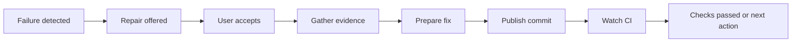

# Make Eli repairs discoverable, useful and measurable

Reviewed 11 October 2026 against checkout `1a1f9d01`. This is a product and code
review, with an implementation proposal. The implementation record below describes
the subsequent workspace changes; these have not been deployed. The supplied
screenshot is evidence of displayed outcomes, not a source of instructions.
Production logs, the deployed version and the model requests for those attempts
were not available. Historical token counts cannot be inferred from the screenshot.

## Product direction

Eli should meet people at a failed PR, explain what it can do and offer to do it.
The main experience should be: **failed check, offer, repair, verified outcome**.
Configuration supports that journey; it should not be the place people must go
to discover, initiate and follow every repair.

Default new setup to **Ask me first**. Offer **Manual only**, **Ask me first**,
**Automatic**, and **Off** as explicit repository modes. Preserve existing policy
behaviour on upgrade. An offer must not call a paid model or publish a commit.

## What the code establishes

| Finding | Evidence | User impact |
| --- | --- | --- |
| Setup and repair history are below provider configuration | `web/src/lib/settings/AssistantPanel.svelte:226` renders `EliRepairs` | Repairs feel like an advanced setting rather than a working feature |
| Repository text is entered separately for a request, policy and account verification | `web/src/lib/settings/EliRepairs.svelte` | Repetition, spelling errors and unnecessary knowledge of installations |
| Account linking requires an administrator, then personal consent | Same component and `internal/api/handlers_eli_repairs.go` | Several disconnected steps before the first useful action |
| Even a manual-only policy requires an installation provider | `handleSetEliPolicy` validates it regardless of `automatic`; the UI marks the select required | People must configure an unattended payer even when requests use their personal provider |
| Automatic repair exists, but an offer mode does not | `internal/controller/eli_repairs.go:124` returns when `policy.Automatic` is false | The choice is manual discovery or unattended writing |
| Job explanations can open chat, but do not initiate a repair | `web/src/lib/jobs/JobWhy.svelte:185`; conversation UI directs code changes to settings | The context is available at the failure but lost in the repair journey |
| History renders state, raw message and PR link | `EliRepairs.svelte`, Recent repairs | No contextual retry, next action, stage, timestamp display or usage explanation |
| Request errors combine unrelated causes | `handleRequestEliRepair` maps conflicts to provider/access/budget in one message | People cannot tell which prerequisite to fix |

Identity linking is global per Zoomies user, not per repository. The form makes
it look more repetitive because it asks for a repository and installation to
verify the account. Simplify the experience without creating per-repository
identity links.

## Diagnose the screenshot

The messages point to application source limits, not proof that the model ran
out of its context window.

| Message | Code path and interpretation |
| --- | --- |
| `repair source budget exhausted` | `prrepair.Generate` increments source bytes on every requested read, including already-known files, and stops above 128 KiB |
| Source file too large or unsupported text | GitHub blob reads reject files above 32 KiB, non-base64 responses, invalid UTF-8 or NUL bytes; these causes share one error |
| PR source could not be read within repair limits | Older generic wording; the current controller includes the underlying reason |
| Named `web/tests/updates.spec.ts` failure | The current file is 51,298 bytes, exceeding the 32,768-byte ceiling. This supports the size explanation but does not establish its size at the historical PR SHA |

Commit `a15ef98f` (#861) already changed initial source gathering to skip and name
oversized changed files instead of failing the whole snapshot. It also improved
source failure reporting. Historical rows retain their old messages, so their
presence does not establish that the running service is outdated. A requested
oversized file remains fatal; the skip improvement does not make that file editable.

The controller gathers complete changed files before retrieving failure evidence.
GitHub's returned file order therefore decides which files consume the initial
budget, rather than relevance to the failure. No PR diff hunks are included.

The read loop has a separate accounting defect: four distinct 32 KiB files fill
128 KiB; requesting any one again adds another 32 KiB and fails, even though the
unique source is unchanged. Repeated reads also append duplicate content to the
conversation. This is statically established, not attributed to any specific
screenshot attempt without its trace.

## Context and token audit

| Current limit or behaviour | Consequence |
| --- | --- |
| 32 KiB per source and replacement file | Ordinary large tests and modules cannot be repaired |
| 128 KiB cumulative source bytes | Byte budget, not a model-aware token budget; repeated reads count again |
| 256 KiB serialised initial snapshot | Includes inventory and JSON overhead, but excludes the subsequently appended instruction and system prompt; not rechecked against the full transcript each round |
| Six model calls maximum | Each call resends accumulated history; total billed input can substantially exceed the final context size |
| 12,000 requested output tokens per call | Complete replacement files compete with JSON overhead and provider-dependent reasoning/output limits |
| 96 KiB response, eight edited files, 64 KiB combined replacement content | A tiny edit in a large file is charged as the whole replacement |
| Inventory rejected above 10,000 tree entries; changed-file response rejected at 100 entries | Broad PRs and large inventories stop before useful targeted investigation |
| Provider usage events ignored by `repairModel.Answer` | No per-step or per-attempt actual token accounting |
| Provider stream errors replaced with a generic message | Output exhaustion, rate limits and other provider errors lose actionable distinctions |

Using four bytes per token only as an illustration, 128 KiB is about 32,768
tokens of source. Resending that base across six calls is about 196,608 input
tokens before other context. Tokenisation, JSON escaping, caching and provider
billing vary; these are not measured usage or a cost estimate. The theoretical
requested output allowance is 72,000 tokens across six calls, not observed usage.

`ContextJobErrors` also reads only the first 8 MiB of a log and extracts
`##[error]` lines plus one preceding line. Unannotated stack traces can disappear;
late failures in a longer log can be missed entirely. Automatic repair refuses
empty evidence. Improve evidence collection before spending more model context.

## Proposed user journey

### 1. Start where the failure is

Show a repair offer on the failed job, repository and Eli activity view. Reuse
the existing deterministic explanation to distinguish likely code failures from
runner, credential and infrastructure problems. Where classification is uncertain,
offer investigation without promising a fix. Keep a paste-PR-URL entry point.

Example copy, illustrative rather than a claim about the supplied PR:

> Checks failed on zoomies #853.
> Eli can investigate the failing test and attempt one repair commit.
> **Review repair** · View failed check · Dismiss

The review card shows the PR and branch, failed checks, payer/model, and whether
workflow edits are allowed. Its primary action is **Repair with Eli**, with plain
copy that it pushes one commit to the PR branch and then watches CI. If setup is
incomplete, show **Finish setup** and the exact missing step, retaining the PR.

Do not silently replace personal payment with installation payment. A future
team-funded manual mode needs an explicit policy and visible payer selection.

### 2. Set up once

Guide people through account connection, repository selection, provider choice
and readiness. Reuse existing verified identity information where it proves
ownership. A GitHub OAuth link is a longer-term option; a typed username or a
matching email is not proof. Keep a guided administrator link as the fallback.

List and search repositories accessible through the connected GitHub App,
including pagination. Infer owner and installation from the chosen repository.
Select multiple repositories and apply a shared policy in one operation, with
clear per-repository overrides and per-item errors. Show permission gaps beside
each repository and a direct path to updating the App installation.

Reuse the existing GitHub repository discovery machinery behind AI Context where
appropriate, through a repair-specific permission-checked API. Do not assume AI
Context's tracked list is complete or that its access rights equal repair rights.

Manual and ask-first modes need a usable personal provider at execution time;
automatic mode needs an installation provider. Do not require an installation
provider just to save a manual policy. Show a readiness checklist covering account
consent, repository access, provider, App permissions and event delivery. Display
budget remaining and its reset time when it is relevant.

### 3. Offer help proactively without noise

Persist repair opportunities separately from attempts. Group failed jobs by
repository, PR and pinned head SHA, accumulate evidence as checks finish, and
produce one offer. Dismissal applies to that head. A newer head supersedes the
offer. Revalidate the head, access, consent, policy and budget on acceptance.

Use webhook events with reconciliation for missed deliveries. Surface existing
eligible failures after setup so the user does not have to wait for another CI
failure. Keep opportunities scoped to people allowed to see their repositories.
Discovery should not consume the repair-attempt allowance or invoke a model.
Rate-limit metadata work separately.

Start with persistent in-product offers. GitHub comments and external notifications
are separate opt-ins, not a default broadcast. Preserve suppression of automatic
repairs of Eli's own commits and existing deduplication guarantees.

### 4. Show progress and a useful outcome

Provide an Eli Repairs view with Needs attention, In progress and Completed.
Keep setup reachable there and in settings. Show these stages:

Each attempt should expose its failed check, timestamps, model, payer, head,
commit, source coverage, actual token usage when reported, and next action.
Distinguish Setup needed, Source unavailable, Provider unavailable, No supported
fix, Interrupted, Waiting for CI, Checks failed and Checks passed. Keep technical
details expandable. Never turn absent usage into zero.

Offer retries for transient failures, setup repair for permission/provider issues,
and an exportable investigation handoff for unsupported edits. A retry must say
what changed when the previous failure was a deterministic limit. Preserve useful
evidence even when no commit can be produced. A successful model reply is not a
successful repair: report success only from checks on the published commit.

## Engineering changes in delivery order

1. **Measure and remove avoidable failures.** Cache reads by pinned head and path;
   account for unique source once and avoid duplicate transcript content. Record
   per-step provider input/output usage, reporting status, model, elapsed time,
   request size, source bytes and failure stage/code. Preserve safe provider error
   categories, including output exhaustion. Save partial usage on failed attempts;
   record unknown where the provider never reported it. Expose this via the repair
   API and UI. Collect useful failure evidence before selecting source.
2. **Make setup and manual repair usable.** Searchable bulk repository picker,
   inferred installations, PR URL parsing, readiness API, granular actionable
   errors and a contextual repair action on failed jobs. Remove the installation
   payer requirement for manual-only policies with the corresponding schema and
   validation changes. First-class repair history with next actions.
3. **Add ask-first opportunities.** Persist opportunities, group failure events,
   reconcile missed events, expire stale heads and implement accept/dismiss. Use
   existing admission checks again at acceptance. Migrate existing policies without
   changing their effective behaviour; new setup recommends ask-first.
4. **Support real-sized source files efficiently.** Retrieve diff hunks and bounded
   line/symbol windows around failure locations, with on-demand expansion. Replace
   whole-file model output with validated edits against pinned originals. Keep
   originals server-side; verify exact preimages, reject ambiguous/overlapping
   edits, preserve untouched content and modes, and never silently truncate a file
   that will be replaced. Separate maximum blob size from model context size.
   Set request budgets from model capacity with a reserved output allowance and
   conservative fallbacks. Keep scope restrictions and non-force publication.

The fourth item changes the repair contract and needs its own design and tests.
Blindly raising the byte limits would increase spend and still leave whole-file
output failures. The first item provides a smaller immediate reliability gain.

Use existing package boundaries: pure context selection and edit validation in
`internal/prrepair`; GitHub reads in `internal/github`; orchestration in the
controller; persistence in the store; documented API routes and generated clients
for every UI operation. This proposal does not require a new service or framework.

## Acceptance evidence

- A first-time user can select multiple discovered repositories without typing
  an owner or repository name and see exactly what remains before repairs work.
- A manual-only policy can be configured without an installation payer.
- An eligible failed PR produces one persistent offer; multiple failed jobs and
  webhook redeliveries do not produce duplicate offers or consume attempts.
- Accepting a stale offer does not write to a newer PR head. Dismissal, access
  revocation, policy changes and provider changes behave predictably.
- A repeated read at the unique-source limit succeeds without extra source
  accounting or duplicate source in subsequent model messages.
- A small supported edit inside a text fixture larger than 32 KiB can be proposed
  and applied while untouched content is byte-for-byte preserved.
- A late log failure and an unannotated test stack trace remain useful evidence.
- Usage matches synthetic provider reports across multiple steps, including
  partially completed attempts. Missing usage is explicitly unknown.
- Output truncation, source limits, rate limits, permission failures and exhausted
  daily allowances produce distinct messages with appropriate next actions.
- UI verification covers keyboard use, mobile layouts, both themes and returning
  from setup to the original failed PR.

Measure setup completion, time to first accepted offer, offer acceptance, repairs
whose checks pass, failure reasons, tokens per attempt and tokens per verified
repair. Record baselines before claiming improvements. Avoid treating the number
of commits pushed as the success metric.

## Verification and limits of this review

Read the setup UI, API validation, webhook admission, repair worker, source
retrieval, plan validation, provider usage contract, persistence and relevant
tests. Confirmed the current size of the file named in the screenshot. No live
provider calls or production writes were made.

Attempted `go test ./internal/prrepair ./internal/github`, but this environment's
`/usr/bin/go` is not a working Go toolchain and returns `Go: Unknown option: test`.
No Go test results are claimed. The checkout's source explains the mechanisms;
production attempt traces and deployed-version information are still needed to
attribute each historical failure and establish actual token spend.

## Implementation record

Implemented in the workspace on 11 October 2026:

- A dedicated `/repairs` page, navigation entry, contextual failed-job action,
  PR URL parsing, preserved PR target and expandable setup. Repository discovery
  provides search and paging, infers the installation and supports bulk policy
  saves with per-repository results. Manual policies no longer require an
  installation payer. Existing modes survive migration unchanged.
- Persistent ask-first opportunities, webhook deduplication, personal dismissals,
  access filtering, bounded reconciliation and acceptance pinned to the offered
  head. Acceptance shares a durable deduplication key across requesters. Offers
  appear on the Overview and Repairs page without model work or attempt charges.
- Unique-source accounting, cached and overlapping reads, bounded line windows,
  failure-location prioritisation, bounded PR diffs and exact validated edits
  inside blobs up to 512 KiB. Unread content is preserved and partial-file full
  replacements are refused. Repository inventory cannot consume the whole input
  allowance. Logs retain bounded tails and unannotated failure context.
- Per-step provider usage, elapsed time, request bytes, source bytes, model and
  failure stage persist with each attempt. Unknown usage remains unknown. Provider
  output settings are honoured; output exhaustion, rate limiting, refused keys
  and input-context failures receive actionable categories. History supports
  filtering, readiness-based retry and copyable investigation details.
- Documented REST operations, regenerated OpenAPI clients, a backwards-compatible
  database migration and regression tests for the new admission and editing paths.

Verification: full tests passed for prrepair, store, GitHub and model-provider
packages; focused controller and API tests passed, including route authorisation
and schema coverage. Source/store race checks passed. UI type/accessibility
checks, targeted lint, the unit suite and production builds passed. Chromium
verified bulk manual setup against the real controller on desktop/light and
mobile/dark. A signed-in browser also verified URL entry, explicit prerequisites,
return to setup, target preservation, zero attempts from readiness and no mobile
horizontal overflow.

Boundaries: no production deployment or paid model call was made. Provider APIs
in this repository do not expose a uniform, trusted model context-capacity field,
so input sizing currently uses the conservative application byte allowance;
usage is measured from provider reports, not inferred from bytes. Discovery still
has the shared 500-repository ceiling and reconciliation is bounded to recent
jobs. Identity linking retains administrator verification and personal consent;
OAuth self-linking remains the longer-term option described above. No claim of
improved real-model repair success or token cost is made without production data.
