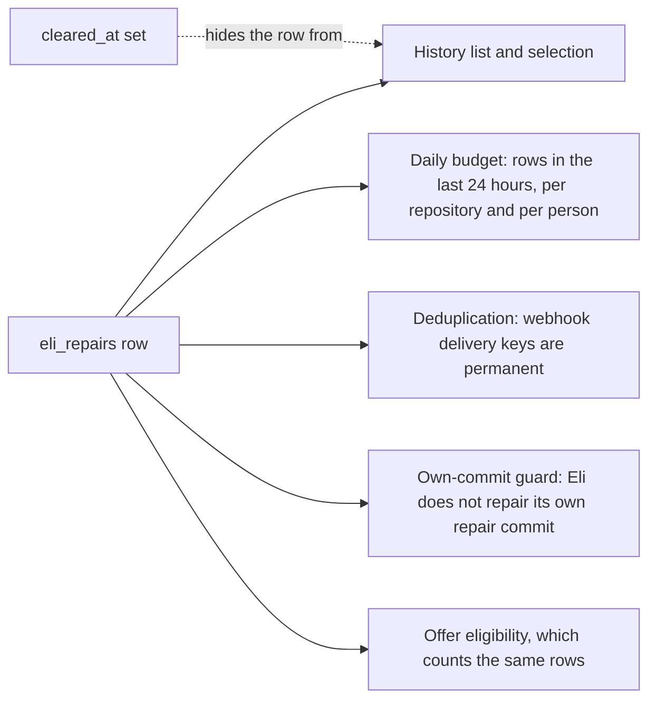

# Page, filter and clear Eli's repair history

Draft for review, 12 October 2026, written against checkout `e104846`. Nothing
here is built yet. The design below was agreed in conversation: the owner chose
**Clear from history** over a hard delete, approved server-side paging and
filters, a frozen select-all snapshot and a bulk clear, and asked for this spec
before any plan or code.

## What was asked

**Recent repairs** (the card on the Eli repairs page and on Settings, Eli AI
Assistant, which are one component) needs paging, filtering and a bulk delete
with a select-all.

## What the code does today

| Fact | Where | Consequence |
| --- | --- | --- |
| History is one unpaged call, newest 100 rows | `listEliRepairs` in `internal/store/queries_eli_repairs.go` (`LIMIT 100`) | Anything older is unreachable, and there is no total |
| The four-way "Show" filter runs in the browser over those 100 rows | `visibleRepairs` in `web/src/lib/settings/EliRepairs.svelte` | A filter cannot find a repair outside the newest 100 |
| The same three state lists are written out in three places | Same component | A new state has to be added in each |
| No route removes a repair | `internal/api/router.go` | Nothing to build a delete on |
| Visibility is decided in the handler: administrators see every row, everyone else their own rows | `handleEliRepairs` | Scoping for a bulk action must match it exactly |

## Why clearing is not deleting

A repair row is history, and it is also the ledger several safety rules read.
Removing one would weaken all of them, and the person pressing "delete all"
would not know.

| Reader | Where | If the row were deleted |
| --- | --- | --- |
| Daily budget | `EnqueueEliRepair` (`internal/store/queries_eli_repairs.go`) | The limit resets, so clearing becomes a way round the spend cap |
| Deduplication | `dedup_key` unique constraint, same function | A redelivered webhook runs a second repair |
| Own-commit guard | `IsEliRepairCommit`, used at `internal/controller/eli_repairs.go:135` and `internal/controller/eli_experience.go:232` | An automatic repair loop becomes possible |
| Offer eligibility | `internal/store/queries_eli_opportunities.go:57` | Offers ignore attempts already spent |

So **clearing hides a row from the history and nothing else.** A row gains a
`cleared_at` timestamp; every reader above keeps seeing it. The button says
"Clear from history", not "Delete", because the row is kept and the dialog says
what that means.

## Design

### Data

Migration `0100_eli_repair_cleared.sql` adds a nullable `cleared_at INTEGER`
(epoch milliseconds, like the table's other timestamps) to `eli_repairs`. It is
not added to `eliRepairCols`: the column is read only by the history queries and
written only by the clear, so the insert and the scan stay as they are. No index
yet; the guards already scan this table by repository and time without one, and
that is the point to revisit if it grows.

### Store (`internal/store`)

* `ListEliRepairsPage(ctx, EliRepairFilter)` replaces `ListEliRepairs` and
  `ListEliRepairsForOwner`. The filter carries the owner scope (all, or one
  person), a state group, a repository substring, a trigger, a limit and an
  offset. It returns the page and the total of matching, uncleared rows. Order is
  newest first with the id as tie-break, so paging is stable.
* The state groups are defined once, in the store: **active** is `queued`,
  `working` and `checking`; **passed** is `succeeded`; **attention** is every
  other state (`checks_failed`, `interrupted`, `unverified`, `superseded`,
  `blocked`, `failed`). The Svelte component stops repeating them.
* The repository filter is a case-insensitive substring with `%`, `_` and `\`
  escaped. Trigger is `automatic` or `requested`; the stored `mention` value is
  what `requested` means.
* `EliRepairIDs(ctx, EliRepairFilter, cap)` returns the ids a select-all would
  take: matching, uncleared and **clearable** (not active), plus the total.
* `ClearEliRepairs(ctx, ids, scope)` runs in the single writer transaction and
  answers per unique id, in the order asked:
  * an id that does not exist, or that the caller may not see, is `not found`
    (the same answer for both, so ids cannot be probed);
  * an active row is `still running`;
  * an already cleared row is `ok`, so a repeat is harmless;
  * anything else is cleared.
* **No guard changes.** The budget count, the dedup lookup, `IsEliRepairCommit`,
  the offer query, `NextEliRepair` and `CheckingEliRepairs` never read
  `cleared_at`.
* One deliberate reader of it: when `EnqueueEliRepair` answers a new request or
  offer with an *existing* row (the in-flight and "already succeeded" cases), it
  clears that row's `cleared_at`, so the person sees the outcome of what they
  just asked for instead of an empty list. A retry of a failed `ui:` request
  already inserts a new row and needs nothing.

### API (`api/openapi.yaml`, `internal/api`)

| Route | Change | Role |
| --- | --- | --- |
| `GET /assistant/repairs` | Gains `group` (`attention`, `active`, `passed`), `repo`, `trigger` (`automatic`, `requested`), `limit` and `offset` (the house `Limit` and `Offset` parameters). Returns `{items, total}`. An unknown `group` or `trigger` is a 422 with a field error, because a filter that silently widens would show the wrong history. | viewer, as now |
| `GET /assistant/repairs/selection` | New. The same filters, no paging. Returns `{ids, total, truncated}`: the clearable matches, at most 500, frozen at the moment of the call so rows arriving later are not swept in. Past 500 the page says so. | viewer |
| `POST /assistant/repairs/bulk` | New. `{action: clear, ids}` with 1 to 500 ids and one action for now. Returns `{results: [{id, ok, error?}]}` like `/machines/bulk`. | viewer |

Scoping for all three is the existing rule: administrators reach every row,
everyone else only rows whose `user_id` is theirs and not empty. A clear is
written to the audit log as `assistant.repair_clear` with the count and the ids,
never the repair's text.

The default page is 50, the house default, where the call used to return up to
100. Only the UI calls it today. `EliRepairList` gains a required `total`.

Everything that has to move together: `api/openapi.yaml`, the regenerated
`internal/api/openapi_spec.go` and `web/src/lib/api/schema.d.ts`,
`web/src/lib/api/client.ts`, `docs/api-surface.md`, `router.go`, and the
route and role table in `internal/api/api_test.go`.

### UI

Recent repairs moves out of the 650-line `EliRepairs.svelte` into
`web/src/lib/repairs/RepairHistory.svelte`. The parent keeps the cards and the
setup, passes down a callback for "Review another attempt", and its `reload()`
(the page header's Refresh) calls the history's own.

* **Filters:** the state group (the four labels used today), a repository search
  (debounced), and trigger (any, automatic, requested). A change resets the
  page and the selection.
* **Paging:** the existing `Pagination` component, with its page sizes taken from
  the preferences the other lists use. After a clear that empties the page, step
  back one.
* **Selection:** a checkbox per row and a header checkbox for the rows shown
  (indeterminate when some are chosen). Once every shown row is chosen and more
  match, **Select all N matching** reads the selection endpoint and chooses those
  ids; past 500 it says "500 of N selected". One set of chosen ids serves both,
  and it survives the 10-second poll and moving between pages.
* **In-flight rows** have a disabled checkbox with a title saying why.
* **Clearing:** a bar above the list says how many are chosen and offers **Clear
  from history** and **Clear selection**. The confirmation says what the button
  does: the rows stop showing here, still count towards the daily limit, and Eli
  will not repair its own commits again. The outcome is reported as the Queue
  page does: how many were cleared and, in a disclosure, which were skipped and
  why.
* **Empty states:** "No repairs match these filters", with **Clear filters**,
  is separate from "No repairs yet".
* House rules: `Pagination`, `Checkbox` and `ConfirmDialog` as they are, tokens
  only, no new library, labels on every control, an `aria-live` selection bar,
  and a layout that wraps on a phone without sideways scrolling.

## Tests

**Go**

* Store: the filters and the total; paging is stable across pages and with equal
  timestamps; owner scoping; `%` and `_` in a search are literal; the clear rules
  (`not found` for someone else's id, `still running`, idempotent repeat); and
  one test per guard proving it still counts a cleared row (budget, dedup,
  `IsEliRepairCommit`, offers). A request that dedups onto a cleared row brings it
  back.
* API: the three routes in the role table, an owner cannot clear another
  person's row, a 422 for a bad `group`, `trigger`, action or an empty or
  oversized id list, per-id results in the order asked, and the audit row.
* The demo seed (`internal/controller/seed.go`) gains about sixty finished
  repairs spread over states, repositories, triggers and dates, so the pages and
  the browser tests have rows. They are finished only: a queued or checking row
  would be picked up by the repair worker in a controller that has no GitHub
  behind it. `seed_test.go` and `seed_demo_isolation_test.go` keep their
  promises.

**Playwright** (`web/tests/repairs.spec.ts`, desktop and mobile)

* Filtering and paging reach rows beyond the first hundred, and the count is the
  server's.
* Select the rows shown, then select all matching; clear; the list, the total and
  the page update, and the dialog's wording is the true one.
* A selection survives the poll and a page change; a filter change drops it.
* An in-flight row has a disabled checkbox. The seed has none, so this test
  injects one into the list response; the rule itself is held by the Go tests.

**Unit** (`web/unit`): the state group and trigger mapping, and the selection
helper if one is split out.

**Docs:** `docs/eli.md` (a short paragraph on the history and on what Clear does
and does not do) and `docs/api-surface.md` (the changed row and the two new
ones). Prose follows the repository voice: British spelling, no em dashes.

## Delivery

Commits on `claude/brave-ramanujan-jkd9iw`, one draft pull request. The first
(already made) is the Eli message-size handling, which touches different files.
The second is this spec. The third is the change itself, built test first: the Go
store and API tests, then the migration and handlers, then the component and its
browser tests.

## Out of scope

* Restoring a cleared row.
* Hard deletion and retention. Rows are kept for good, as they are now.
* Sorting, and searching by pull request number.
* Exposing the history through the MCP server or the CLI.

## Points for the reviewer

1. **A new request surfaces a cleared row.** Chosen so the outcome of what a
   person just asked for is never hidden by an earlier clear. The alternative,
   leaving it hidden, is simpler and worse.
2. **The selection cap is 500**, the bulk limit, and the page says when it bites.
   The Queue page's 5,000 is for a table that grows much faster.
3. **The default page of 50** replaces an unpaged 100.
