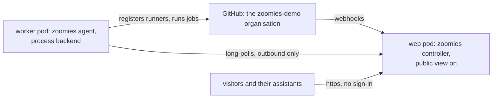

# A live public demo, and the public view it needs: design

**Status:** approved approach; the public view is built on this branch, and the demo is hosted on InstaPods.
**Date:** 12 October 2026.

## Goal

The landing page's "Try the demo" button takes a person to a real fleet they
can look around without installing anything, signing in or owning a GitHub
App. The fleet is live: jobs queue, runners start, logs stream and runners are
destroyed while the visitor watches. Nothing a visitor does can change the
fleet, read anything about the people who run it, or cost anyone money.

Today the button leads to the quickstart's "Just looking?" section, which asks
for a terminal and a download and then shows a fixture fleet that never moves.
That demo stays, because it is the one that needs no network and shows Eli, but
it is no longer the first thing a visitor is asked to do.

### Success criteria

1. A visitor opening `https://demo.zoomies.sh` lands on the Overview of a live
   fleet with no sign-in form, sees a line saying this is a read-only public
   view, and can open any pool, runner, job, host or log.
2. Every change the API offers answers a visitor with 403 and a sentence saying
   the public view is read-only, whether it is asked for through the UI, the
   REST API or MCP.
3. A visitor never reads the audit log, accounts, tokens, settings, sessions,
   MCP connections, AI context or any assistant conversation, through any of
   those three, including the live event stream.
4. Anyone can connect their own assistant to `https://demo.zoomies.sh/mcp` with
   no credential and ask about the fleet with the read-only tools.
5. Whoever runs the demo signs in as usual and gets their own role back.
6. The setting is off by default, and a controller with it on says so in its
   problems list, as every setting that weakens the default posture does.

## Decisions

Taken with the owner on 12 October 2026, one question at a time.

| Question | Decision |
| --- | --- |
| What the demo is | **A live fleet**, not the fixture hosted. Visitors watch real jobs. |
| How visitors get in | **No sign-in.** A new public view: an anonymous request is a visitor. |
| What it runs | **A public demo organisation's scheduled workflows**, not this repository's CI, so a stranger's pull request never runs on it. |
| Where it lives | **InstaPods, two pods** (revised the same day from one VM). A web pod runs the controller with the public view; a worker pod with no public address runs `zoomies agent` on the process backend, because pods offer no Docker. Jobs never share a pod with the database or the GitHub App key. |
| How a pod gets Zoomies | **A published release, downloaded and checked against its checksums** by the pod's build command, not compiled there: the Go preset has neither Go 1.27 nor Node for the UI. `dev` until the public view ships in a release. |
| Eli and MCP | **MCP read-only for anyone. Eli stays out of the public view.** Chatting is an administrator's action and spends a model provider's money; the local demo's fixture provider remains the way to try Eli without a key. |
| What this branch does | **The design, then the public view in the product, with its docs.** The VM, the organisation and DNS are the owner's, from the runbook below. |

## Design

### 1. The setting

`security.public_view`, a boolean, off by default, `ZOOMIES_PUBLIC_VIEW` as its
override, platform scope, applied at restart for the reason
`security.disable_auth` is (the authentication service takes its security
settings when it is built).

With it on, the configuration validator raises `auth.public_view`, a
**warning**: *anyone who can reach this controller reads its fleet without
signing in: pools, hosts, runners, jobs, usage and runner logs. Writes, people
and settings stay behind sign-in.* The fix is *turn security.public_view off
unless this controller is meant to be public*. With `security.disable_auth` on
as well the finding is not raised: every request is already an administrator,
and `auth.disabled` says so.

### 2. The visitor

`auth.Authenticate` resolves a request with no credential at all to a visitor
when the setting is on, instead of `ErrNoCredentials`:

- `Kind` is a new `KindPublic` (`"public"`), `ID` `"public"`, `Name`
  `"public visitor"`, `Role` viewer.
- `Scopes` is a fixed list, `auth.VisitorScopes`. The role alone is too wide:
  a viewer reads the audit log (usernames and client addresses), their own
  tokens and assistant conversations, and the AI context's source files. A
  visitor carries exactly these, each a read:

  `pools:read`, `runners:read`, `jobs:read`, `usage:read`, `hosts:read`,
  `providers:read`, `machines:read`, `installations:read`, `webhooks:read`,
  `updates:read`, `kennel:read`, `events:read`, `logs:read`, `stats:read`.

  `Allowed` already treats scopes as a ceiling below the role, so every route's
  existing `require` refuses the rest with no new check. A test holds the list
  to the rule that every entry is a viewer's action and a read.

What stays strict:

- **A bearer token that does not check out is still 401.** Automation with a
  revoked token must hear that, not quietly become a visitor.
- **A session cookie that does not check out falls back to a visitor**, and the
  response clears the cookie. A visitor whose session lapsed is a visitor; a
  401 there would strand them on a sign-in form with a cookie they cannot
  remove, since sign-out is itself behind authentication.
- **A credential the controller could not check** (`ErrAuthBackend`) is a 500
  as today, never a visitor.

`auth.Explain` words a visitor's refusal for them: *this is a read-only public
view; sign in to do this*. Nothing else in the 403 changes.

### 3. The account routes

The `/auth/*` routes behind authentication carry no action, because each is the
caller's own: sign out, preferences, password, two-step, MCP consent and
connections. A visitor has none of those, and signing out writes an audit row,
so an anonymous loop could fill the audit log. A middleware on that group lets
a visitor reach `GET /auth/session` and nothing else; every other route answers
403 with the visitor's sentence.

### 4. The event stream

The stream sends every frame to anyone holding `events.read` and narrows a few
kinds by role. That was already too wide for a token scoped to `events:read`
alone, which received audit rows, and it is far too wide for a visitor.

Each frame is now sent only to a caller who could read it with `GET`: a table
maps every bus kind to the read action that covers it (`runner.*` to
`runners.read`, `audit` to `audit.read`, `problems.updated` and `stats` to
`stats.read`, and so on), resolved per frame like the existing filters. A kind
missing from the table is dropped, and a test walks every kind the bus defines
so a new one cannot ship unmapped.

### 5. MCP

`/mcp` authenticates through `auth.Authenticate`, so with the setting on an
anonymous MCP client is a visitor. The tools that change the fleet are already
offered only to a caller `auth.Allowed` lets use them, so a visitor is offered
none. The read tools are offered to everyone by design, and the API refuses
what a credential cannot read: a visitor calling an AI context tool is told the
public view does not show it. A person who wants more
connects with an API token in the `Authorization` header; MCP OAuth is not
offered to an anonymous client on a public view, because an unauthenticated
request is answered rather than challenged.

### 6. The UI

- `GET /meta` carries `public_view`.
- The session store learns `visitor` (an identity of kind `public`). Its `can`
  answers false for every role above viewer, as a viewer's does.
- A visitor sees a slim line under the top bar: *You are looking at a public,
  read-only view of this fleet.* with a **Sign in** link, which opens the sign-in
  form; the form gains **Continue without signing in** when `public_view` is on.
- The user menu says *Visitor* and offers **Sign in** in place of sign-out.
- Audit, Settings, Eli repairs and Migrate are left out of the navigation, the
  command palette and the `g` shortcuts for a visitor, and the Eli widget is
  not shown: each would only answer 403.

### 7. The landing page

The button keeps pointing at the local demo until `demo.zoomies.sh` answers,
because a button that leads nowhere is worse than one that asks for a terminal.
Once the instance is up, the runbook's last step changes `docs/index.md` so
**Try the demo** opens `https://demo.zoomies.sh` and the local command moves
below it as *or run the demo on your own machine*.

## The demo deployment (runbook, the owner's)

`docs/instapods.md` is the general guide to running Zoomies on InstaPods, and
`deploy/instapods/` holds the build and start scripts both pods run. The demo
is that guide with these choices:

1. **Organisation.** Create `zoomies-demo` on GitHub with three or four public
   repositories, each with a workflow on `schedule` (every ten minutes, offset
   per repository) and `workflow_dispatch` only: a short build, a matrix of a
   few jobs, one longer job, and one that fails on purpose now and then so the
   failure views have something in them. **No secrets**: a visitor reads every
   log. Set the organisation's Actions policy to require approval for every
   outside contributor, because the runners are processes in a pod rather than
   throwaway containers. `runs-on` names the demo pool's labels.
2. **Keep the schedules alive.** GitHub disables a scheduled workflow after
   sixty days without repository activity. A monthly workflow in one repository
   commits a timestamp to each, or the owner re-enables them from the API.
3. **The web pod.** A Go-preset pod on the Build plan, connected to
   `github.com/eyupio/zoomies` with auto-deploy off, using the guide's install,
   build and start commands for the controller. Set `ZOOMIES_EXTERNAL_URL` to
   the pod's address (or `https://demo.zoomies.sh` once the custom domain is
   attached), `ZOOMIES_ENCRYPTION_KEY`, `ZOOMIES_VERSION=dev` and
   `ZOOMIES_PUBLIC_VIEW=true`. Create the first account, connect the GitHub App
   for the organisation, and create one pool for the process backend.
4. **The worker pod.** A second Go-preset pod, converted to a worker so it has
   no public address, using the guide's commands for the agent, with
   `ZOOMIES_CONTROLLER_URL` and a join token from **Hosts, Add a host**. Size it
   for the jobs: Grow (2 vCPU, 4 GB) runs two at a time comfortably.
5. **Name and limits.** Attach `demo.zoomies.sh` to the web pod. Each visitor
   holds an event stream open, under `limits.visitor_event_subscribers` (200 by
   default), a ceiling of their own that never takes the streams the people
   running the demo need; raise it to what the plan carries and watch it.
6. **Check it.** The problems list carries `auth.public_view` and nothing worse;
   a private window lands on the Overview with the read-only line; an assistant
   pointed at `/mcp` with no credential lists pools.
7. **Flip the button.** Change **Try the demo** in `docs/index.md` as section 7
   says.

## Tests

- `internal/auth`: an anonymous caller is a visitor with the setting on and is
  refused with it off; a bad bearer token is 401 either way; a lapsed session
  is a visitor with it on and 401 with it off; every visitor scope is a
  viewer's read; a visitor is refused the audit log, tokens and assistant
  actions; the visitor's refusal sentence.
- `internal/config`: `auth.public_view` is a warning when the setting is on and
  absent with `security.disable_auth`; the settings registry row.
- `internal/api`: a visitor reads every route its scopes name and is refused
  every write; the account routes refuse a visitor but `GET /auth/session`; a
  visitor signing out writes no audit row; the lapsed cookie is cleared; `/meta`
  says `public_view`; a stream sends an audit frame only to a caller who may read
  the audit log; every bus kind has a read action.
- `web/unit`: the navigation a visitor sees.

## Docs and generated files

`docs/public-view.md` (what it is for, what a visitor sees and cannot, MCP),
`docs/security.md`, `docs/configuration.md`, `docs/problem-codes.md` and the
catalogue it generates, `docs/api-surface.md`, `docs/mcp.md`, `api/openapi.yaml`
with `openapi_spec.go` and `schema.d.ts` regenerated, and `mkdocs.yml`.

## Risks and how each is bounded

- **A scope list that drifts from the role table.** Bounded by the test that
  every visitor scope is a viewer's read, and by `Allowed` refusing anything
  not listed: a new read action is hidden from visitors until somebody adds it.
- **A route with no action that writes.** The account group is the only such
  group behind authentication; it is closed to visitors as a whole.
- **Load from strangers.** Visitors' event streams have a ceiling of their own,
  `limits.visitor_event_subscribers`, and are not counted against
  `limits.event_subscribers`, so a crowd cannot lock out the people running
  the demo; the runbook puts a rate limit in front as well. Watching a running
  job's log asks the agent for a stream, so the demo pool stays small.
- **A demo workflow that prints a secret.** The organisation holds none.
- **Jobs that are processes, not containers.** Pods offer no Docker, so a job
  runs as the worker pod's user and a later job can see what an earlier one
  left outside its work directory. Bounded by running only the organisation's
  own scheduled workflows, requiring approval for outside contributors, and
  keeping the worker pod free of anything but the agent's own token.

## Not included

- An animated fixture fleet. The live fleet is the demo; the local demo stays a
  still life.
- Eli in the public view, and any model spend on visitors.
- A per-address rate limit inside the controller. It belongs in front of it.
