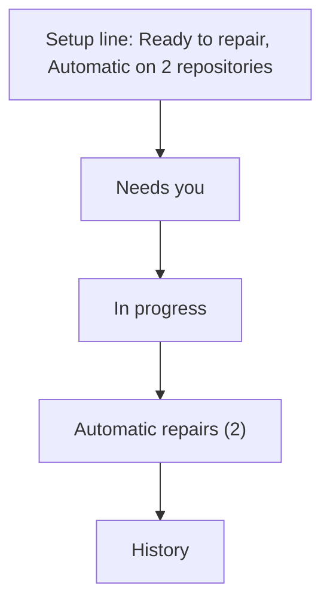

# Let an operator see what automatic repairs are doing, and stop them

Agreed in conversation on 18 October 2026, written against checkout `607c68a`.
The owner's words were: "Don't forget auto repairs if enabled. User needs
visibility and controls." The repair pages in
[2026-10-18-eli-repair-workspace.md](2026-10-18-eli-repair-workspace.md) are built
and merged (#1156), and that document never mentions automatic repairs. This one
closes the gap, and all of it is built, in the pull request that carries this
document. The implementation plan is
[2026-10-18-eli-automatic-repairs-plan.md](2026-10-18-eli-automatic-repairs-plan.md),
which says where the build departed from it.

## What was asked

A repository set to **Automatic** has Eli repair its failed pull request checks
with nobody asking: no button, no offer, a commit on the pull request's branch and
tokens spent on the installation's provider. Whoever switched that on should be
able to see that it is on, where, what it has done and what it may still spend,
and to stop it. Where nothing is automatic, the pages should say nothing about it.

## What the code does today

| Fact | Where | Consequence |
| --- | --- | --- |
| An Automatic policy admits a failed `workflow_job` delivery, queues a repair keyed `automatic:<repo>:<head>` and the worker pushes one commit | `enqueueRepairWebhook`, `runEliRepair` in `internal/controller/eli_repairs.go` | An operator who switched it on has no page that says it is on, where, or who pays |
| The hub counts only repositories that ask first | `web/src/lib/repairs/SetupBar.svelte`, `hub.ts` | A repository on Automatic is counted nowhere on the hub |
| A repository's allowance (1 to 50 attempts in 24 hours) is shared by requests and automatic repairs, cleared repairs included. When it is spent an automatic repair is not queued, and the only trace is the log line "Eli repair budget reached" | `EnqueueEliRepair`, `enqueueRepairWebhook` | Failures stay unrepaired and nothing in the product says why |
| If the installation provider is deleted or disabled, each queued automatic repair fails when the worker reaches it | `runEliRepair` | Nothing says in advance that Automatic can no longer work |
| Automatic repairs have no owner, so only administrators can read them | `GetEliRepair`, the history scope | Visibility belongs to administrators, and so does the control (`PUT /assistant/repairs/policy` is an administrator route) |
| The only way to stop Automatic is to save the repository's whole policy again in setup, and that save is refused while the policy's provider is missing or disabled | `handleSetEliPolicy` | Stopping is the moment a person is least able to fill in a form |
| The attempt page says "Started automatically" and nothing about why, which policy, or how to stop it | `web/src/lib/repairs/attempt.ts` | |
| The repair page offers **Fix with Eli** on a failure the repository would have repaired itself, without saying so | `DecisionCard.svelte` | A person can spend an attempt repeating one Eli already made, or wait for one that will never start |
| An automatic repair starts only from GitHub's report of the failed job. Nothing reconciles it afterwards, as the five-minute look-back does for offers | `reconcileEliOpportunities` | A failure from before Automatic was switched on, or one whose webhook never arrived, is never repaired on its own |

## Design

### Four rules

1. **A repository that is not automatic adds nothing.** No panel, no empty state,
   no hint, on any page, for anyone. The owner's "if enabled".
2. **Stopping is one deliberate step and always works. Starting is a decision made
   in setup.** The hub stops automation and never turns it on.
3. **Every page that can start or follow a repair says whether the repository is
   automatic**, so nobody repeats an attempt Eli already made or waits for one it
   will not start.
4. **Administrators see and stop. Everyone else sees one sentence.** Automatic
   repairs have no owner and an ordinary user cannot read them, so the pages do not
   claim what an ordinary user cannot check.

| Who | Sees |
| --- | --- |
| Administrator | The panel on the hub, the card on an automatic repair, the full note on the repair page, the stop controls |
| Anyone else who can use Eli repairs | On the repair page of an automatic repository: one sentence saying so. Nothing else |

### The hub: Automatic repairs

A panel on `/repairs` for administrators when at least one enabled policy is
Automatic. Between **In progress** and **History**, so the page still opens on
what needs the person.

Title **Automatic repairs**, description "Eli repairs failed pull request checks
on these repositories without asking. It pushes one commit and never merges."
The header action is **Stop all** when there are two or more, and **Setup**. One
row per repository, repositories with a problem first and then by name:

* the repository name, and under it who pays ("Paid by Team provider, model-name")
  and whether workflow file edits are allowed;
* **health**: "Ready", or the problem in a sentence with the way to fix it
  ("The provider is disabled. Choose another in setup." linking to
  `/repairs/setup?repo=`). The problem is that the installation provider is
  missing (deleting a provider leaves its policies with none), disabled, or not
  an installation provider at all. A removed GitHub installation cannot appear:
  its policies are deleted with it;
* **allowance**: "3 of 5 attempts used in the last 24 hours" with a bar. Requests
  and automatic repairs share it, and the row says so in its tooltip. When it is
  spent: "All 5 attempts used. Automatic repairs here wait until 14:05." (the
  moment the oldest attempt leaves the window), in the warning tone;
* **last**: the outcome badge of the most recent automatic repair that is still in
  the history, its pull request and how long ago, linking to its page, or "None
  yet"; and "1 running now" when one is queued, working or checking;
* **Stop automatic repairs**, which opens the dialog below.

On a phone each row stacks: name and health, allowance, last, button. The panel
reads on the hub's ten-second timer with the rest of the page, and a failed read
keeps the last answer and says so in one line.

### Stopping

One dialog, used for a repository and for all of them. It names what will stop,
then asks what should happen instead:

* **Ask me first** (chosen): "When checks fail, Eli offers a repair under Needs you
  and waits for you."
* **Turn repairs off**: "Eli neither offers nor starts a repair here, and nobody
  can request one, until it is turned on again in setup."

and says what happens to work in flight: "A repair that has not pushed yet stops
without changing the branch. One that has pushed carries on watching its checks."
The button is **Stop automatic repairs**. Afterwards a toast says what the
repository does now, and the panel drops it.

Turning repairs off clears only the policy's enable switch. The mode, provider,
allowance and workflow setting stay, so switching it back on in setup resumes
Automatic as it was. Choosing Ask me first keeps them too. Neither needs the
provider to be working, which is the point: it is the route for the day the
provider is the problem.

The stop never turns anything on. There is no **Resume** on the hub.

### The attempt page

For an automatic repair:

* the facts gain **Started by** "Automatic repairs, by the repository's policy";
* an administrator gets a card, **Automatic repairs on acme/widgets**, saying
  where the policy stands now: still automatic (allowance used, who pays,
  **Stop automatic repairs**), or no longer ("This repository asks first now",
  "Repairs are off for this repository", "Automatic repairs are no longer set for
  this repository"), with the link to its policy in setup. If the status cannot be
  read the card says so and the rest of the page is unaffected.

### The repair page

Readiness says which mode the repository is in (`policy_mode`). When it is
automatic, a note sits above the decision:

* **Administrator, Eli has already tried this failure on its own**: "Eli already
  tried this on its own: [outcome]. [View the attempt]. It does not try the same
  commit twice by itself, so starting again here is the retry." The match is the
  pull request and the commit the page is about;
* **Administrator, nothing started**: "No automatic repair has started for this
  failure. Eli starts from GitHub's report of a failed job, so a failure from
  before Automatic was switched on, or one whose report did not arrive, is not
  picked up. A spent allowance also holds it back. You can start one yourself
  below." When the allowance check is the blocked one, the note says that is the
  reason;
* **Anyone else**: "This repository repairs failed checks automatically. An
  administrator can see what Eli has done."

A repair that is running opens its own page, as before, so the note never has to
describe one.

### The setup line

Gains "Automatic on 2 repositories" next to "Ask me first on 1 repository", for
administrators, when the number is above zero. It is the count of enabled
policies set to Automatic.

## Data and API

All additive. No migration: both new reads are queries over `eli_repairs` and
`eli_repair_policies`.

### `GET /assistant/repairs/automatic`

Administrator (`assistant.read`). One entry per enabled Automatic policy:

| Field | Meaning |
| --- | --- |
| `repo`, `installation_id`, `provider_id` | The policy |
| `provider_name`, `model` | The installation provider, empty when it is gone |
| `problem` | Present only when automatic repairs here cannot run, in a sentence |
| `allow_workflows`, `daily_limit` | The policy |
| `used` | Attempts on this repository in the last 24 hours, by anyone, cleared ones included: the number `EnqueueEliRepair` compares to the limit |
| `next_free_at` | When the oldest attempt in the window leaves it. Present when `used` is above zero |
| `running` | Automatic repairs queued, working or checking |
| `last` | `{id, state, pull_number, updated_at}` of the newest automatic repair not cleared from the history |

### `POST /assistant/repairs/automatic/stop`

Administrator (`assistant.write`). Body `{repos: [..1 to 50..], then: "ask_first" | "off"}`.
Answers 200 with `{results: [{repo, changed, error?}]}`:

* a repository that is Automatic and enabled is changed (`then` `ask_first` sets
  Automatic off and Ask me first on; `off` clears the enable switch) and
  `changed` is true;
* a repository that is not automatic any more is `changed: false` with no error,
  so a second press, or a second administrator, is not an error;
* a repository with no policy is `changed: false` with an `error` saying so.

An empty list, more than fifty, or any other `then` is 422. One audit row
`assistant.repair_automatic_stop` is written per repository changed, with the
actor and `then`. The route validates nothing about the provider, because it only
relaxes a policy.

### Readiness says the mode

`policy_mode` on the readiness answer: `automatic`, `ask_first` or `manual`, absent
until readiness has reached the policy check.

## Security and privacy

* Both new routes are administrator routes. A viewer or operator is refused by the
  role gate, as for every other administrator route, and the route-authorisation
  table covers them.
* The overview holds provider names, model names and counts. It holds no key, no
  log text, no pull request title.
* The stop route can only relax a policy. It cannot enable a repository, change a
  provider or raise a limit.
* The ordinary user's sentence on the repair page comes from `policy_mode`, which
  readiness already computes for them, and tells them nothing about attempts they
  cannot read.

## Tests

* Store: usage counts the window and no more, cleared rows included, per
  repository; activity counts running automatic repairs only and returns the
  newest non-cleared automatic repair per repository.
* Controller: the overview lists enabled Automatic policies only; reports a
  missing, disabled and personal provider as problems and a working one as none;
  `next_free_at` is the oldest attempt plus 24 hours;
  stop changes `ask_first` and `off` as specified, keeps provider, limit and mode,
  succeeds with the provider gone, is idempotent, and reports an unknown
  repository; a queued automatic repair of a stopped repository is blocked when
  the worker reaches it (existing behaviour, pinned); readiness names the mode.
* API: role table rows for both routes; the shape of the overview; the stop
  route's 422s, per-repository results and audit rows; a viewer is refused.
* UI unit: the allowance, last-repair and problem wording, the ordering, the
  setup count, the dialog copy, the note's three states.
* Playwright: the hub panel (absent when nothing is automatic and for an ordinary
  user, present with rows otherwise, a full allowance, a problem, stop one, stop
  all, a refused stop), the setup line, the attempt card, the repair page note in
  its three states; the accessibility and phone audits cover the panel and the
  dialog; the gallery shows every state.

## Delivery

One pull request after the merged one. Docs: `docs/eli.md` (a section on watching
and stopping automatic repairs), `docs/ui.md` (the tour), `docs/api-surface.md`,
the OpenAPI definition and its two generated copies, and one hub screenshot with
the panel in it.

## Out of scope

* A **Resume** button, a pause that remembers, or a schedule. Starting automation
  stays a decision in setup.
* Stopping one repair. Turning the repository off already stops a repair before it
  pushes.
* Overview, Recent failures learning that Eli is repairing a failure. The repair
  page already follows a running repair.
* Changing the allowance, provider or workflow setting from the hub.
* Notifications when a limit is reached.

## Decisions taken, and how to reverse them

| Decision | To reverse |
| --- | --- |
| Stopping is a route of its own and not the policy save, so it works when the provider is the problem, writes its own audit row and is one call for many repositories | The hub sends `PUT /assistant/repairs/policy` for each repository |
| Turn off clears only `enabled`, so setup's switch resumes it | Clear the mode too |
| No Resume on the hub | Add a button that sends the policy save |
| No undo on the stop's toast | A toast action that sends the policy save with the old values |
| The panel sits between In progress and History | Move the element |
| The panel is for administrators because automatic repairs have no owner | Give automatic repairs an owner, which is a migration |

## Risks

* The hub makes one more read every ten seconds for an administrator. It is three
  small queries over a table that holds a repair per failure, and an administrator
  with nothing automatic gets an empty list.
* The allowance shown is the repository's, shared with requests, so a person's own
  limit of ten a day is not in it. The repair page's readiness already shows that.
* A stop that races a repair already publishing cannot take the commit back. The
  dialog says so ("One that has pushed carries on watching its checks").
* A pull request opened from a failure that Zoomies learnt only by polling is
  never repaired automatically. The note says so; making Automatic reconcile as
  Ask me first does is a larger change and not part of this one.
