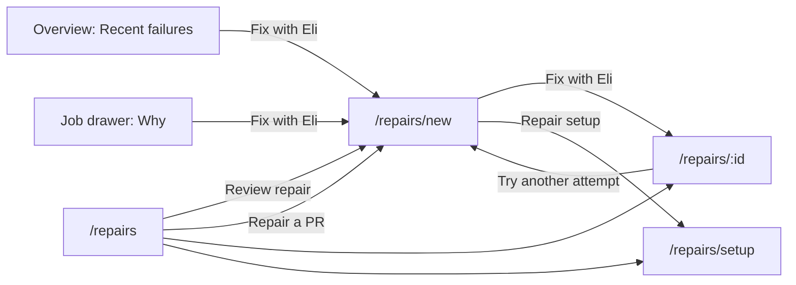

# Give every Eli repair a page that says what it is fixing

Agreed in conversation on 18 October 2026, written against checkout `6efa071`.
The design was reviewed as a mockup (hub, repair page, attempt page, and the
phone versions of two of them) before this was written, and approved with one
choice made by the owner: the failing job's error output is shown **on demand,
redacted, and never stored**. Nothing here is built yet. The implementation plan
is [2026-10-18-eli-repair-workspace-plan.md](2026-10-18-eli-repair-workspace-plan.md).

## What was asked

From Overview, Recent failures, **Fix with Eli** lands on a page that does not
say what the request is. The owner wants to see which repository, which pull
request, which job and which step, with links to GitHub and the failure's
details, and wants the whole experience brought to a professional standard, on a
phone as much as on a desktop. A separate repair page, apart from the setup
material, was suggested as one way to get there.

## What the code does today

| Fact | Where | Consequence |
| --- | --- | --- |
| Fix with Eli passes only `repo` and `run` | `web/src/lib/overview/RecentFailures.svelte`, `web/src/lib/jobs/JobWhy.svelte` | The page cannot say which job was opened, though Zoomies holds the workflow, job, failed step, branch, commit and run link for that run |
| The arrival state prints "Fix the failure in repo, run N", then readiness | `web/src/lib/repairs/RepairJourney.svelte` | A person decides whether to spend an attempt with no view of the failure |
| Readiness fetches the PR's title, author, branch and link, and returns only the number and head | `internal/controller/eli_experience.go`, `github.RepairPull` | The facts the server already has are thrown away |
| Readiness returns before it looks the pull request up when the identity or write-access check fails | same | The blocked state, the one a person most needs explained, has the least context |
| A repair started from the page or an offer records no run and no job, and no repair records a PR title, branch or failing job | `requestPinnedEliRepair`, `store.EliRepair` | History rows and a single repair cannot say what they were about |
| Links are written as `https://github.com/...` | `RepairRow.svelte`, `RepairJourney.svelte` | Wrong on the GitHub Enterprise Server installations the product supports |
| One 600-line component stacks offers, the flow, setup and history, and Settings embeds the same component | `web/src/lib/settings/EliRepairs.svelte`, `AssistantPanel.svelte` | The page is long, the first screen on a phone is mostly chrome, and there is no address for one attempt |
| There is no read of one repair | `internal/api/router.go` | An attempt cannot be linked to or followed by id |

## Design

Four pages, each doing one job, and a repair that can be linked to.



| Address | Page | Job |
| --- | --- | --- |
| `/repairs` | Hub | What needs me, what is running, what happened |
| `/repairs/new` | Repair page | One failure: what failed, can Eli act on it, start |
| `/repairs/:id` | Attempt | One repair: live progress, outcome, what to try next |
| `/repairs/setup` | Setup | The GitHub account link, repository policies and verification |

`/repairs/new` and `/repairs/setup` are listed before `/repairs/:id` in the router,
as `/pools/new` is before `/pools/:id`. The navigation entry stays one item,
Eli repairs, lit on all four because they live under one path.

### The repair page, `/repairs/new`

It is addressed by what it is about: `?repo=&run=` (from a failure), `?repo=&pull=`
(a pasted pull request), or `?offer=` (an offer). `?job=` names the Zoomies job
the person opened, so it can be marked "You opened this one". A pasted GitHub
pull request URL is parsed as today and becomes `?repo=&pull=`.

From the top, in one column on a phone and with a decision card beside it from
1180px wide:

1. **The case.** A card with a red rail: when it failed; the title (the pull
   request's title once it is known, otherwise "CI #482 failed on branch");
   links and chips for the repository, the pull request number, the branch, the
   commit (short SHA, a copy button for the full one) and the run; and facts:
   where it ran (pool and runner), which jobs failed with the step each failed
   at, and where the person came from. When the pull request has not been looked
   up the card says so in a dashed chip instead of leaving a gap.
2. **The decision.** One card that states the single next thing. Blocked: what
   to fix and the button for it (check again; manage access on GitHub; repair
   setup). Ready: the payer and model, the attempts left and when they reset,
   whether workflow files may be edited, the branch it will push to, an optional
   note to Eli, and **Fix with Eli**. It says what Eli will not do: merge, or
   force-push. On a phone it follows the case.
3. **What failed.** One disclosure per failed job (the one the person opened
   first and open), each with the job name, a badge saying whether the workflow
   or the fleet is to blame, the failing step and its number, how long it ran, a
   link to the job on GitHub and one to the job in Zoomies, and:
   * the explanation, from the job's `fault_domain` and `fault_fix`. When the
     fleet caused the failure (out of memory, runner lost) the card says a repair
     is unlikely to help and points at re-running, so an attempt is not spent on
     something code cannot fix;
   * **Error output**: the failing job's error lines, read from GitHub when the
     disclosure is opened, redacted, labelled "Read from GitHub a moment ago.
     Nothing here is stored.", with Copy and Fetch again. If the person cannot
     read logs yet (write access not verified) it says why instead;
   * the steps, collapsed once error output is available and open when it is
     not.
4. **Can Eli act on this?** A checklist of every check readiness makes, in the
   order it makes them, each `ok`, `blocked` with its sentence and its own
   action, or **not checked yet** when an earlier blocker stopped the run. When
   everything passes it collapses to one line ("All 9 checks passed") with the
   list one click away.

The page keeps today's behaviours that matter: it checks readiness on arrival and
never calls a model to do so; **Fix with Eli** is the only thing that spends an
attempt; a target that changed (`fixed`, `closed`, `superseded`) replaces the
card with the explanation, the original run link and "Check the current PR"; a
refused start because the head moved re-reads readiness. After a start the
browser moves to `/repairs/:id`.

### The attempt page, `/repairs/:id`

Header: the pull request title (or the case summary when no title was kept), a
status badge, who asked and with which kind of provider, when it started. Actions:
Open PR, Open run, Refresh. Beneath it:

* **Progress** for a running repair: queued, read the failed checks, preparing
  the fix, pushing the commit, watching CI, as a horizontal track on a desktop and
  a vertical one on a phone, with elapsed time and a line saying the person may
  leave. It polls every four seconds while the repair is active and stops at a
  terminal state. The existing `REPAIR_TRACK` and `trackIndex` are kept.
* **Outcome** for a finished repair: a banner in the outcome's tone with the
  repair's own message, then **What to try next**, which is the existing retry
  guidance made specific by failure code (see below), with Try another attempt,
  Open PR and Repair setup.
* **What Eli was asked to fix**: the case, from the snapshot the repair kept
  (below), with Error output on demand again.
* **Technical details**, collapsed except on a finished repair: the model calls
  as a table (input tokens, output tokens, request size, time; "unknown" where the
  provider did not report usage, never zero), source supplied, stage reached,
  failure code, Copy investigation details.
* A side card with the facts of the attempt (id, result, started, finished, took,
  provider, commit pushed) and, once finished, a timeline.

A repair that is not the caller's (or does not exist) answers 404, and the page
says "This repair is not in your history." without saying which.

### The hub, `/repairs`

* A one-line **setup bar**: ready or not, the linked GitHub account, and for an
  administrator how many repositories are on Ask me first; **Manage setup**.
* **Needs you**: offers, each with the PR title and number, repository, branch,
  when it failed, the failing jobs and steps, **Review repair** and **Dismiss**.
* **In progress**: running repairs with the stage and a five-segment indicator.
* **History**: the existing filters, paging and clearing, with richer rows (status
  badge, PR title, repository and number, branch, the failing job and step, the
  fix commit when there is one, who or what triggered it, when and how long) that
  link to the attempt page. Selecting repairs to clear them moves behind a
  **Select** button, so the list reads as a record until somebody wants to edit
  it.
* Actions: Refresh, **Repair a PR** (paste a URL), Setup.

### Setup, `/repairs/setup`

The account card, repository policies and link-an-account forms move out of
`EliRepairs.svelte` into `RepairSetupPanel.svelte` unchanged in behaviour. The
repair page's blockers still open a setup wizard for the failure in hand
(`RepairSetup.svelte`) so a person fixes what is missing and stays on the
failure. Settings, Eli AI Assistant no longer embeds the whole composite; it
shows a short card that links to the hub and to setup.

### Old addresses

`/repairs?repo=&run=` and `/repairs?repo=&pull=` keep working: the hub replaces
the address with `/repairs/new` and the same query, so bookmarks, docs and the
problems drawer's old links land in the right place. The offers banner on the
Overview keeps pointing at `/repairs`.

## Data and API

Every change is additive. No migration: what a repair remembers goes into the
existing `details` JSON, and an old row without it still decodes and renders.

### Readiness says what it found

`GET /assistant/repairs/readiness` keeps `blockers` and gains:

* `pull`: `{number, title, author, branch, base, url, open}`, present once the
  pull request has been looked up, including when it turns out to be closed or
  out of date, because "PR #1131 is closed" reads better with its title. It is
  set only after the access check, so it never reaches someone whose GitHub
  account cannot write to the repository, which is the rule offers already follow.
  `github.RepairPull` gains `Base` (GitHub's `base.ref`) for it.
* `checks`: one entry per check in the order `identity`, `provider`,
  `installation`, `access`, `policy`, `budget`, `pull`, `checks`, `permissions`,
  each `{code, status, message}` with `status` one of `ok`, `blocked`,
  `unchecked`. A check the function returned before reaching is `unchecked`.
  `blockers` is unchanged, so an older client reads the same answer. The labels
  are the UI's, keyed by `code`; an unknown code from a newer server shows its
  code.

### One repair, by id

`GET /assistant/repairs/{id}` returns one `EliRepair`, scoped as the list is:
an administrator reaches every repair, anyone else only their own, and a
caller with no identity reaches nothing. A missing id and one the caller may
not see both answer 404 with the same words. A cleared repair is still readable by
id, since clearing hides a row from the history and does nothing else.
Role: viewer, action `assistant.own`, as the list.

### What a repair remembers

`EliRepairDetails` gains `case`, written when the repair is queued from the page
or an offer (the pull request is in hand) and filled in by the worker for the
other triggers once it has resolved the pull request:

```text
case: {
  pull_title, pull_url, author, branch,
  run_url, workflow, run_number,
  jobs: [ { name, step, url, duration_ms } ]   // at most 10
}
```

The jobs come from Zoomies' own records (`store.JobFilter.RunIDs` when the run is
known, otherwise the repository's failed jobs at the pull request's head), the
step from `Job.FailedStep()`, so the page and the job drawer name the same step.
Every string is clipped, and none is ever rendered as markup. It holds no log
text. `EliRepairDetails` is the one JSON blob the row already writes on every
save, so the snapshot survives the worker's saves without a second write path.

### Starting from a failure

`POST /assistant/repairs` takes an optional `run_id` and stores it on the row, as
the offer's accept does from the offer's own `run_id`. It changes nothing about
evidence: `RepairFailures` still reads one job only when `job_id` is set, and
the UI path never sets it. The point is that a repair can say which run it came
from.

### Error output, on demand

`GET /assistant/repairs/error-output?repo=&job_id=` returns
`{lines: string[], note?: string}` for one job, with `job_id` being GitHub's.

* Personal account only and `assistant.own`, as readiness. The caller's linked
  GitHub account must still have write access to the repository, checked the
  way readiness checks it, so job logs, which can hold anything a workflow
  prints, are read only for someone entitled to them.
* It uses `RepairFailures` with an empty pull request and the job id, which is
  the path the worker already uses for a single job (`ContextJobErrors`: the
  last 8 MiB of the log, `##[error]` lines and the line before, bounded), then
  runs every line through `prrepair.Redact`. No new GitHub client method.
* A log GitHub no longer has is an answer, not an error: `lines` is empty and
  `note` says so.
* Cached in memory for a minute by repository and job, so a person pressing
  Fetch again costs one download, not one each. Never written to the database,
  never logged.

### Links

The UI no longer writes `https://github.com/`. A job's `html_url` is GitHub's own
job address for the host that sent it, so the run, repository and commit
addresses are derived from it (`links.ts`, a pure helper with unit tests), and the
pull request's from `pull.url` or the snapshot. Only `http` and `https` addresses
become links.

## Security and privacy

* The pull request's title and author appear only after the caller's GitHub
  account is verified to write to the repository (readiness) or on a repair the
  caller owns or administers. The repair record now keeps a title, branch and
  author as the offer record already keeps a title. The MCP tools read these rows
  through a field whitelist and so do not see them.
* Error output is never stored, is redacted by the same filter that protects the
  model's input, and is fetched only for a verified writer. Redaction cannot
  recognise every secret, which the documentation already says about model use.
* Everything a workflow controls (job, step, workflow and branch names, error
  lines) and every pull request title is untrusted. It is rendered as text, and
  the hostile-input specs gain a case for these pages.
* The page never starts a repair without the press of the button that says so,
  and readiness never calls a model.

## UI structure

Routes: `web/src/routes/EliRepairs.svelte` (hub, rewritten),
`EliRepairNew.svelte`, `EliRepairAttempt.svelte`, `EliRepairSetup.svelte`.

Components in `web/src/lib/repairs/`: `CaseCard`, `FailedJobs` (with
`ErrorOutput`), `ReadinessChecklist`, `DecisionCard` (blocked and ready),
`ProgressTrack`, `OutcomeBanner`, `RepairStatusBadge`, `RepairRow` (rewritten),
`OfferList`, `SetupBar`, `RepairSetupPanel` (extracted), and `RepairSetup`
(kept). `RepairJourney` and `lib/settings/EliRepairs.svelte` are deleted once
nothing imports them.

Pure TypeScript with unit tests: `case.ts` (the case from readiness, jobs and a
snapshot), `links.ts`, `checks.ts` (codes to labels and actions), `guidance.ts`
(next steps), `workspace.ts` (the page's states, replacing the stage machine in
`journey.ts`), and the repair-state mapping onto the fixed status tones in
`lib/status.ts`, which is where every status in the product comes from:

| State | Tone | Shape |
| --- | --- | --- |
| queued | pending | dashed |
| working | busy | filled |
| checking | busy | filled |
| succeeded | idle | filled |
| checks_failed, failed, blocked, interrupted | danger | triangle |
| superseded | neutral | square |
| unverified | pending | hollow |

Tokens only, no new library, no raw colour. Every state the new components can be
in (blocked, ready, changed, running, each outcome, locked and loaded error
output) gets an entry in the component gallery before a route reaches it.

### What to try next

`guidance.ts` maps a failure code, or a terminal state when there is none, to
a headline and at most three steps. The copy as first written; a wording change
in review does not change the mapping:

| Code or state | Say |
| --- | --- |
| `unsupported_fix` | Add a note that points at the file or the test, then try again. Read the error output. The quickest fix may be yours |
| `context_limit` | The failure and the source were too big for one attempt. Name the file or the test so Eli reads less |
| `source_unavailable` | Eli could not read the source. Check the App's Contents permission and that the PR changes fewer than 100 files |
| `provider_unavailable` | The provider failed. Test it in Eli settings, then try again |
| `rate_limited` | The provider is rate limiting you. Wait, or check the quota |
| `provider_credentials` | The provider refused your key. Update it in Eli settings |
| `output_limit` | The model ran out of room. Lower its reasoning effort or choose a model with more output |
| `setup_needed` | Eli's access changed. Check repair setup, then check readiness again |
| `checks_failed` | Eli pushed a commit and the checks still fail. Open the commit; another attempt starts from the new head |
| `interrupted`, `unverified`, `superseded`, `blocked` | One sentence each: what happened and the one thing to check |

## Tests

**Go.** Store: `GetEliRepair` scoping (owner, other user, administrator, no
identity), the `case` round trip, and an old row without it. Controller: readiness
returns `pull` once looked up and not before the access check, returns `checks`
with `unchecked` after an early blocker, and keeps `blockers` as it was; a
UI-started repair records its run and its case; the worker fills a missing case;
error output refuses an unverified caller, redacts, and caches. API: the new
routes in the route and role table in `api_test.go`, a 404 that does not tell
"missing" from "not yours", and the 422s. `make openapi` leaves the tree clean.

**Unit** (`web/unit`, built to the generated types): `case.ts`, `links.ts` (including
an Enterprise Server address and a non-http one), `checks.ts`, `guidance.ts`,
`workspace.ts`, the status mapping.

**Playwright**: a new spec for the repair page (blocked, ready, changed, a fleet
fault, error output, the start moving to the attempt page), one for the attempt
page (running, finished, not found) and updates to `repairs.spec.ts`,
`repair-history.spec.ts` and `repair-setup.spec.ts` for the hub and setup split.
Each runs on a desktop and a phone viewport with the accessibility pass, in both
themes, with no horizontal scroll. The gallery spec covers the new states. The
screenshot script gains the new pages.

**Docs**: `docs/eli.md` (the page tour and the repair flow), `docs/ui.md`,
`docs/api-surface.md` (the new and changed rows), the nav description in
`docs/ui-guidelines.md`, and `roadmap/progress.md`. Prose follows the repository
voice.

## Delivery

One draft pull request, built test first in four stages, each of which leaves
the product working:

1. **Data**: readiness `pull` and `checks`, `GET /assistant/repairs/{id}`,
   `details.case`, `run_id` on start, error output, `make openapi`, the Go tests.
2. **The repair page**: `/repairs/new`, the new components, the entry points from
   Overview and the job drawer, the old address handled.
3. **The attempt page and the hub**: `/repairs/:id`, the status mapping, the
   rewritten hub and history rows.
4. **Setup and docs**: `/repairs/setup`, the Settings card, the deleted
   composites, docs and screenshots.

## Out of scope

* Live repair events on the stream: the pages poll, as the history does.
* Storing error output with a repair. The owner chose on demand.
* A change to what a repair does: limits, payer, evidence, safety rules.
* Notifications outside the product, and MCP tools for the new data.
* One page per pull request holding all its attempts.

## Decisions taken, and how to reverse them

* **Error output on demand and not stored.** Storing it would add a redacted,
  bounded excerpt to `details`, which is the owner's call to revisit.
* **The pull request's title only after access is verified.** Relaxing it means
  setting `pull` before the access check in `EliReadiness`.
* **Clearing behind a Select button.** The bulk logic is unchanged and only its
  entry point moved.
* **Steps collapsed once error output exists.** A default, one attribute.

## Risks

* **GitHub API volume.** Readiness already calls GitHub on every visit. Error
  output is opt-in and cached for a minute.
* **Retention.** Zoomies' job records may be pruned, so a repair keeps its own
  snapshot, and the repair page degrades to "details no longer retained".
* **Size.** The UI change is large. Four stages, a unit-tested core and the
  gallery keep each step reviewable, and the app shell budget is untouched
  because every new page is a lazily loaded route.
